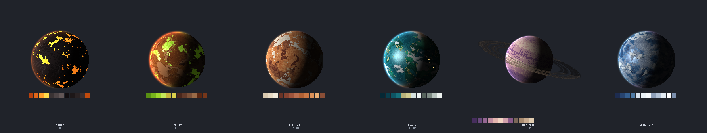
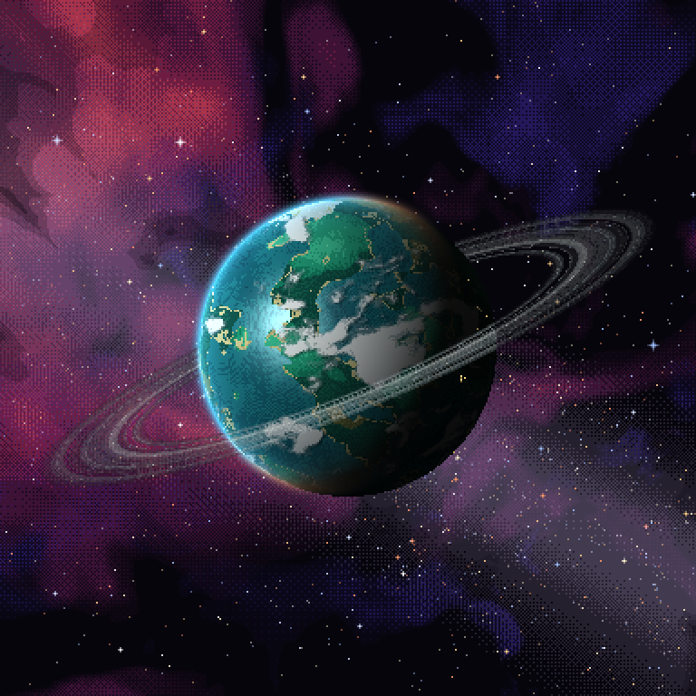
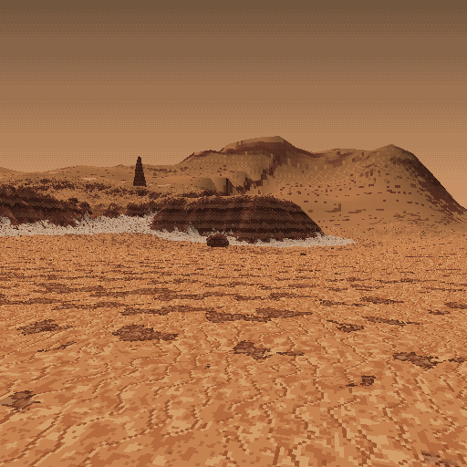
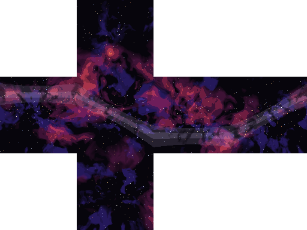
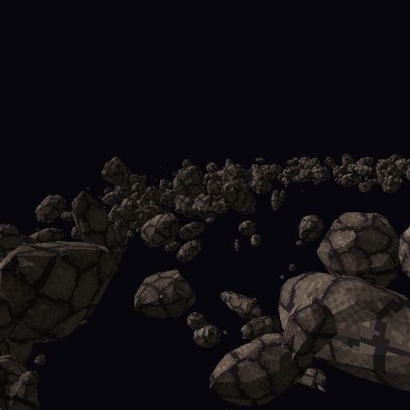
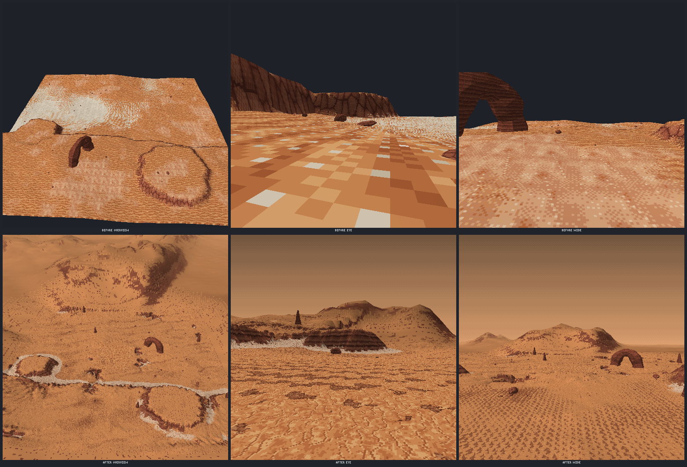

# Agent Art

**Pixel art for AI agents.** An MCP server with a live web UI that lets any agent (Claude, GPT, DeepSeek, local models) make real pixel art: sprites, characters, tilesets, seamless textures, icons, UI, isometric and HD-2D scenes, and animations. Every asset is built from tools the agent can reason about: shapes, form shading, Voronoi cells, outlines, lighting and rigs. It looks at its own work as an image, gets a critique, fixes what's wrong and exports PNGs, GIFs and spritesheets for any engine.

- **Works with weak models too.** Tool descriptions are compact, and details load on demand through `art_help`. Images are sized to their token cost. Errors print the correct usage. Rig templates turn "draw a walking character" into "draw six parts, call one preset".
- **The same asset in every view and frame.** Rigs draw each part once per view (side/front/back plus mirrored views) and generate frames by tweening poses, at any frame rate. `humanoid_hd` adds detailed 8-direction characters with per-view poses, two-bone IK, foot planting, follow-through and RotSprite sampling.
- **Low-res to high-res.** 8×8 icons up to 2048² scenes. Shading and cells are geometry-based, so they scale. Scale2x/EPX upscaling and RotSprite rotation keep edges clean.
- **Characters that hold guns right.** Declare a `weapon` on a rig and both hands stay on the grips in every frame, view and carry state (aim, ready, sprint, reload, slung, holster, ...), with reach limits, no clipping through the body, muzzle discipline and depth-driven draw order. `check` validates every clip in all 8 directions. The same solver puts first-person `fp_arms` on `fp_rifle` / `fp_pistol`.
- **You can watch, steer and review.** The web UI updates live as the agent draws: an activity timeline of every tool call with before/after snapshots, an asset browser, viewers for canvases, animations, rigs, 3D, audio and sheets, an asset graph (`art_graph`) and review notes you pin on a frame or part (`art_review`), which the agent reads and resolves. Your edits go through the same API, so the agent sees them.
- **3D and audio too.** `art_model` turns pixel textures into low-poly `.glb` map kits, props, ships and vehicles. Hard-surface detail (greebles, pipes and cables, trim sheets, PBR, pixel-correct height normals, booleans, morphs) and render-cost tools (baked AO, LODs, impostors, collision/occluder proxies, room/portal culling) keep sci-fi scenes rich and fast in a browser. Rigid-part rigs (first-person rifle, pistol and arms templates, doors, turrets) get poses, animation clips and sockets in the `.glb`, or render to pixel sprite frames that 2D arms follow with IK. `art_audio` makes SFX (including firearms and sci-fi), music and mixes, and reports what they sound like.
- **Zero dependencies.** Plain Node.js 20+, no native modules. The web UI's 3D viewer uses a vendored copy of three.js r170 (MIT).

> Example: [Sanctum Burn](https://sanctum-burn.vercel.app), a co-op 2.5D survivor game. All of its art was made by an agent with Agent Art.

## Install

```sh
# Claude Code
claude mcp add agent-art -s user -- npx -y @rusticstack/agent-art mcp

# any MCP client (stdio)
{ "mcpServers": { "agent-art": { "command": "npx", "args": ["-y", "@rusticstack/agent-art", "mcp"] } } }
```

Then ask the agent: *"open the art UI and make a 32×32 knight with a walk cycle"*.

The MCP process hosts the UI at http://localhost:7420. If an `agent-art serve` is already running on the same workspace, it uses that one, so the UI outlives agent sessions and several agents can share it. If that server goes away mid-session, the MCP process looks for another server on the same workspace (ports 7420-7440) and otherwise hosts one itself, on the same workspace; it logs each switch to stderr.

From a source checkout: `npm start` (UI), `npm test`. The included `.mcp.json` registers the server for Claude Code in this folder.

### Upgrading to 0.7

- **Compact replies:** `art_info` and `art_rig` `info`, `create` and `update` reply with a summary. Rig cells come as `cells.rows` (the y of each view's band) plus `cells.parts` (`[x, w, h]`), so a cell is `[x, rows[view], w, h]`. Pass `full: true` for the old full reply or `fields: [...]` for just those fields.
- **Animation tags:** preset animations are always tagged `<preset>_<view>`: `walk` in the side view is now `walk_side` (it used to be `walk` for the first view).
- **`humanoid_hd`:** the near (`_f`) limbs now sit on the correct screen side in the 3/4, front and back views, and in the front and back views the thighs draw above the pelvis, so renders of non-side views change.
- **`mirror_pairs`:** an arm held by IK on a non-foot end (a weapon grip, a hand on a prop) keeps its side instead of swapping. Set `mirror_hands: true` on a key to swap on purpose.
- **`preview`:** the ground line is drawn at the feet, not at the root.
- **`art_critique`:** HD sprites (64x96 and up) get a 48-128 colour budget instead of 32, and ordered dither there is not flagged as noise. `style` overrides the detection.
- **Material layers:** canvas layers named `height`, `metal` or `rough` are material channels in `art_model` (normal map, metalness, roughness) and no longer show in the base colour. Rename such layers to keep them as paint.
- **Package size:** the npm package grows from about 360 kB to about 770 kB packed (2.6 MB unpacked), because the web UI vendors three.js r170 (MIT).

## How an agent works with it

1. **Palette first:** `art_palette ramp` builds hue-shifted shading ramps. `art_project` shares a palette and style notes across a whole asset set.
2. **Block in** flat silhouettes with `art_draw` commands: `rect`, `ellipse`, `polygon`, `line`, `curve`, `grid` (pixel rows plus a legend), `fill`, `text`, ...
3. **Form and surface:** `shade` gives volume shading from one light direction, based on the shape's geometry, with no pillow shading. `cells` makes tileable stones, scales and bricks. `noise` makes dithered textures with exact color weights. `outline` and `bevel` finish edges.
4. **Look and check:** `art_view` renders the image with a grid, seam-check tiling and onion skin. `art_critique` scores orphan pixels, noise, contrast, colour count, seams, weak outline, jaggies, pillow shading, and animation drift (volume, ground line, palette, duplicate frames).
5. **Export:** `art_export` (PNG). `art_animation export` (GIF, or a spritesheet plus Aseprite-style JSON). `art_sheet` gives a contact sheet of a whole set.

### Characters, views and animations: `art_rig`

```jsonc
// 1. start from a template (humanoid | humanoid_hd | blob | flyer): only a starting point
{ "action": "create", "name": "knight", "frame": [32, 32], "template": "humanoid",
  "parts": { "head": { "w": 14, "h": 11 }, "cape": { "w": 8, "h": 12, "pivot": [4, 0], "parent": "body", "at": [-2, -6], "z": -4 } } }
// 2. draw each part in the cells the reply lists (one row per view) on canvas "knight_parts"
// 3. generate animations: frames are assembled from the same part pixels, so the knight never drifts
{ "action": "animate", "name": "knight", "preset": "walk", "view": "side", "frames": 16, "fps": 20 }
```

Templates set up parts, joints, views, poses and presets: humanoid has idle, blink, walk, run, attack, hurt, jump and death; blob has idle, hop, blink, hurt and death; flyer has fly, hurt and death. Every size, joint, view, pose and preset can be changed. You can add parts (tails, capes, weapons) or remove them. For anything else (quadrupeds, vehicles, props with moving parts), define your own rig. Poses set per-part offsets, rotation, squash and stretch (`sx`/`sy`), variants (a blinking head) and visibility. `mirror_pairs` swaps left and right limbs for the second half of a walk, and `plant_feet` keeps feet on the ground line.

#### High-detail characters: `humanoid_hd`

For detailed sprites in the style of late-90s pre-rendered games or *Replaced* (64x96 up to 160x240 frames, rich shading, 12-24 frame cycles), `template: "humanoid_hd"` gives 21 parts: `pelvis` (root), `torso`, `chest`, `neck`, `head`, `upper_arm`/`forearm`/`hand` and `thigh`/`shin`/`foot` on both sides, plus optional `weapon` (child of `hand_f`), `gear_back`, `gear_hip` and `cape` slots. Limbs are parent chains, so elbows and knees bend. It draws five views (`side`, `front_side`, `front`, `back_side`, `back`) and mirrors three more, for 8 directions. Presets: idle (12 frames), walk (16), run (12), crouch_walk (16), aim (1), shoot (6), reload (24), hurt (8), death (20), throw (12) and blink.

```jsonc
// the template already gives the cape and gear_hip secondary motion; this loosens the cape
{ "action": "create", "name": "soldier", "frame": [128, 192], "template": "humanoid_hd",
  "secondary": { "cape": { "stiffness": 0.15, "damping": 0.2, "gravity": 0.5 } } }
// draw the cells, then one canvas per preset and view (frame strips are at most 8192 px tall)
{ "action": "animate", "name": "soldier", "preset": "reload", "view": "front_side", "canvas": "soldier_reload_front_side" }
// a custom cycle from the template's poses, with planted feet and cape follow-through
{ "action": "animate", "name": "soldier", "animation": "patrol", "view": "front_side", "frames": 16, "fps": 12,
  "keys": [{ "pose": "walk_contact" }, { "pose": "walk_pass" }, { "pose": "walk_contact", "mirror_pairs": true }, { "pose": "walk_pass", "mirror_pairs": true }],
  "plant": true, "secondary": true, "canvas": "soldier_patrol_front_side" }
// a pose with a view-specific override and two-bone IK (hand on the weapon's foregrip)
{ "action": "pose", "name": "soldier", "pose": "brace", "parts": { "chest": { "rot": -4 } },
  "views": { "front": { "head": { "rot": 0 } } },
  "ik": { "hand_b": { "target": { "part": "weapon", "at": [20, -3] }, "bend": -1 } } }
```

- **Per-view poses:** `views: {front: {part: {...}}}` is merged over the base pose in that view; mirror views use their source view, and tweening blends the overrides. The template's poses come with front, back and 3/4 overrides already, so forward swings foreshorten (thigh and shin `sy` with `scale_children`) instead of splaying sideways.
- **Two-bone IK:** `ik: {end: {target: [x, y] | {part, at: [dx, dy]}, bend: 1 | -1, rot?, weight?}}` in a pose or key rotates the end's parent and grandparent so the end pivot reaches the target. It is solved per frame after FK, in each view. `rot` sets the end part's world rotation afterwards, for example to keep a gun level. Targets tween between keys, and a key without the entry fades back to FK.
- **Foot planting:** `animate {plant: true}` (alias `ik_feet`) keeps stance feet on the ground through every contact frame with leg IK. A standing foot stays put and a walking stance foot moves at constant speed. `plant: ["foot_f"]` picks the feet; rig `feet` sets the default.
- **Secondary motion:** rig `secondary: {cape: {stiffness, damping, gravity?}}` plus `animate {secondary: true}` adds lag and follow-through to capes, straps and pouches. Loops are simulated until they repeat, so they stay seamless.
- **`scale_children`:** a part's `sx`/`sy` also moves its children's joints (foreshortening, breathing); humanoid_hd has it on.
- **Rotation sampling:** rig `sampling: "rotsprite"` (the humanoid_hd default) supersamples the Scale2x image, keeps only the part's own colours and cleans up holes and stray pixels, so thin limbs keep their thickness from frame to frame. `"smooth"` does the same on the 1x cell, and `"nearest8"` is the old behaviour, still the default for existing rigs.
- **Follow another animation (`ik_from`):** `animate {ik_from:{canvas, animation, map:{hand_r:"socket_grip_r", hand_l:{anchor:"socket_grip_l", bend:-1}}, offset?}}` takes per-frame IK targets from another canvas's anchors, for example an `art_model render` of a gun clip, and copies its frame count, timing and loop. A map value is an anchor name or `{anchor, bend?, rot?, at?, weight?}`. Give the rig the render's frame size (or an `offset`). See [the end-to-end example](#rigid-part-rigs-animation-clips-and-pre-rendered-sprites).
- `art_animation export {format: "spritesheet", json: false}` skips the sidecar JSON.

- **Equipment sets:** give parts variants (`chest: ["plate"]`, `head: ["helmet", "helmet_blink"]`) and optionally a rig `variant_sets: {heavy: {chest: "plate", head: "helmet"}}`. Then `animate {..., variant: "heavy"}` renders every part with that set, so armour sets need no sheet swapping. A pose variant such as `blink` combines as `<set>_<variant>` (`helmet_blink`) when the part has one.
- **Tags:** preset animations are always tagged `<preset>_<view>` (`walk_side`, `walk_front`). Pass `animation` to choose your own.
- **Compact replies:** `create`, `update` and `info` reply with a summary. Cells come as `rows` (the y of each view's band) plus `parts` (`[x, w, h]`), so a cell is `[x, rows[view], w, h]`. `full: true` returns everything, and `fields: ["poses"]` returns only those fields. `art_info` works the same way.

See [docs/rig-hd-guide.md](docs/rig-hd-guide.md) for a step-by-step guide. Skill: `rig-hd`.

#### Held weapons: `weapon`

Without constraints, generated sprites hold guns wrong: the support hand misses the foregrip, arms don't reach, the rifle clips through the torso, the gun swaps hands halfway through a walk cycle, and it vanishes outside aim poses. Declare the weapon and the rig handles it in every frame of every pose, clip and view:

```jsonc
{ "action": "create", "name": "soldier", "frame": [128, 192], "template": "humanoid_hd",
  "weapon": { "class": "rifle", "attachments": { "vgrip": "vertical_grip" } } }
// draw "weapon" and "att_vgrip" in the side row only, pointing right; then
{ "action": "check", "name": "soldier" }   // every preset x 8 directions -> pass / fail + failing frames
{ "action": "animate", "name": "soldier", "preset": "walk", "view": "front_side", "carry": "ready_high", "canvas": "soldier_walk_fs" }
```

- **Weapon definition:** named points in the weapon cell: `grip_main` (trigger hand), `grip_support` (handguard; it may slide back along the rail), `stock` (shoulder pocket contact), `muzzle`, `optic` (eye line) and `mag`. Classes (`rifle`, `carbine`, `smg`, `shotgun`, `dmr`, `sniper`, `lmg`, `pistol`) give defaults as fractions of the cell. Attachments are sub-parts that mount on sockets (`underbarrel`, `top`, `muzzle`). A vertical or angled grip or a bipod takes over `grip_support`, a suppressor the `muzzle`, an optic the `optic`. `attach` picks the active ones, and `animate {attach: []}` overrides them per call.
- **Hands:** both hands solve onto their grips with two-bone IK every frame, and the wrists turn to each grip's angle. The support hand of a pistol cups the trigger hand. Mirrored views, 3/4 views and front and back views all hold, because the weapon and arms are solved once in a 3D body proxy and projected into each view.
- **Reach:** arm lengths come from the rig. The shoulders protract a little. If that isn't enough, the support hand slides back along the rail and then the weapon moves back along its axis, or the frame is flagged. Limbs never stretch, and elbows always bend down and out.
- **Dead zone:** the torso, head and legs (and any free arm) are capsules the weapon may not enter. The weapon is pushed out forward first, then outward, turning about the stock when it is shouldered. `standoff` sets the minimum gap between chest and receiver. When aiming, the stock sits in the shoulder pocket and the head tilts for a cheek weld to the optic line.
- **Carry states:** long guns have `aim`, `ready_low`, `ready_high`, `hip`, `sprint`, `reload`, `slung`, `one_hand_low`, `drop` and `holster`. Pistols have `aim`, `compressed`, `low`, `reload`, `one_hand_low` and `holster`. Outside firing states the muzzle points down or forward-low, never at the character's own body. Set the state with `carry` on a pose or key, `weapon.poses` (by pose name), `weapon.carry` (the default) or `animate {carry}`, and add your own with `weapon.states`. The humanoid_hd presets come mapped: walk and idle use `ready_low`, run `sprint`, aim and shoot `aim`, reload `reload`, and throw `slung` (a pistol is holstered). The weapon stays visible unless it is holstered.
- **Mirroring:** `mirror_pairs` swaps legs and free arms but keeps held hands and the weapon on their side. The key option `mirror_hands: true` deliberately swaps handedness.
- **Front-view readability:** a barrel pointing at the camera is canted outward with a length floor (`foreshorten: {floor, cant, back_cant} | false`). In back-facing views the muzzle angles out past the silhouette on the weapon side.
- **Layering:** the weapon is drawn over the torso when it is held in front of it and under it when behind, using projected depth. `weapon.layer: {above, below, pin}` overrides that. `layers {name, pose | preset + frame, view}` lists the draw order with the reason for each z, and `explain {part_a, part_b}` says why one part is drawn over another.
- **Validation:** `check` measures every frame: hand-to-grip distance, limb over-extension, inverted elbows, weapon-body penetration, muzzle flags, layering and weapon visibility. `animate` runs the same checks and by default refuses to write a clip with a violating frame. `constraints: "fix"` auto-corrects instead (muzzle down, stronger cant, flipped elbows, draw order), and `"warn"` writes the frames and reports.

The same system works for first-person `art_model` arms: see [Guns held by arms](#guns-held-by-arms-first-person). Skill: `weapon-handling`.

### 3D environments and props (HD-2D): `art_model`

Turn pixel art into low-poly game assets in the HD-2D style (pixel textures on low-poly meshes, nearest filtering), exported as glTF 2.0 `.glb` with no dependencies. The focus is modular map kits; characters stay 2D billboards.

```jsonc
// a kit piece: tileable textures repeat at 1 texel = 1 px, so every piece keeps 32 px per unit
{ "action": "create", "name": "wall_ruin", "parts": [
  { "type": "wall", "w": 32, "h": 64, "d": 8, "texture": { "canvas": "stone", "overlay": "grime" }, "broken": { "seed": 3 }, "holes": "crack" },
  { "type": "rubble", "texture": "stone", "count": 6, "at": [0, 0, 10] } ], "preview": true }
// a diorama section from placed pieces (cell = 32 px grid, turn = 90° steps)
{ "action": "create", "name": "crypt", "parts": [
  { "type": "model", "model": "floor_a", "array": { "count": 4, "cell_step": [1, 0, 0] } },
  { "type": "model", "model": "wall_ruin", "cell": [1, 0, -1] } ] }
{ "action": "export", "name": "crypt" }          // exports/crypt.glb + crypt.meta.json (or instances:true)
```

- **Kit pieces:** `floor`, `wall`, `corner`, `pillar`, `column`, `arch` (gothic or round; frame, solid or ring), `vault`, `stairs`, `ledge`, `balustrade`, `roof`, `rubble`, `box`, `cylinder`/`prism`, `plane`, `shape` (any outline). **Props:** `extrude` (sprite to solid; side walls take the edge pixel's colour; `depth_map` gives voxel relief) and `lathe` (revolve a right-half silhouette). **Layouts:** `model` places other models.
- **Ruins:** `broken` gives jagged tops or edges, `holes` takes a mask canvas whose painted pixels become cracks and breaches, and `rubble` scatters chunks. Outlines are smooth polygons (marching squares, then simplified) and arch curves get a segment count from their size. `style:"voxel"` (arches: `voxel:true`) keeps the old blocky look.
- **Ships and vehicles:** `wedge` (box whose top is resized and moved: `top_w`, `top_d`, `shift:[x,z]`; the default is a ramp), `box` with `taper` (front face scaled for a nose), `bevel` (chamfer px) or `insets` (recessed or raised panels for intakes, hatches and hangar mouths, without CSG; also the `inset` part), `cylinder` with `r_top`/`r_bottom` (frustum; 0 gives a `cone`), `shape` on plane `xy`, `xz` or `zy` (side profile `[z,y]`, extruded along x; unknown planes are an error), and `loft` (a `shape` whose far cross-section is scaled by `scale_end`, so a hull narrows toward the nose). See [Ships and vehicles](#ships-and-vehicles).
- **Smooth geometry:** `lathe` profiles are simplified before revolving (collinear runs merged, then Douglas-Peucker with `simplify` px, default 0.75), so a pixel silhouette gives a few clean rings instead of one ring per pixel row.
- **World-space UVs:** tiled faces get their UVs from the world position after placement, planar per face direction, at 1 texel = 1 px. The texture lattice starts at a grid-cell edge (`uv_origin`, default `[16,0,16]`, settable per model). Offsets, turns, arrays and nested layouts all continue the texture across touching pieces.
- **Overlays:** grime, decay, moss, blood and edge wear become decal shells on a second UV set (glTF `TEXCOORD_1`, strength in `COLOR_0` alpha, alpha MASK). Example: `overlays:[{texture:"grime", where:["bottom","corners"], falloff:20}, {texture:"moss", where:"top"}]`. `map` is `world` (the overlay's own scale) or `face`/`piece`/`surface` (stretched 0..1). Overlays go on a part or on the whole model (model-level `overlays`, kept by `create` and `update`). Decal shells are tessellated adaptively (`detail` defaults from the falloff and face size, 16-64 px), and uniform areas such as `where:"all"` are not split at all.
- **Hard-surface detail and render cost:** greebles, sweeps (pipes, cables), trim sheets, PBR materials, pixel-correct height normals, baked AO, booleans, morph targets, LODs, impostors, collision/occluder proxies and room/portal cull data; see [Hard-surface detail and render cost](#hard-surface-detail-and-render-cost).
- **Connected textures (CTM):** `art_model ctm` builds an OptiFine/Continuity-style tileset; see below.
- **Textures:** set them per face (`faces`, `top`, `side`), use a colour, or add a grime `overlay`. Emissive comes from a layer named `emissive`; that layer is left out of the base colour, so a glow-only pixel is black in the albedo and lit only by the emissive texture. `normal_maps:true` adds normal maps.
- **Preview:** `art_model preview` renders a contact sheet with a software rasterizer. It includes the 38° game camera plus front, side, top and iso views.
- **Export:** NEAREST samplers, REPEAT wrap, embedded PNGs, alpha MASK (cutoff 0.5) only when a triangle actually samples a transparent texel (unused tileset slots no longer force it), and emissive/normal textures. The file is Y-up with 32 px = 1 unit (`scale`). For a Z-up engine set `object.rotation.x = Math.PI / 2` or export with `up:"z"`. Options: one baked mesh, `instances:true` (shared meshes and nodes), or `atlas:true`.

`art_help {topic:"3d"}` has every option plus recipes for a gothic arch kit, a gargoyle relief, chains, lathed candles, CTM marble floors, wall trims, moss and a spaceship. Skills: `3d-kit`, `ship-model`, `hard-surface`.

#### Rigid-part rigs, animation clips and pre-rendered sprites

For first-person weapons and arms, or any prop with moving parts (doors, chests, turrets), a model can be a rig of rigid parts, PSX / Half-Life 1 style (no skinning). The same rig exports as glTF nodes and animations or renders to pixel-art sprite layers.

```jsonc
// by hand: name = its own node, parent = nesting, pivot = the joint
{ "action": "create", "name": "door", "parts": [
  { "type": "box", "name": "frame", "w": 20, "h": 34, "d": 2 },
  { "type": "box", "name": "leaf", "parent": "frame", "w": 16, "h": 32, "d": 1, "at": [0, 1, 0], "pivot": [-8, 0, 0] } ],
  "sockets": { "handle": { "part": "leaf", "at": [6, 16, 1], "look": [0, 0, 1] } } }
{ "action": "pose", "name": "door", "pose": "open", "parts": { "leaf": { "rot": [0, -80, 0] } } }
{ "action": "animate", "name": "door", "clip": "swing", "keys": [ { "t": 0, "pose": "rest" }, { "t": 0.8, "pose": "open", "ease": "smooth" } ],
  "events": [ { "t": 0, "name": "creak" } ] }
{ "action": "export", "name": "door" }   // a node per part + socket_handle + one glTF animation per clip
```

- **Nodes:** a part with `name` becomes its own glTF node with its own mesh; `parent` nests it under another named part, and its transform is local to the parent (translation = joint offset, rotation, scale). `pivot:[x,y,z]` is the joint. Unnamed parts merge into the root mesh or into their named parent's mesh; `rig:{merge:false}` makes every part a node. `create` and `info` report the node tree. Models without names export exactly as before.
- **Poses and clips:** `pose` stores per-node offsets from the rest pose (`rot` degrees, `at` px in the parent's frame, `scale`; `base` starts from another pose). `animate` stores a clip of keys in seconds (`ease`: `linear`, `smooth` or `step`, applied to the motion into the key), with `loop`, `duration` and `events:[{t, name}]`; `keys:null` deletes it. Export writes one glTF animation per clip, with translation, rotation (quaternion) and scale channels per moved node. All-linear clips use LINEAR samplers at the key times, all-step clips use STEP, and anything else is baked at 30 fps. Events go in the animation's `extras`. `preview {clip, frames, view}` shows a clip as a contact sheet.
- **Sockets:** `sockets:{muzzle:{part, at, look?}, sight, grip_r, grip_l, mag_well}` export as empty child nodes `socket_<name>`, for aligning ADS, spawning muzzle flashes and placing hands. `meta.json` lists each node's parent-space transform, so a Roblox import maps it to Motor6D joints (C0 = translation and rotation).
- **Templates:** starter rigs in view space (origin = the eye, -Z forward, 32 px = 1 m): `fp_rifle` (receiver, barrel, handguard, stock, magazine, bolt, charging handle, optic, trigger; clips `fire`, `reload_tactical`, `reload_empty`), `fp_pistol` (frame, slide, barrel, magazine, trigger; clips `fire`, `reload`) and `fp_arms` (clavicle > upper arm > forearm > hand > fingers per side; poses `grip_rifle` and `grip_pistol` put the palms on the weapons' grip sockets). The weapons have the five sockets above. Override anything with `textures` (slots such as `metal`, `polymer`, `sleeve`, `glove`), `set` by part name, `add`, `remove`, `poses`, `clips` and `sockets`. The `fp` preview view is the matching camera (eye at the origin, 60°).
- **Sprite renders (`render`):** each clip sample, pose, `angles` entry or `sweep:{yaw:[a,b,step], pitch:[..]}` grid cell becomes one frame of a canvas animation. Frames use nearest texels with no anti-aliasing and a transparent background, plus an optional `light`, `quantize` (median-cut `colors:n`, a colour list or `palette:"project"`, with ordered `dither`) and a 1 px `outline`. The camera is `fp` (the default), `side`, `front`, `iso`, `top`, `game` or `{pos, look, fov}`. `only` and `hide` render layers (for example the gun without its magazine) with the same fitted camera, so the layers stack.
- **Anchors:** every rendered frame stores each socket's screen position and rotation in `meta.anchors`, and spritesheet export writes them to `frames[].anchors`. A 2D arm rig follows them with `art_rig animate {ik_from}` (see [`art_rig`](#characters-views-and-animations-art_rig)).
- **Known limitation:** the `fp` camera drops triangles that cross its near plane instead of clipping them, so a part that reaches behind the eye (a long stock, a shoulder) can vanish in some frames. Shorten it, move the weapon forward, or render that layer with `camera:"side"`.

End to end, a first-person rifle from the template to 2D sprite layers with arms (texture canvases must exist before `create`):

```jsonc
// art_create_canvas: a texture (paint it with the tileable-texture skill)
{ "name": "gun_metal", "width": 16, "height": 16, "background": "#2c2e33" }
// art_model: the rig, a custom reload clip, the .glb
{ "action": "create", "name": "ar", "template": "fp_rifle", "textures": { "metal": "gun_metal" }, "set": { "magazine": { "h": 5 } } }
{ "action": "animate", "name": "ar", "clip": "reload_fast", "keys": [ { "t": 0, "pose": "rest" },
  { "t": 0.25, "pose": "reload_tilt", "ease": "smooth" },
  { "t": 0.5, "pose": "reload_tilt", "parts": { "magazine": { "at": [0, -9, 1.5] } }, "ease": "smooth" },
  { "t": 0.9, "pose": "reload_tilt", "ease": "smooth" }, { "t": 1.2, "pose": "rest", "ease": "smooth" } ],
  "events": [ { "t": 0.5, "name": "mag_out" }, { "t": 0.9, "name": "mag_in" } ] }
{ "action": "preview", "name": "ar", "clip": "reload_fast", "frames": 6, "view": "side" }
{ "action": "export", "name": "ar" }   // exports/ar.glb: nodes, socket_* nodes, animations fire, reload_*, reload_fast
// art_model: pixel sprite frames (hide/only give stackable layers, sweep gives turn frames)
{ "action": "render", "name": "ar", "canvas": "ar_reload", "clip": "reload_fast", "fps": 12, "size": [160, 120],
  "camera": "fp", "quantize": { "colors": 16, "dither": true }, "outline": "#14141a" }
// art_rig: 2D arms with the same frame size; draw the parts in the listed cells, then follow the grips
{ "action": "create", "name": "arms2d", "frame": [160, 120], "views": ["side"], "root": [80, 119], "parts": {
  "body": { "w": 2, "h": 2, "pivot": [1, 1] },
  "upper_r": { "w": 8, "h": 32, "pivot": [4, 0], "parent": "body", "at": [68, 0] },
  "fore_r": { "w": 7, "h": 30, "pivot": [3, 0], "parent": "upper_r", "at": [0, 30] },
  "hand_r": { "w": 8, "h": 8, "pivot": [4, 0], "parent": "fore_r", "at": [0, 28] },
  "upper_l": { "w": 8, "h": 32, "pivot": [4, 0], "parent": "body", "at": [-30, 0] },
  "fore_l": { "w": 7, "h": 30, "pivot": [3, 0], "parent": "upper_l", "at": [0, 30] },
  "hand_l": { "w": 8, "h": 8, "pivot": [4, 0], "parent": "fore_l", "at": [0, 28] } } }
{ "action": "animate", "name": "arms2d", "animation": "reload_fast", "canvas": "arms_reload",
  "ik_from": { "canvas": "ar_reload", "animation": "reload_fast",
    "map": { "hand_r": { "anchor": "socket_grip_r", "bend": -1 }, "hand_l": "socket_grip_l" } } }
// art_animation: one spritesheet per layer; json frames[].anchors line them up in-engine
{ "canvas": "ar_reload", "action": "export", "format": "spritesheet" }
```

The full pipeline (gun and magazine layers, angle sweep, 3D arms) is in `art_help {topic:"3d"}` under "Rigs & clips" and "Pre-rendered sprites". Skills: `fp-weapon`, `prop-rig` (doors, chests, turrets).

#### Guns held by arms (first person)

Create `fp_rifle` or `fp_pistol` with `weapon` and the `fp_arms` hands solve onto the gun instead of following a fixed pose:

```jsonc
{ "action": "create", "name": "arms", "template": "fp_arms" }
{ "action": "create", "name": "gun", "template": "fp_rifle", "weapon": { "attach": ["vertical_grip"] } }
{ "action": "render", "name": "arms", "canvas": "arms_low", "camera": "fp", "hold": { "weapon": "gun", "carry": "ready_low", "both": true } }
{ "action": "check", "name": "arms", "hold": { "weapon": "gun" } }   // every carry state and clip -> pass / fail
{ "action": "animate", "name": "arms", "clip": "reload_empty", "hold": { "weapon": "gun", "carry": "reload", "bake_weapon": "reload_empty_held" } }
```

- **Weapon:** `weapon.grips: {grip_main, grip_support, stock, muzzle, optic, mag}` names a socket or a `{part, at, look, up}` point for each (defaults: the template's `grip_r`, `grip_l`, `muzzle` and `sight` sockets). The attachments `vertical_grip`, `angled_grip`, `bipod` and `suppressor` add parts and sockets and take over the grip or the muzzle. Without `weapon` the templates are unchanged.
- **Hold:** two-bone IK puts each palm on its grip, with the wrist turned to the grip's `look` and `up`. The carry states are `hip`, `aim` (the optic on the screen centre, stock welded), `ready_low`, `ready_high`, `sprint`, `reload` (the support hand on the magazine) and `holster`, plus pistol `compressed` and `low`. `weapon.states` adds your own, with `base`. A grip out of reach moves the gun back or slides the support hand, never stretching the arm. A gun inside the head, chest or shoulder capsules is pushed out. The muzzle must point down outside firing states, and `fix: true` lowers it.
- **Output:** `render {hold}` and `animate {hold}` return a `hold` / `held` report (corrections, issues, pass). `animate {hold}` bakes the solved arms into a clip, and `bake_weapon` also writes the matching gun clip, so the exported glTF plays back without the solver. `check` adds visibility: how much of the gun is on screen and how much the arms hide.

#### Ships and vehicles

```jsonc
{ "action": "create", "name": "scout", "origin": "bottom", "preview": true, "parts": [
  { "type": "loft", "points": [[-12,0],[12,0],[10,10],[-10,10]], "d": 64, "scale_end": [0.3,0.4], "color": "#8a94a6" },
  { "type": "wedge", "w": 40, "h": 3, "d": 24, "top_w": 8, "shift": [16,0], "at": [14,2,0], "mirror": "x" },
  { "type": "cone", "r": 3, "h": 8, "rotate": [90,0,0], "at": [0,5,32] },
  { "type": "cylinder", "r_bottom": 5, "r_top": 4, "h": 10, "rotate": [-90,0,0], "at": [10,5,-32], "mirror": "x" },
  { "type": "box", "w": 10, "h": 6, "d": 14, "bevel": 2, "glass": true, "color": "#9fd8ff", "at": [0,10,8] },
  { "type": "box", "w": 6, "h": 6, "d": 6, "at": [0,0,-20], "insets": [{ "face": "back", "rect": [1,1,4,4], "depth": 3, "texture": "#f80" }] },
  { "type": "cylinder", "r": 1.5, "h": 4, "at": [6,10,-10], "array": { "count": 4, "rotate": [0,90,0], "about": [0,10,-10] } } ] }
```

- **Transform order:** every part is scaled, then rotated about the fixed axes X, then Y, then Z (`rotate:[x,y,z]` in degrees), then turned (`turn`, 90° steps about y). All of this happens about the part's own origin (its local `0,0,0`, bottom-centre for most builders), or about `pivot:[x,y,z]` (local px) when given. Then the part is moved by `at` + `cell` × grid. On `extrude` and `lathe` a two-element `pivot:[x,y]` is still the canvas pivot.
- **Mirror:** `mirror:"x"` (or `"y"`, `"z"`, or a list for every combination) also emits a copy mirrored across the model's `x=0` plane. Winding and normals are fixed, so the copy is not inside out.
- **Radial arrays:** `array:{count, rotate:[0,60,0], about:[x,y,z]}` rotates copy k by k steps about that model-space point (engine rings, rotor blades). Without `about`, copies turn in place as before.
- **Translucency:** `opacity:0..1` exports glTF `alphaMode:"BLEND"`, with `baseColorFactor` alpha = opacity multiplied by the texture alpha. `glass:true` is BLEND at opacity 0.35 (unless set), double-sided and glossy. The material extras carry `depthWrite:false`. The image is shared with the opaque material, and the preview blends translucent parts after the opaque ones.
- **Cylinder decals:** `wrap:"once"` puts one copy of the texture round the side, centred on +z. `u_offset` (in turns, + toward +x) rotates it, so a decal can face any side. `wrap:"repeat"` gives a whole number of copies (`repeat:n`, or a default from the circumference), so there is no seam. `tile:false` keeps the old stretched mapping.
- **Insets:** `insets:[{face, rect:[u,v,w,h], depth, texture?, side?}]` on a box. `rect` is in px from the face's top-left as seen from outside. `depth > 0` cuts a recess (the face gets a hole, four inner walls and a floor), and `depth < 0` adds a raised panel. Panels may touch the face border, for a hangar mouth.
- **Origin:** the default `origin:"auto"` keeps part coordinates, so kit pieces stay on the grid; this did not change. For a standalone prop, ship or vehicle use `origin:"bottom"` (centred on X/Z, bottom on y=0). `create` says so in its `next` hint when the model is off-centre.

#### Hard-surface detail and render cost

Ships, stations, carrier interiors and cities that read like a big-budget sci-fi universe at a pixel-texture budget, and stay fast in a browser. Everything below is opt-in: models that use none of it export byte-for-byte as before.


```jsonc
{ "action": "trim", "canvas": "hull_trim" }                     // a 64-wide trim sheet: plate, bevel, bolts, seam, hazard, grate, rib, pipe, rubber, light
{ "action": "create", "name": "hull_a", "origin": "bottom", "parts": [
  { "type": "box", "id": "hull", "w": 160, "h": 40, "d": 96, "bevel": 3, "texture": "hull", "material": "painted_metal", "trim": "hull_trim:bevel",
    "greebles": [ { "face": "top", "seed": 11, "grid": 2, "density": 0.35, "avoid": [[64, 0, 32, 96]] },
                  { "face": "right", "seed": 12, "density": 0.3, "size": [2, 8], "kinds": { "vent": 3, "pipe": 2, "bolts": 2, "panel": 3 } } ] },
  { "type": "box", "w": 52, "h": 22, "d": 30, "at": [0, 0, 36], "boolean": "subtract", "target": "hull" },       // hangar mouth
  { "type": "tube", "path": [[-82, 30, 44], [-82, 30, -40], [-60, 30, -46]], "r": 2, "trim": "hull_trim:pipe", "mirror": "x" },
  { "type": "tube", "from": [-12, 50, 30], "to": [-12, 50, -30], "sag": 3, "r": 0.6, "sides": 4 },             // hanging cable
  { "type": "cylinder", "r_bottom": 9, "r_top": 7, "h": 14, "rotate": [-90, 0, 0], "at": [-50, 20, -48], "mirror": "x", "material": "bare_metal" } ] }
{ "action": "preview", "name": "hull_a", "views": ["game"], "ao": true }        // also lod:1|2, morph:{open:1}, bump
{ "action": "export", "name": "hull_a", "bake_ao": true, "lods": [1, 0.5, 0.2], "impostor": { "grid": 8, "size": 64 }, "collision": "hull", "occluder": "boxes" }
```

- **PBR materials:** `material` on a part is a preset (`painted_metal`, `bare_metal`, `rubber`, `plastic`, `glass`, `emissive_panel`, `fabric`) or `{metal, rough}`, exported as glTF `metallicFactor`/`roughnessFactor` (the old default stays metal 0, rough 1). Canvas layers named `metal` and `rough` (grey = value, unpainted = the factor) become a `metallicRoughnessTexture`; canvas `meta.material` sets a whole canvas. `atlas:true` packs PBR textures into one metallicRoughness atlas.
- **Height and normals:** a `height` layer (or a same-size `<canvas>_h` canvas with `bump`) gives a pixel-correct normal map: no blur, only texels within `bevel` of a drop to a lower neighbour tilt, so a raised panel gets a crisp rim and the low side stays flat. `bump:{strength, bevel, auto:"luminance"|"panels"}` derives height from brightness steps or dark panel lines when you have no height map. glTF convention (green = up).
- **Baked AO:** `bake_ao:true|{mode:"texture"|"vertex"|"both", samples, distance, texel}` ray-casts hemispheres against the model (BVH) into an AO lightmap (`occlusionTexture`, its own unique `TEXCOORD_1`, NEAREST) and/or `COLOR_0`. Contact shadows land in crevices, under greebles and in insets. Bakes are deterministic. `cast_shadow:false` / `receive_shadow:false` on a part split it into a node with those flags in `extras`.
- **Greebles:** a `greeble` part, or `greebles:[{face, ...}]` on a box/wall/floor, scatters non-overlapping pieces (`panel vent pipe conduit antenna bolts hatch heatsink nozzle dome cables tank block`, or your own models via `"model:<name>"` / `greeble_kind`) with a seed, density, size and height ranges, an optional panel `grid`, and an `avoid` mask or rectangles. Pieces merge into the model's materials, or `instanced:true` exports them with `EXT_mesh_gpu_instancing` (three.js `InstancedMesh`). LODs drop them (`drop_lod:"auto"`: flat pieces at LOD 1, tall ones at LOD 2).
- **Sweeps:** `tube`/`sweep` sweeps a circle or a custom `profile` along a polyline, Catmull-Rom or Bezier `path` with rotation-minimising frames, mitred corners, `twist`, taper (`r_end`), caps and texture wrap; `from`/`to`/`sag` hangs a cable. Pipes, hoses, railings, conduits.
- **Trim sheets:** `art_model trim {canvas}` paints a sheet with colour, height, metal, rough and emissive layers, or marks your own (`strips:{name:[y,h]}`). `trim:"sheet:strip"` maps a part's bevels, inset walls and thin faces to that strip: u along the face at world scale, v across the strip. Hulls and interiors share one texture.
- **Mesh ops:** `boolean:"subtract"|"union"|"intersect"` (BSP CSG per closed piece; results are edge-manifold, world UVs continue on the cut walls), model `merge` (weld + drop hidden faces between touching pieces), and model `morphs:{open:{set:{door:{rotate:[0,-90,0]}}}}` (`door` = part index or `id`; a part `name` makes a rig node, and rigs cannot morph yet) or `{model:"variant"}` as glTF morph targets with names in `mesh.extras.targetNames`.
- **LODs:** `lods:[1,0.5,0.2]` runs quadric edge collapse onto existing vertices. Each triangle keeps its own UVs, so flat regions stay pixel-exact. Material and open borders are kept, and hidden faces between pieces are dropped first. The levels go into `<name>_lods > <name>_LOD0..n` nodes (or `lod_mode:"files"`), and `meta.lods.levels[i].distance` is where that level's error falls below one screen pixel (`lod_screen:{height:720, fov:70, px:1}`).
- **Impostors:** `impostor:{grid:8, size:64}` (hemi-octahedral) or `{layout:"ring", angles:8|16}` renders albedo, world-normal and depth atlases plus `<name>.impostor.json` (cells, directions, encode formula, quad size, switch distance) for far-LOD billboards.
- **Proxies and stats:** `collision:"hull"|"boxes"` and `occluder:"boxes"` (conservative, inside the surface) export as hidden named nodes, with the boxes also listed in `meta.json`; they are not counted in triangles. `stats:true` adds per-part triangles and bounds.
- **Cull data:** a layout's `cull:{rooms:[{name, min, max}]}` exports one `room_<name>` node per room, finds doorways automatically where rooms touch, and writes `meta.cull` (rooms, portals, PVS). The engine draws the camera's room plus its PVS, or walks the portals through the frustum.


`node docs/surface/build-demos.mjs` rebuilds these renders. `art_help {topic:"3d"}` has every option plus recipes for hull greebling, a corridor with one trim sheet, a pipe run and LOD + impostor for a city block. Skill: `hard-surface`.

#### Connected textures (CTM)

```jsonc
{ "action": "ctm", "name": "marble_ctm", "ctm": { "base": "marble", "method": "full", "border": { "width": 2, "style": "bevel" } } }
{ "action": "create", "name": "hall", "parts": [ { "type": "floor", "texture": "marble_ctm", "cell": [0, 0, 0], "array": { "count": 4, "cell_step": [1, 0, 0] } } ] }
```

- **Methods:**
  - `full`: the 47-tile blob set.
  - `compact`: 5 tiles, combined by quarters.
  - `horizontal`, `vertical` and `horizontal+vertical`.
  - `top`.
  - `random`: weighted, picked deterministically from the world cell. `variants:[...]` lists the canvases; without `base`, the first variant is the base.
  - `repeat`: one big pattern over cols × rows cells.
  - `overlay`: tiles that creep in from neighbouring cells of another material.
- **Tileset sources:** a base texture plus a border style, or a hand-drawn `template`. A template holds either all the tiles, or the 5 compact tiles, which are expanded to 47.
- **Bake:** every world-tiled face using the tileset is split into world cells. Each cell takes its tile from its 8 neighbours across all placed pieces. A neighbour counts when it is on the same plane and has the same connect key: `material`, `texture`, or `tag` via `ctm_tag`. Walls fold around vertical corners.
- **Export:** writes `<name>.ctm.json` (method, tile order, masks, connect rule) and the tileset PNGs, for re-tiling at runtime.

Neighbour bits: N=1 NE=2 E=4 SE=8 S=16 SW=32 W=64 NW=128 (N = up on walls, −Z on floors). Reference selection for engines:

```js
/**
 * ctmTileFor(neighbors, method, opts) -> tile index into the tileset (compact: [tl, tr, br, bl]
 * indices of the 5 compact tiles). neighbors: 8-bit mask (N1 NE2 E4 SE8 S16 SW32 W64 NW128),
 * an array of 8 booleans in that order, or {n, ne, e, se, s, sw, w, nw}.
 * opts: cell [x, y, z?] (random, repeat), weights (random), seed (random), repeat [cols, rows].
 */
function ctmTileFor(neighbors, method = 'full', opts = {}) {
  const K = ['n', 'ne', 'e', 'se', 's', 'sw', 'w', 'nw'];
  let m = 0;
  if (typeof neighbors === 'number') m = neighbors & 255;
  else if (Array.isArray(neighbors)) neighbors.forEach((v, i) => { if (v) m |= 1 << i; });
  else K.forEach((k, i) => { if (neighbors && neighbors[k]) m |= 1 << i; });
  const blob = (x) => {
    let r = x & 85; // edges N E S W
    if (x & 1 && x & 4 && x & 2) r |= 2;
    if (x & 4 && x & 16 && x & 8) r |= 8;
    if (x & 16 && x & 64 && x & 32) r |= 32;
    if (x & 64 && x & 1 && x & 128) r |= 128;
    return r;
  };
  const N = !!(m & 1), E = !!(m & 4), S = !!(m & 16), W = !!(m & 64);
  const cell = opts.cell || [0, 0, 0];
  const hash = () => {
    let h = (opts.seed ?? 1) ^ 0x9e3779b9;
    for (const v of [cell[0] | 0, cell[1] | 0, (cell[2] ?? 0) | 0]) { h = Math.imul(h ^ v, 0x85ebca6b); h ^= h >>> 13; h = Math.imul(h, 0xc2b2ae35); h ^= h >>> 16; }
    return (h >>> 0) / 4294967296;
  };
  switch (method) {
    case 'full':
    case 'overlay': {
      if (!ctmTileFor.blobIndex) {
        const masks = [...new Set([...Array(256).keys()].map(blob))].sort((a, b) => a - b);
        ctmTileFor.blobIndex = new Map(masks.map((x, i) => [x, i]));
      }
      // overlay: bits mean "the other material is there"; its tiles are the blob set of the complement
      return ctmTileFor.blobIndex.get(blob(method === 'overlay' ? ~m & 255 : m));
    }
    case 'compact': {
      const q = (v, h, d) => (v && h ? (d ? 1 : 4) : v ? 3 : h ? 2 : 0);
      return [q(N, W, m & 128), q(N, E, m & 2), q(S, E, m & 8), q(S, W, m & 32)];
    }
    case 'horizontal': return (W ? 1 : 0) | (E ? 2 : 0);
    case 'vertical': return (N ? 1 : 0) | (S ? 2 : 0);
    case 'horizontal+vertical': return (N ? 1 : 0) | (E ? 2 : 0) | (S ? 4 : 0) | (W ? 8 : 0);
    case 'top': return N ? 0 : 1;
    case 'random': {
      const w = opts.weights && opts.weights.length ? opts.weights : [1];
      let r = hash() * w.reduce((a, b) => a + b, 0);
      for (let i = 0; i < w.length; i++) { r -= w[i]; if (r < 0) return i; }
      return w.length - 1;
    }
    case 'repeat': {
      const [cw, ch] = opts.repeat || [1, 1];
      const mod = (a, n) => ((a % n) + n) % n;
      return mod(cell[0], cw) + mod(cell[1], ch) * cw;
    }
    default: throw new Error(`unknown CTM method "${method}"`);
  }
}
```

#### World-space UVs at runtime (three.js)

The same mapping the exporter bakes, for runtime-placed tiles. Shown for a Z-up scene; for Y-up swap `up` to `(0,1,0)` and the cap branch accordingly.

```js
const pxPerUnit = 32, texSize = 32; // texels per tile
material.onBeforeCompile = (shader) => {
  shader.uniforms.uvScale = { value: pxPerUnit / texSize };
  shader.uniforms.uvOrigin = { value: new THREE.Vector3(0.5, -0.5, 0) }; // uv_origin [16,0,16] px, glTF Y-up -> Z-up
  shader.vertexShader = shader.vertexShader
    .replace('#include <common>', `#include <common>
      uniform float uvScale;
      uniform vec3 uvOrigin;`)
    .replace('#include <uv_vertex>', `#include <uv_vertex>
      vec3 wp = (modelMatrix * vec4(position, 1.0)).xyz - uvOrigin;
      vec3 wn = normalize(mat3(modelMatrix) * normal);
      vec3 up = vec3(0.0, 0.0, 1.0);
      vec3 t = abs(dot(wn, up)) > 0.999 ? vec3(1.0, 0.0, 0.0) : normalize(cross(up, wn));
      vec3 b = abs(dot(wn, up)) > 0.999 ? (dot(wn, up) > 0.0 ? vec3(0.0, 1.0, 0.0) : vec3(0.0, -1.0, 0.0)) : cross(wn, t);
      vMapUv = vec2(dot(wp, t), -dot(wp, b)) * uvScale;`);
};
```

### Sound effects and music: `art_audio`

Agents cannot hear, so `art_audio` turns audio into things they can read: an analysis image (waveform with beat grid and onsets, log spectrogram, loudness and energy per section, goniometer, band balance; `view:"mix"` overlays stem spectra and marks masking) and a **listener report** in plain words: what a listener taps along to versus the written BPM, the drum feel per section (half-time, blast, double-kick, four-on-the-floor, ...), the key/mode and chord progression, timbre words (dark, muddy, harsh, distorted and which stem, reverb size), what stands out or is buried, what gets repetitive, and how it compares with a genre profile and the stated intent. `critique` ranks issues by audibility and names the parameter to change.

- **SFX:** 58 seeded recipes (gore, combat, holy, UI, monsters, sfxr classics, plus FPS/sci-fi below) with `vars` (pitch, length, intensity, variation, wet, target) and `variants` for batches; or sfxr params, or your own layers. Normalised to the peak `target` (default -1 dBFS), head silence trimmed.
- **FPS and sci-fi SFX:** firearms (`gunshot_rifle`, `_pistol`, `_marksman`, `_shotgun`, `_smg`, `_lmg`, `_suppressed`) layer crack, body, thump, sub, mechanics and an environment tail (`vars.environment: "outdoor"|"indoor"|"canyon"`). Weapon handling: `mag_out`, `mag_in`, `bolt_rack`, `dry_fire`, `shotgun_pump`, `casing_drop`. Sci-fi: `laser_bolt`, `plasma_shot`, `shield_hit`, `glitch_tear`, `teleport_swell`, `servo`, `drone_rotor` (loop), `hologram_ui`, `alarm_klaxon` (loop), `radio_squelch_on`/`_off`, `bullet_whiz`, `ricochet`, and `footstep` (`vars.surface: metal|dirt|concrete|snow|grate`).
- **SFX options:** `fx:[{type:"dc"|"eq"|"comp"|...}]`, `reverb:{preset, wet}`, `target` and `loop:true` (a seamless crossfaded loop with loop points on export) work on recipes and custom layers alike. Two extra layer kinds: `glide` (a tone or noise band along a frequency path, with AM, vibrato and a swell) and `glitch` (stutter, bitcrush shards, dropouts). `info` on a recipe asset shows the resolved layers to copy and edit; `delete` takes wildcards and `names:[...]`.
- **Song updates:** re-sending a saved song with only `tracks` or only `sections` merges them in (`null` removes one).
- **Music:** a compact text notation (`tempo`, `key e phrygian`, `track gtr metal_guitar gain=-3 hp=80`, `section verse 8`, `gtr: E5' E5' _ F5!`), generators (`@doom_riff`, `@organ_progression`, `@blast_beat`, `@dread_ambient`), instrument presets as JSON patches (pipe organ with wind and chiff, formant choir, modal bells, Karplus-Strong guitars double-tracked through amp and cab, bowed strings, metal and industrial kits), humanised timing, round robin, sends, buses, automation, sidechain, a cathedral reverb, and a mastering chain to a LUFS target with a true-peak ceiling. Loops wrap their reverb tail so the seam is clean.
- **Song text + JSON:** send `text` together with JSON `tracks`, `buses` or `master`; the JSON deep-merges over the parsed text, so notes stay in the text and mix tweaks go in JSON.
- **Analysis:** kick and snare detection is gated (a low-band transient with a sharp, noisy attack near the loudest hits), so choirs, wind, organ, drones and sub bass do not read as double-kick or backbeat. Distortion is measured from harmonic and intermodulation structure on loud, pitched frames, not spectral flatness, so reverb tails and drum kits do not count. The reverb RT60 comes from free decays and has a `reverb_confidence`. `loop_seam` is only reported for a real discontinuity; a level change at the seam is `loop_level_change`. One-shots get `sweep_octaves`, which tells a laser or power-up glide from an impact.
- **Export:** WAV 16/24/32-bit float with a `smpl` loop chunk and a JSON sidecar; mp3/ogg/opus through ffmpeg (`AGENT_ART_FFMPEG` or PATH). Stems and adaptive-music intensity layers with a crossfade manifest. Renders run at 44.1 kHz; `sample_rate:48000` delivers 48 kHz through a windowed-sinc resampler with sample-exact loop points.

```js
art_audio { action:"sfx", name:"gib", recipe:"gib_burst", variants:3 }
art_audio { action:"song", name:"crypt", text:"<notation>", intent:"gothic cathedral doom", genre:"cathedral_doom" }
art_audio { action:"analyze", name:"crypt" }        // image + listener report
art_audio { action:"export", name:"gib_*", format:"ogg" }
art_audio { action:"sfx", recipe:"gunshot_marksman", variants:4, vars:{ environment:"canyon" } }
art_audio { action:"sfx", name:"rifle_in", recipe:"gunshot_rifle", vars:{ environment:"indoor", intensity:0.8 }, reverb:{ preset:"room", wet:0.2 } }
art_audio { action:"sfx", name:"hum", recipe:"drone_rotor", loop:true }
art_audio { action:"sfx", name:"zap", layers:[{ kind:"glide", pts:[[0,2400],[0.25,300]], dur:0.3 }, { kind:"glitch", at:0.05, dur:0.2, gain:-9 }], fx:["dc", { comp:{ ratio:4 } }], target:-3 }
```

`art_help {topic:"music"}` has the full worked "gothic cathedral doom" track; topics `audio`, `mixing` and `perception` cover the rest.

### Planets, ground terrain and space backdrops: `art_planet`

Planets you can see from orbit and land on, with pixel-art textures (palette ramps, ordered dither, NEAREST, every texture at most 1024 px) for a browser three.js game, and kept portable to Roblox. Each planet comes from one seeded field (3D noise on the unit sphere). The orbit maps, cube faces, mesh LODs, quadtree tiles and ground patches all sample that same field, so they agree.



- **Planets** (`planet`): presets `ice`, `toxic`, `bloom`, `lava`, `desert`, `gas` (latitude bands, storms, rings) and `barren`. Any preset field can be overridden. Biome rules (`where: {water, height, lat, moisture}` select a palette `ramp`, mapped `by` height, moisture, latitude, noise or depth), noise (`fbm`, `ridged`, `billow`, domain warp), continents, craters, canyons, emissive seams (lava rivers, ice crevasses), night-side city lights, `hue`, and `palette` (quantise to a list or `"project:<name>"`).
- **Maps:** equirect (three.js `equirectUv`) and cube faces (`px nx py ny pz nz`, OpenGL / `CubeTextureLoader` order). Each set has albedo, height (8-bit and 16-bit packed), tangent-space normal, roughness (glTF metallicRoughness), emissive glow, night lights, and a cloud layer with alpha. Rings come as a banded alpha strip.
- **Meshes:** a cube-sphere on an integer lattice, so shared face edges are bit-identical and every LOD is watertight. The `.glb` holds a root node carrying the axial tilt, with `<name>_lods` (LOD0..n with switch distances), a cloud shell, an atmosphere shell (shader parameters in `extras`) and a ring annulus. A quadtree tile set (`tiles/<face>/<level>/<x>_<y>.glb` plus `<name>.tiles.json` with bounds, geometric error, children and skirt depth) lets an engine stream detail near the camera. For far LODs there is an octahedral impostor atlas (#7 `bakeImpostor`) and a pre-lit disc sprite.
- **Systems** (`system`): an original star with 4 to 8 bodies (distinct biomes, orbits, moons and names), written as `.system.json` with a palette strip render.
- **Ground** (`terrain {planet, lat, lon}`): a landing-zone patch in a local frame (+X east, +Z south, metres). Its base elevation and biome come from the planet field. On top of that come ground detail, ridged-multifractal mountain ranges on parts of the horizon, dunes on desert worlds, mesas and escarpments, then a thermal pass (scree at cliff bases) and a droplet hydraulic pass (gullies). The landing pad stays flat. The ground uses per-biome pixel tilesets painted with Agent Art's own `cells`, `noise`, `scatter` and `line` ops (cracked plates, sand ripples, gravel, dried mud, ice crust, toxic crust, moss, snow, glowing basalt, regolith), with 4 variants and 2 transition tiles per layer at 32 px/m. Materials blend per texel through a noise-perturbed splat lookup with noise-masked, dithered organic borders and a 1 px rim, and steep faces get strata bands. Output: chunk `.glb`s (8 px/m, LODs, skirts, collision), 32 px/m detail decals around the pad, a horizon ring out to the far ranges with fog and sky colours, an RGBA splat (bytes sum to 255), the tileset, masks and noise for a runtime ground shader, `heightfield.json`, clustered GPU-instanced props (boulder clusters with size falloff at cliff bases and in gullies, debris, rock spires, shrub and grass clumps, crystal outcrops), rock arches, colony `anchors`, and overview / eye-height (1.7 m) / wide renders.
- **Kits:** `rocks` (chunky low-poly boulders, rocks, slabs, shards and pebbles, plus crystals, grass cards and the `mesa`, `butte`, `spire` and `arch` formations, each with LODs from #7's simplifier) and `asteroids` (potato, contact-binary, shard and cratered shapes; a belt, ring or cluster field exported as instance transforms with spin, plus an instanced `.glb`).
- **Backdrops:** `skybox` (layered, domain-warped nebula gas, dust lanes, an optional galaxy band, star classes and bright-star sprites; 6 faces plus an equirect, 512 to 1024 px) and `fx` (a sun with corona, a lens-flare sheet, a debris card, dust-storm frames and lightning frames).

```js
art_planet { action:"system", seed:2251, count:6 }
art_planet { action:"planet", name:"phalo", preset:"bloom", seed:<from the system json>, rings:{ inner:1.45, outer:2.25 } }
art_planet { action:"terrain", planet:"phalo", lat:14, lon:32, size:512 }
art_planet { action:"skybox", name:"ember_sky", preset:"ember", size:512 }
art_planet { action:"asteroids", name:"belt", field:{ shape:"belt", count:1200 } }
```

| Orbit (atmosphere, clouds, rings) | Landing zone | Nebula skybox | Asteroid belt |
| --- | --- | --- | --- |
|  |  |  |  |



`art_help {topic:"planets"}` lists every option. The `planets-space` skill has the reference three.js snippets: the atmosphere shader (fresnel rim and day/night terminator), night lights, quadtree tile streaming, the far-planet sphere-on-quad impostor, terrain loading and a pixel ground shader. `node docs/planets/build-demos.mjs` rebuilds the renders and `docs/planets/demo-stats.json`.

### Canvas op options worth knowing

- `art_canvas crop` keeps every frame, animation and tag of a frame strip, with the rect given in frame coordinates. `rotate {angle, expand:true}` grows the canvas so rotated content is not cut off.
- `outline` is safe to re-run: it skips pixels next to existing outline-coloured pixels (`skip_existing`).
- `clear` with no region clears the whole layer. `stamp_visible {keep_visible:true}` keeps the source layers. `ellipse {thickness}` draws a ring. `text {font:"5x7"|"7x9"}` gives larger fonts.
- `noise` takes a `"keep"` colour and only erases under a mask with `erase:true`. `adjust {alpha:-0.3}` is a change in opacity (`set_alpha` sets it directly). `mask:"!#hex"` means everything but that colour. `glow {select:"value"}` lets saturated neon bloom. `gradient {dither:false}` turns dithering off.
- `art_draw {commands_file}` runs a JSON batch from a file. `art_critique {tileable:true}` reports `seams:{ok, edge, interior, worst}`. Spritesheet export takes `json:false`. `art_view {tile:3, max_size:300}` zooms the tiled preview to fill `max_size`.

## Tools

| Tool | What it does |
| --- | --- |
| `art_create_canvas` | New canvas: size, frames, background, palette, project |
| `art_draw` | Batch of drawing commands as one undo step. `preview` returns the image, `critique` the score |
| `art_view` | The canvas as an image: zoom/region, pixel grid, `tile` seam check, `onion`, guides (`grid:16`, `iso:32`), tint preview. Large canvases get a token-cheap overview |
| `art_critique` | Heuristic quality report and score for a frame, an animation or every frame |
| `art_help` | Usage and examples for any command (`{op}`), guides (`{topic}`: workflow, textures, characters, animation, rig, scenes, hires, minecraft, 3d, audio, music, mixing, perception, graph), and step-by-step recipes (`{skill}`) |
| `art_rig` | Multi-view, multi-animation characters from parts and poses (templates incl. `humanoid_hd`, presets, tweening, IK, foot planting, secondary motion, equipment sets, `ik_from` to follow rendered anchors). Held weapons: `weapon` with carry states; `check` validates every clip and view, `layers` lists the draw order with reasons, `explain` says why one part is over another. Compact replies (`full`, `fields`) |
| `art_model` | 3D: modular HD-2D kit pieces, ruins, extruded/lathed props, ships and vehicles, and dioramas, previewed from the game camera, exported to `.glb`. Rigid-part rigs with `pose`, `animate` (glTF clips) and sockets, FP templates (`fp_rifle`, `fp_pistol`, `fp_arms`), `render` to pixel sprite frames. `hold` puts the arms on a gun in `render` / `animate`, and `check` validates it. Hard-surface: greebles, tubes, trim sheets (`trim`), PBR, height normals, booleans, morphs; export baked AO, LODs, impostors, collision/occluder proxies, cull data |
| `art_audio` | Sound effects, music, mixing and mastering; analysis images, listener reports and critiques; WAV/mp3/ogg/opus export |
| `art_planet` | Planets (orbit maps, cube-sphere LODs, quadtree tiles, clouds, rings, atmosphere, impostors), original star systems, matching landing-zone terrain with splat maps, instanced props and colony anchors, rock and asteroid kits, nebula skyboxes and space FX sprites |
| `art_read` | Exact pixels as text rows plus a legend, in the format `grid` accepts |
| `art_palette` | Named colors per canvas or project. `ramp` builds shading ramps |
| `art_project` / `art_sheet` | Group assets with a shared palette and notes; contact sheets to check consistency |
| `art_layer` | Layers with blend modes (multiply, screen, add, overlay, ...), opacity, order, merge, flatten, `stamp_visible` |
| `art_canvas` | Resize, crop, scale (`nearest` or `scale2x` pixel-art upscaling), frames, metadata, `normal_map` |
| `art_animation` | Frame ops, tags with per-frame durations, forward/reverse/pingpong, filmstrip, GIF/spritesheet export |
| `art_graph` | Asset graph: what is part of what (`part_of`, `variant_of`, `view_of`, `rendered_from`, ...), tags, notes and nested groups. `summary` / `query` answer in a few hundred characters, so the agent orients itself without `art_info` on everything. Structural edges are automatic |
| `art_review` | Review notes the user leaves in the web UI (a box or pin on a frame, view, part or audio range, with a category and a "compare with" asset). `list` is one line per note, `get` returns the marked region then / now / compared as an image, `update` moves a note to `in_progress` / `fixed`, `add` asks the user something |
| `art_undo`, `art_import`, `art_export`, `art_list`, `art_info`, `art_open_ui` | The rest |
| `art_minecraft` | Optional: Minecraft Java resource packs (vanilla texture names and sizes for reference, pack build plus zip) |

**Drawing commands** (`art_help {op}` for each): `grid`, `pixels`, `line`, `curve`, `polygon`, `rect`, `ellipse`, `fill`, `replace`, `remap`, `text`, `gradient`, `noise`, `scatter`, `cells`, `shade`, `adjust`, `outline`, `bevel`, `flip`, `rotate` (RotSprite for any angle), `shift`, `mirror`, `copy` (across canvases: scale, tint, opacity), `clear`, `quantize`.
**Light and 2.5D:** `light`, `fog`, `rays`, `glow`, `blur`, `vignette`, `cast_shadow`, `iso_tile`, `iso_box`.
Every command takes `layer`, `frame`, `mask` (opaque / transparent / a colour / `layer:name`), `blend` and `symmetry`.

## Skills

The recipes behind `art_help {skill}` are also served as MCP prompts and can be installed as agent skills:

```sh
npx @rusticstack/agent-art skills --out ~/.claude/skills   # tileable-texture, sprite, rig, rig-hd, weapon-handling, walk-cycle, iso-scene, hd2d-scene, 3d-kit, ship-model, hard-surface, fp-weapon, prop-rig, ui-icons, minecraft-pack, sfx-pack, music-track, planets-space
```

## CLI (no MCP needed)

```sh
agent-art tools                                   # tool list + instructions (for agents without MCP)
agent-art tool art_draw - --out view.png <<'EOF'  # call any MCP tool; image replies go to --out
{"canvas":"stone","commands":[{"op":"cells","size":5,"colors":["#555","#777","#999"]}],"preview":true}
EOF
agent-art op create '{"name":"stone","width":16}' # raw engine ops
agent-art batch steps.jsonl --out-dir renders     # many ops in order (an absolute "out" is used as is)
agent-art help shade                              # docs for a command, topic or skill
```

## Web UI

The UI shows everything the agent does, live, and lets you steer it.


- **Activity timeline.** Every MCP tool call is an entry: tool, action, key arguments, duration, result summary or error, and before/after thumbnails of the canvases and models it changed. Filter by tool, by the open asset, by errors or by source, and search. Clicking an entry opens the asset as it was after that call; `⇆` compares before and after. Dock it right or at the bottom (`P`).
- **Asset browser.** One tree of the workspace: pinned items, groups, projects, canvases (layers and animation tags), rigs (parts canvas, clips, poses), 3D models (named parts, clips), audio and exported files. Each item can be hidden (eye), pinned or soloed; hidden and pinned state is saved per workspace. New assets appear as the agent makes them.
- **Viewers.** Canvas editor (zoom at the cursor, pan, pixel grid, 3×3 tile, frame scrubber, onion skin, per-layer view, the paint tools). Animation player with fps, loop and a per-view grid that plays all 8 directions of a rig animation as a compass. Rig viewer with the skeleton drawn from the per-frame part anchors, plus pose previews per view. 3D viewer (three.js, vendored) with orbit, wireframe, vertex normals, UV checker, glTF clips, sockets, pivots and triangle stats. Audio player with waveform, spectrum, loop and range selection, and the analysis report the agent reads. Sprite sheet / export preview with frames and anchors. Project overview grid.
- **Layers view.** The draw order of a rig clip or a canvas for the current view and frame (name, z, the rule that placed it), view-only eye and solo, a debug tint by draw order with overlap highlighting, hover to see which part drew a pixel and what is underneath, and a z-order lane chart across frames.
- **Asset graph.** Force-directed or layered view of `art_graph`: thumbnails, colours by kind, relation labels, filters by relation or tag, collapsible groups, review badges.
- **Review notes.** Press `M`, drag a box or click a pin (on a canvas, an animation view, a rig clip, the 3D view or an audio range) and leave a note: `fix`, `redo`, `inconsistent` (across views), `layering`, `style`, `question` or `approve`, with a priority and an optional asset/view to compare with. The agent sees open notes in `art_review list` and as one line in the reply of any tool that touches that asset; it marks them `fixed` and you accept or reopen them. Approving an asset makes the agent's replies warn before it changes it.
- **Compare** (`C`) puts two assets or two states side by side. **Follow** (`F`) switches the viewer to whatever the agent is touching; turn it off to browse while events keep streaming.
- Resizable panes, keyboard shortcuts (`?`), dark theme, and a narrow-screen layout with drawers. Thumbnails are cached by version and load lazily, so hundreds of canvases stay fast.

The agent's side of the graph and the notes:

```jsonc
// art_graph: record a relation, then ask what is connected (a few hundred characters)
{ "action": "link", "from": "helmet_side", "rel": "variant_of", "to": "helmet_front", "attrs": { "view": "side" } }
{ "action": "query", "node": "helmet_front" }
// art_review: open notes, one line each; the marked region as an image; resolve it
{ "action": "list" }
{ "action": "get", "id": "r1" }
{ "action": "update", "id": "r1", "status": "fixed", "reply": "closed the outline gap" }
```

More screenshots are in [docs/ui](docs/ui).

## Data and configuration

The workspace is `~/.agent-art` (`--home` or `AGENT_ART_HOME` changes it). Since 0.3.0 there is no implicit fallback to a `./workspace` folder next to a source checkout, because it silently split work between clients started from different folders. If that folder exists, `serve` and `mcp` print a note; pass `--home ./workspace` to keep using it. It holds `canvases/*.json` (layers stored as PNG), `models/*.json` (3D model definitions), `projects/`, `exports/` and `packs/`, plus `graph.json` (asset graph and review notes), `reviews/` (review note crops) and `ui-state.json` (hidden and pinned assets in the UI). The port is `AGENT_ART_PORT` (default 7420). The server binds to 127.0.0.1 and refuses cross-origin writes.

## License

MIT
