<p align="center">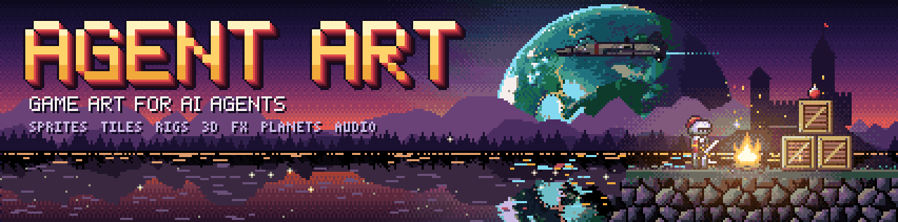</p>

# Agent Art

[](https://www.npmjs.com/package/@rusticstack/agent-art) [](LICENSE)  

**Game art and audio for AI agents.** Agent Art is an MCP server with a live web UI that lets any agent (Claude, GPT, DeepSeek, local models) make real game art: sprites, rigged characters with animations in 8 directions, tilesets, seamless textures, icons, isometric and HD-2D scenes, low-poly 3D models (`.glb`), planets, combat effects, sound effects and music. The agent builds every asset from tools it can reason about (shapes, form shading, Voronoi cells, outlines, lighting, rigs), looks at its own work as an image, gets a critique, fixes what's wrong, and exports PNGs, GIFs, spritesheets, glTF and audio for any engine. You watch, steer and review in the browser while it works.

The banner and every asset in this showcase were made by an agent through Agent Art's own tools:

![Asset showcase: an HD humanoid rig in 8 directions and a walk cycle; three skins sharing one skeleton and melee clip; HD-2D ruins built from 3D kit pieces; a gunship template with livery; a hard-surface reactor prop with neon and glass; door, barrel and crate damage states and a column fracture; PBR channel previews and a connected-texture set; first-person arms with a rifle and attachments; explosion, plasma, muzzle, shield, fire and decal flipbooks; planets on a skybox and an asteroid field; seamless textures, an iso scene and UI icons; song and gunshot analysis](docs/brand/showcase.png)

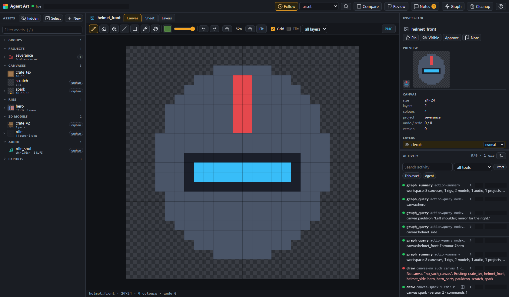

- **Works with weak models too.** Tool descriptions are compact, and details load on demand through `art_help`. Images are sized to their token cost. Errors print the correct usage. Rig templates turn "draw a walking character" into "draw six parts, call one preset".
- **The same asset in every view and frame.** Rigs draw each part once per view and generate frames by tweening poses, so a character never drifts between frames or directions.
- **Zero dependencies.** Plain Node.js 20+, no native modules. The web UI's 3D viewer uses a vendored copy of three.js r170 (MIT).

> Example: [Sanctum Burn](https://sanctum-burn.vercel.app), a co-op 2.5D survivor game. All of its art was made by an agent with Agent Art.

**Contents:** [Quick start](#quick-start) · [First asset in 5 calls](#your-first-asset-in-5-calls) · [Feature tour](#feature-tour) · [Tools](#tools) · [Help topics and skills](#help-topics-and-skills) · [CLI](#cli) · [Web UI](#web-ui) · [Debug and usage logging](#debug-and-usage-logging) · [Configuration](#configuration) · [For AI agents](#for-ai-agents)

## Quick start

**Claude Code:**

```sh
claude mcp add agent-art -s user -- npx -y @rusticstack/agent-art mcp
```

**Any MCP client (stdio):**

```json
{ "mcpServers": { "agent-art": { "command": "npx", "args": ["-y", "@rusticstack/agent-art", "mcp"] } } }
```

Then ask the agent: *"open the art UI and make a 32×32 knight with a walk cycle"*.

The MCP process hosts the web UI at http://localhost:7420. If an `agent-art serve` is already running on the same workspace, it uses that one, so the UI outlives agent sessions and several agents can share it. If that server goes away mid-session, the MCP process looks for another server on the same workspace (ports 7420-7440) and otherwise hosts one itself; it logs each switch to stderr.

**Without MCP (CLI only):** every MCP tool can be called from a shell, which works for agents that only have a terminal.

```sh
npx -y @rusticstack/agent-art tools                       # tool list + server instructions
npx -y @rusticstack/agent-art tool art_create_canvas '{"name":"slime","width":16}'
npx -y @rusticstack/agent-art serve --open                # the web UI on its own
```

**From a source checkout:** `npm install`, then `npm run build:ui` once, and again after pulling changes to `web/` (the web UI is built with Vite into `dist/ui/`; without a build the page says so and the server prints it at startup, and a build older than the sources shows a banner), `npm start` (web UI), `npm test`. To work on the UI, `npm run dev:ui` serves it with hot reload and forwards `/api` to a running server on port 7420 (or `AGENT_ART_URL`). The included `.mcp.json` registers the server for Claude Code in this folder.

## Your first asset in 5 calls

A shaded 16×16 slime, start to finish. Each line is one MCP tool call (tool name, then its JSON arguments):

```jsonc
// 1. a canvas
art_create_canvas { "name": "slime", "width": 16 }
// 2. a hue-shifted shading ramp: palette keys g0 (dark) .. g4 (light)
art_palette { "canvas": "slime", "action": "ramp", "base": "#4fa35a", "steps": 5, "prefix": "g" }
// 3. silhouette, automatic form shading, outline and eyes as ONE undo step; preview returns the image
art_draw { "canvas": "slime", "preview": true, "commands": [
  { "op": "ellipse", "x": 2, "y": 5, "w": 12, "h": 10, "color": "g2" },
  { "op": "shade", "colors": ["g0", "g1", "g2", "g3", "g4"], "of": "g2" },
  { "op": "outline", "color": "#1f3324" },
  { "op": "rect", "x": 5, "y": 8, "w": 2, "h": 2, "color": "#14141a" },
  { "op": "rect", "x": 9, "y": 8, "w": 2, "h": 2, "color": "#14141a" } ] }
// 4. a scored review with coordinates and fixes (stray pixels, contrast, jaggies, pillow shading, ...)
art_critique { "canvas": "slime" }
// 5. the PNG (a bare relative path goes to the workspace exports folder; the reply gives the full path)
art_export { "canvas": "slime", "path": "slime.png" }
```

The same pattern scales up: `art_project` shares a palette and style notes across an asset set, `art_view {tile:3}` checks texture seams, and `art_rig` turns one drawing per part into whole animation sets. The general workflow is palette ramps first, flat silhouettes, `shade`, `outline`, hand detail with `grid`, then `art_critique` and fix (`art_help {topic:"workflow"}`).

## Feature tour

Each area has a deeper page under [`docs/`](docs); every tool and action is in the [Tools](#tools) table.

### Drawing and pixel-art quality

`art_draw` runs a batch of drawing commands as one undo step: shapes (`rect`, `ellipse`, `polygon`, `line`, `curve`, `grid` pixel rows with a legend, `fill`, `text`), form and surface (`shade` for geometry-based volume shading with no pillow shading, `cells` for tileable stones, scales and bricks, `noise` and `scatter` with exact colour weights, `outline`, `bevel`, `damage`), colour (`replace`, `remap`, `gradient`, `adjust`, `quantize`), transforms (`copy` across canvases, `flip`, `rotate` with RotSprite at any angle, `shift`, `mirror`, `clear`), light and 2.5D (`light`, `fog`, `rays`, `glow`, `blur`, `vignette`, `cast_shadow`) and isometric `iso_tile` / `iso_box`. Every command takes `layer`, `frame`, `mask`, `blend` and `symmetry`.

`art_view` shows the canvas with a pixel grid, `tile:3` seam check, onion skin and guides. `art_critique` scores orphan pixels, noise, contrast, colour count, seams, weak outlines, jaggies, pillow shading and animation drift. `art_canvas scale {method:"scale2x"}` upscales cleanly; layers have blend modes; `art_animation` exports GIFs and spritesheets with Aseprite-style JSON. Sizes run from 8×8 icons to 2048² scenes. Help: `art_help {op:"<command>"}` for any command, topics `workflow`, `textures`, `scenes`, `hires`.

<details><summary>Canvas options worth knowing</summary>

- `art_canvas crop` keeps every frame, animation and tag of a frame strip, with the rect given in frame coordinates. `rotate {angle, expand:true}` grows the canvas so rotated content is not cut off.
- `outline` is safe to re-run: it skips pixels next to existing outline-coloured pixels (`skip_existing`).
- `clear` with no region clears the whole layer. `stamp_visible {keep_visible:true}` keeps the source layers. `ellipse {thickness}` draws a ring. `text {font:"5x7"|"7x9"}` gives larger fonts.
- `noise` takes a `"keep"` colour and only erases under a mask with `erase:true`. `adjust {alpha:-0.3}` is a change in opacity (`set_alpha` sets it directly). `mask:"!#hex"` means everything but that colour. `glow {select:"value"}` lets saturated neon bloom. `gradient {dither:false}` turns dithering off.
- `art_draw {commands_file}` runs a JSON batch from a file. `art_critique {tileable:true}` reports `seams:{ok, edge, interior, worst}`. Spritesheet export takes `json:false`. `art_view {tile:3, max_size:300}` zooms the tiled preview to fill `max_size`.
- Export paths: an absolute path is used as is, `./x` or `../x` resolves against the server's working directory, and a bare relative path goes to the workspace `exports` folder (the reply says so). `art_animation export {layout:"files"}` writes one strip per tag.

</details>

### Characters and animation: `art_rig`

Start from a template (`humanoid`, `humanoid_hd`, `blob`, `flyer`; every part, view, pose and preset can be changed) or define your own rig. Draw each part once per view, then `animate {preset, view}` tweens poses into frames at any frame rate. `humanoid_hd` gives detailed 8-direction characters (64×96 to 160×240) with per-view poses, two-bone IK, foot planting, cape follow-through and RotSprite sampling. Declare a `weapon` and both hands stay on the grips in every frame, view and carry state (aim, ready, sprint, reload, slung, holster, ...), with reach limits, no clipping through the body and depth-driven draw order; `check` validates every clip in all 8 directions. `skin` bends your own drawn sprites on the bones (2D skinning).

| 8 directions in the UI | Weapon handling | Skinned 8-direction walk |
| --- | --- | --- |
| 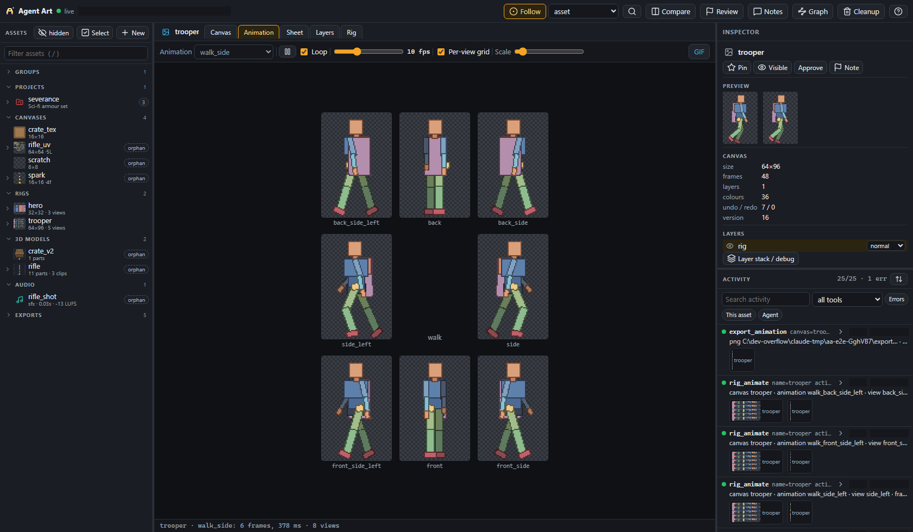 | 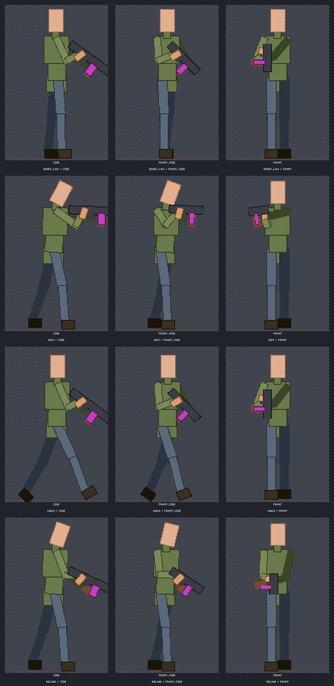 | 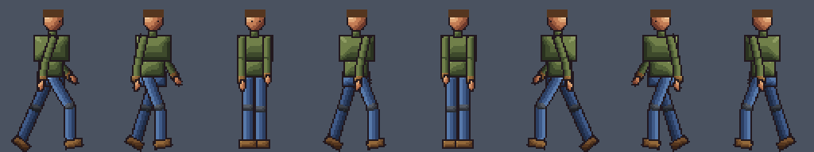 |

More: [docs/rig/README.md](docs/rig/README.md), the [humanoid_hd guide](docs/rig-hd-guide.md), [2D skinning](docs/skin2d/README.md).

### Animation library and melee: `art_anim`

Author motion once per skeleton and render it on every character: skeletons with named proportions and masks, a clip library (keys, layered and additive clips, events), skins with equipment and loadouts, retargeting, and `batch` straight to game strips plus a characters manifest. With runtime weapon layers the game draws the gun, so one character export works with every gun of its handling class. `melee` adds strikes, blocks, hit reactions and paired takedowns (including gun disarms) with hit events and per-frame hit volumes for the game.

| Skins on one skeleton | Melee hit volumes |
| --- | --- |
| 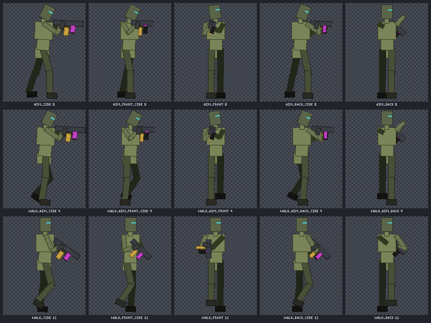 | 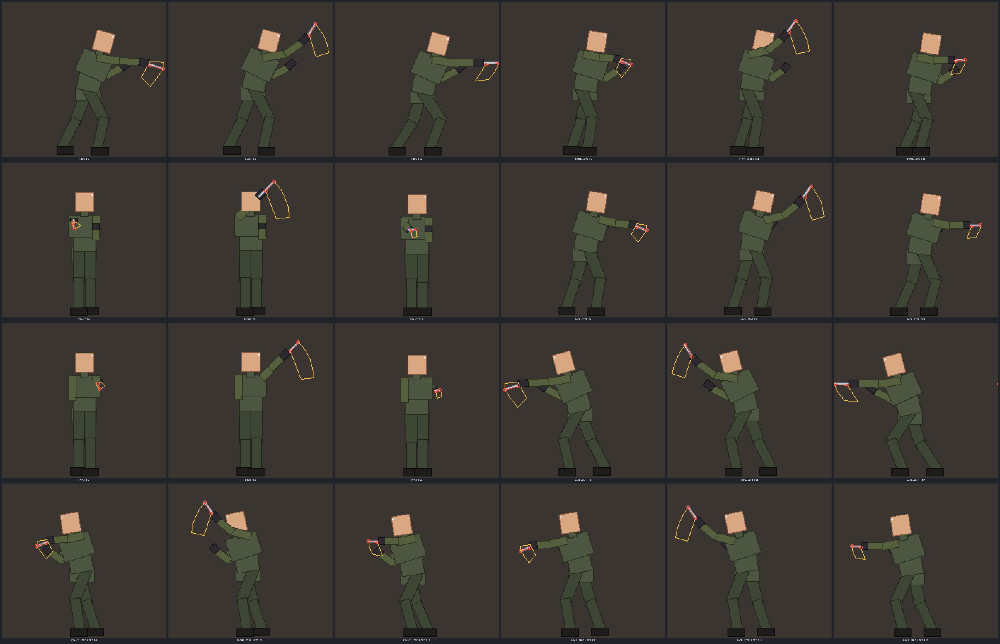 |

More: [docs/rig/README.md](docs/rig/README.md#animation-library-art_anim), [docs/melee/README.md](docs/melee/README.md).

### 3D models: `art_model`

Low-poly glTF 2.0 `.glb` with pixel textures (HD-2D look, NEAREST filtering, 32 px = 1 unit): modular map kits (floors, walls, arches, stairs, ruins) with world-space UVs that continue across pieces, extruded and lathed props (lathe profiles are cleaned with `simplify`), connected textures (CTM), moss and grime overlays, ships and vehicles, walkable sci-fi ships with interiors, and rigid-part rigs with poses, clips and sockets that export as glTF animations or render to pixel sprite frames. Hard-surface detail (greebles, pipes and cables, trim sheets, PBR, pixel-correct height normals, booleans, morphs) and render-cost tools (baked AO, lightmaps, LODs, impostors, collision and occluder proxies, room/portal culling) keep big scenes fast in a browser. Also: skeletal skinning, mesh processing (booleans, remeshing, cluster LOD) and damage states.

| Hard-surface hull section | Walkable hero gunship | Baked lightmap |
| --- | --- | --- |
| 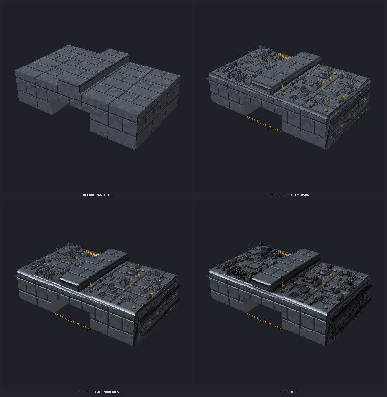 | 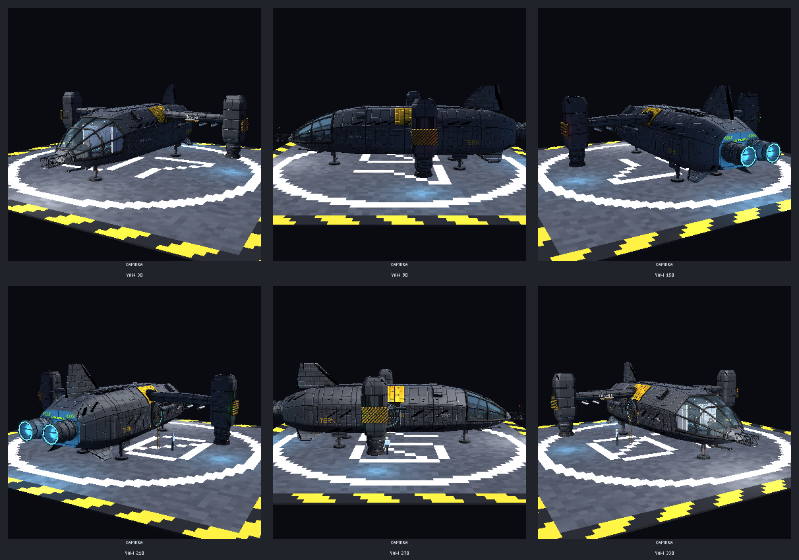 | 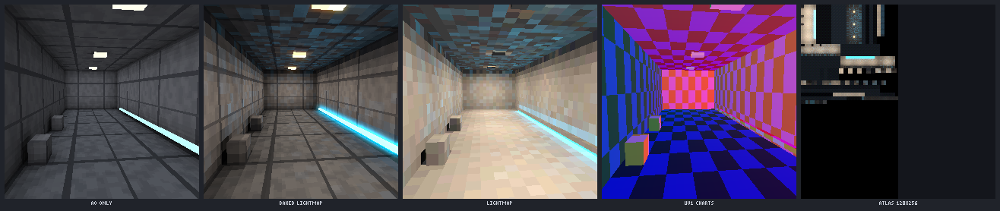 |

New models are unwrapped by default: `art_model create` bakes the model onto one UV atlas canvas `<name>_uv` (no seams on round parts, contact shading, worn edges, patterns and courses across parts) that you can paint directly or through a view, and update / preview / export keep it current. `unwrap:false` keeps per-part textures; models saved before keep theirs (`art_model unwrap {name}` converts one).

More: [docs/3d/README.md](docs/3d/README.md), [materials](docs/materials/README.md), [skinning](docs/skinning/README.md), [mesh processing](docs/meshproc/README.md).

### Damage and destruction

`art_model damage` gives a model seeded, nested damage states (scuffed, damaged, wrecked or custom amounts): dents, lost or hinged panels with exposed frames and sparking wires, shattered glass, scorch, bullet holes, hull breaches and fx sockets. `fracture` pre-cuts parts into watertight chunks with mass and collision hulls, and `export {damage:true}` writes the states, blend masks and a manifest (also for rigged and skinned models, and a Roblox profile). `art_draw damage` does the same on sprites.

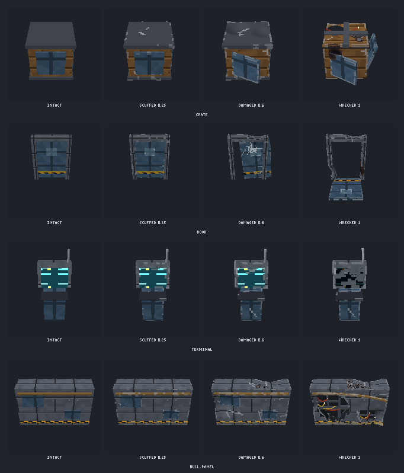

More: [docs/damage/README.md](docs/damage/README.md).

### First-person viewmodels: `art_fp`

First person built from separate pixel sprites, so the gun reads as 3D with no 3D models in the game. Arms are animated once per handling class (pistol to launcher, knife, baton, grenade, med, tablet); guns, magazines, attachments and items are yaw × pitch sprite sweeps that the game composes onto per-frame sockets, so adding a gun or a scope never touches the arms. Sources can be 3D (`art_model` kit) or hand-drawn 2D keys.

| Two loadouts on the same arms clips | Inspect |
| --- | --- |
| 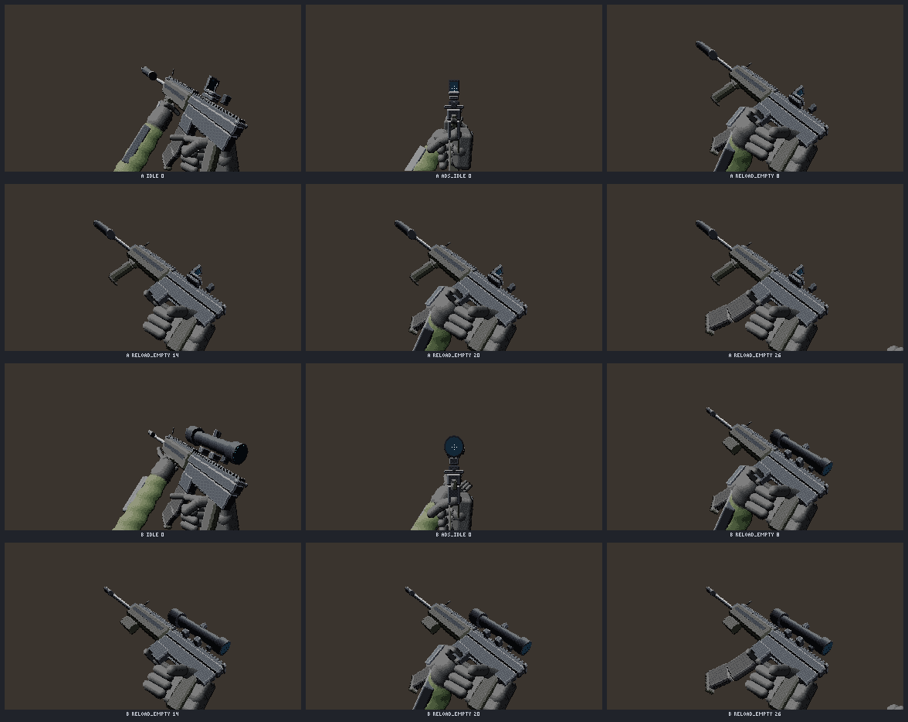 | 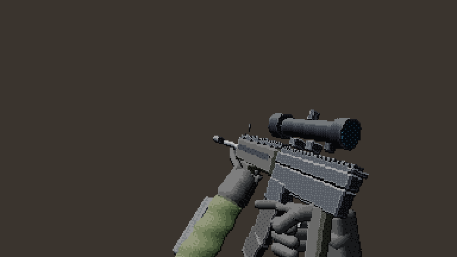 |

More: [docs/fp/README.md](docs/fp/README.md).

### Combat effects: `art_fx`

Seeded, deterministic pixel-art flipbooks (muzzle flashes per view with first-person aim variants, tracers, casings, impacts per surface, decals with normal maps, explosions, smoke, fire, sparks, steam, strobes, heat haze) with engine metadata: blend mode, pivot, emitters, a point-light curve, camera shake, sound names and Roblox flipbook settings.

| Muzzle flashes | Frag explosion | Impacts per surface |
| --- | --- | --- |
| 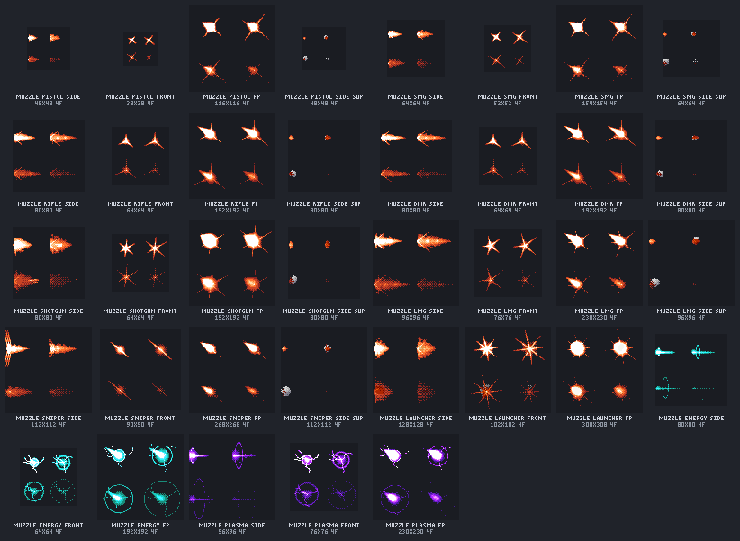 | 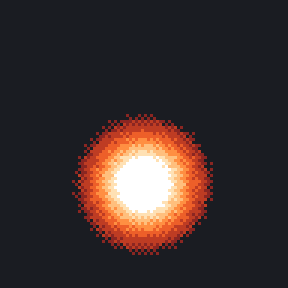 | 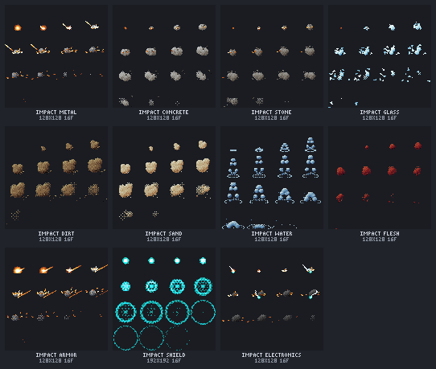 |

More: [docs/fx/README.md](docs/fx/README.md).

### Planets and space: `art_planet`

Planets you can see from orbit and land on, all sampled from one seeded field so every view agrees: orbit maps and cube faces, cube-sphere LODs, quadtree tiles, clouds, rings and an atmosphere shell; original star systems; matching landing-zone terrain with splat maps, instanced props and colony anchors; rock and asteroid kits; nebula skyboxes and space FX sprites. Every texture is at most 1024 px, for three.js and Roblox.

| Six-world system | Orbit | Landing zone |
| --- | --- | --- |
|  |  |  |

More: [docs/planets/README.md](docs/planets/README.md).

### Sound effects and music: `art_audio`

Agents cannot hear, so `art_audio` turns audio into things they can read: an analysis image (waveform, beat grid, spectrogram, loudness, band balance, stem masking) and a listener report in plain words (felt tempo, drum feel, key and chords, timbre, what is buried or repetitive, fit to a genre and the stated intent). It makes SFX from seeded recipes (gore, combat, firearms, sci-fi, UI, monsters, footsteps) with variants (gunshots are real CC0 field recordings: AR-15, AK-47, 9mm pistol, .38 revolver, .30-06, 7.62x54R, 12 gauge, SMGs; the `sample` layer plays them or your own WAVs), music from a compact text notation with generators and instrument presets, and mixes and masters to a LUFS target. With an [ElevenLabs](https://elevenlabs.io) API key it also records voice lines (`art_audio voice`) as sample assets you can analyze, process and export. Export is WAV with loop points, mp3 / ogg / opus through ffmpeg, stems and adaptive layers; renders run at 44.1 kHz, and `sample_rate:48000` delivers 48 kHz with sample-exact loop points.

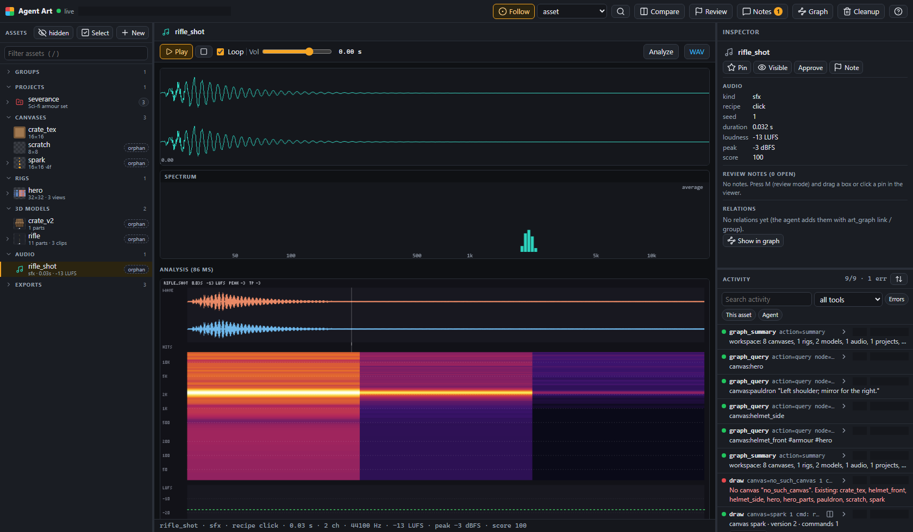

Listen to the bundled recorded gunshots, rendered by their recipes with seed 1: [rifle](docs/audio/samples/gunshot_rifle.ogg), [pistol](docs/audio/samples/gunshot_pistol.ogg), [shotgun](docs/audio/samples/gunshot_shotgun.ogg). This is what an agent "hears" instead, `art_audio analyze` on the rifle:

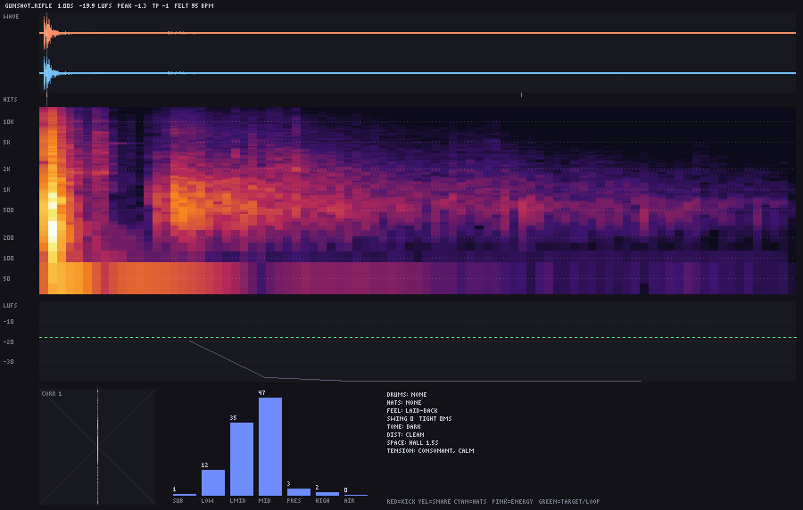

More: [docs/audio/README.md](docs/audio/README.md).

### Asset graph, review notes and cleanup

`art_graph` records what is part of what (`part_of`, `variant_of`, `view_of`, `rendered_from`, ...) and answers `summary` / `query` in a few hundred characters, so the agent orients itself without opening everything. In the web UI you pin review notes on a frame, view, part or audio range; the agent reads them with `art_review`, fixes them and marks them fixed, and any tool reply that touches the asset mentions its open notes. `art_cleanup` retires superseded assets safely: a dry-run plan with dependency blockers, a soft delete to a trash, and byte-for-byte restore.

| Asset graph | Review notes |
| --- | --- |
| 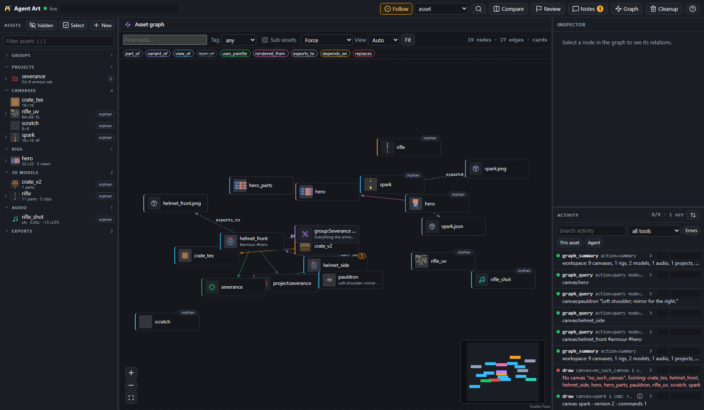 | 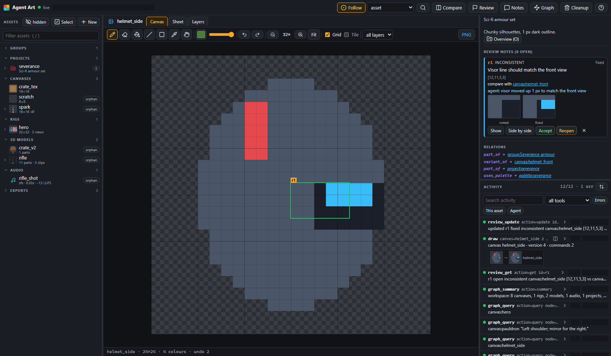 |

More: [docs/ui/README.md](docs/ui/README.md), [docs/cleanup/README.md](docs/cleanup/README.md).

### Minecraft resource packs: `art_minecraft`

Optional: real vanilla texture names and sizes per Minecraft Java version (references only), canvases tagged with `meta.texture`, animated textures, and `build` to write the pack and zip it. Skill: `minecraft-pack`.

## Tools

29 MCP tools. Tools with actions take `{"action": "<name>", ...}`. Each description holds the compact signature; `art_help` and the [full reference](llms-full.txt) hold every option.

| Tool | What it does | Actions |
| --- | --- | --- |
| `art_create_canvas` | New canvas: size, frames (an animation strip), background, palette, project | |
| `art_draw` | Batch of drawing commands as one undo step; `preview` returns the image, `critique` the score | |
| `art_view` | The canvas as an image: zoom / region, pixel grid, `tile` seam check, `onion`, guides, tint preview; big canvases come back as an overview | |
| `art_critique` | Heuristic quality report and score for a frame, an animation or every frame | |
| `art_read` | Exact pixels of a region as text rows plus a legend, in the format `grid` accepts | |
| `art_palette` | Named colours per canvas or project; `ramp` builds hue-shifted shading ramps | `get` `set` `remove` `clear` `ramp` |
| `art_layer` | Layers with blend modes, opacity, order, merge, flatten | `add` `remove` `select` `rename` `visibility` `opacity` `blend` `move` `duplicate` `merge_down` `flatten` `stamp_visible` |
| `art_canvas` | Canvas changes: metadata, resize, crop, scale (`nearest` or `scale2x`), frames, normal map | `meta` `delete` `duplicate` `resize` `scale` `crop` `set_frames` `add_frame` `normal_map` |
| `art_animation` | Frame strip animation: tags with per-frame durations, forward / reverse / pingpong, filmstrip, GIF / spritesheet export | `list` `tag` `untag` `insert` `duplicate` `move` `delete` `set_frame_size` `filmstrip` `export` |
| `art_project` | Group assets with a shared palette and style notes | `create` `update` `list` `info` `delete` |
| `art_sheet` | Many canvases in one labelled contact sheet, to check a set for consistency | |
| `art_rig` | Multi-view, multi-animation characters from parts and poses: templates, presets, IK, foot planting, secondary motion, held weapons, depth order, 2D skinning | `create` `info` `update` `pose` `preview` `animate` `turnaround` `templates` `check` `layers` `explain` `debug_render` `consistency` `derive` `zcheck` `skin` `weights` `shapes` `chain` `export` |
| `art_anim` | Animation library: skeletons, clips, skins, retargeting, batch to game strips + manifest, runtime gun layers, melee | `skeleton` `clip` `skin` `retarget` `render` `batch` `gltf` `list` `info` `weapon` `conform` `weapon_sheet` `composite` `weapon_check` `melee` `melee_check` `melee_sheet` `paired` |
| `art_model` | 3D low-poly models with pixel textures to `.glb`: kits, props, ships, rigs and clips, sprite renders, hard surface, materials, skinning, mesh processing, ship kits, damage, UV atlas | `create` `update` `info` `list` `delete` `preview` `export` `ctm` `pose` `animate` `render` `check` `trim` `skeleton` `skin` `weights` `material` `boolean` `remesh` `decimate` `cluster_lod` `visibility` `kit` `livery` `generate` `budget` `walk_check` `damage` `fracture` `unwrap` |
| `art_fp` | First-person viewmodels: arms per handling class, gun / magazine / attachment / item sweeps, composite and check; hand-drawn 2D sources | `kit` `sweep` `batch` `composite` `check` `paint` `template` `anchors` `sweep2d` `trace` |
| `art_fx` | Combat effect flipbooks with engine metadata | `make` `batch` `preview` `list` `export` |
| `art_planet` | Planets, star systems, landing-zone terrain, rocks, asteroids, skyboxes, space FX | `planet` `system` `terrain` `rocks` `asteroids` `skybox` `fx` `info` |
| `art_audio` | Sound effects, music, mixing and mastering; analysis images, listener reports and critiques; ElevenLabs voice acting; WAV / mp3 / ogg / opus export | `sfx` `instrument` `generate` `song` `render` `analyze` `critique` `compare` `import` `voice` `voices` `export` `list` `info` `delete` |
| `art_graph` | Asset graph: relations, tags, notes and nested groups; compact `summary` / `query` | `summary` `query` `find` `path` `link` `unlink` `tag` `note` `group` |
| `art_review` | Review notes the user leaves in the web UI: list, see the marked region, resolve, ask | `list` `get` `update` `add` |
| `art_cleanup` | Retire superseded assets: dry-run plan, soft delete to a trash, restore, disk usage; `config` reads the cleanup settings (only the user can change them) | `plan` `apply` `replace` `trash` `restore` `empty` `usage` `config` |
| `art_minecraft` | Minecraft Java resource packs: vanilla texture names and sizes, pack build and zip | `vanilla` `build` `init` `add` `icon` `info` `zip` |
| `art_help` | Usage for any draw command (`op`), guides (`topic`) and step-by-step recipes (`skill`) | |
| `art_list` | Canvases (optionally of one project), projects and the UI URL | |
| `art_info` | Canvas details as a summary (`full:true` or `fields` for more) | |
| `art_undo` | Undo or redo the last N steps of a canvas | |
| `art_import` | Import a PNG (path or base64) as a canvas or as a layer | |
| `art_export` | Export the composited canvas to PNG | |
| `art_open_ui` | Open the live web UI in the user's browser | |

## Help topics and skills

**Help topics** (`art_help {topic:"<name>"}`, or `agent-art help <name>`). The long ones (3d, rig, melee, music, fx, damage, audio, fp, materials, library) answer with their core and an index of sections, each with a one-line summary and its token size. `{topic, section:"a,b"}` returns those sections and `full:true` the whole topic, so an agent pays only for what it reads:

| Topic | Covers |
| --- | --- |
| `workflow` | Good pixel art step by step |
| `textures` | Tileable textures: cells, noise, seams |
| `characters` | Sprites and characters |
| `animation` | Frame animation, tags, export |
| `scenes` | Isometric and HD-2D scenes |
| `hires` | High-resolution pixel art (128 px to 2048 px) |
| `minecraft` | Minecraft resource packs |
| `rig` | `art_rig`: templates, poses, IK, weapons, depth |
| `library` | `art_anim`: skeletons, clips, skins, batch, runtime weapon layers |
| `skin2d` | `art_rig` 2D skinning, shapes, chains, export format |
| `melee` | Melee clips, hit volumes, paired takedowns, manifest fields |
| `3d` | `art_model`: every part type and option, rigs, renders, ships, recipes |
| `materials` | Materials v2: PBR extensions, baked light, packing, profiles |
| `damage` | Damage states, fracture, damage exports |
| `audio` | SFX recipes, layers, effects, export |
| `music` | Music notation, generators, instruments, genre recipes |
| `mixing` | Buses, sends, automation, mastering |
| `perception` | How to read the analysis image and listener report |
| `planets` | `art_planet`: every option |
| `fx` | `art_fx`: types, metadata, three.js and Roblox runtime |
| `fp` | `art_fp`: fp v2 contract, sweeps, clips, 2D sources |
| `graph` | `art_graph` relations and queries |
| `cleanup` | `art_cleanup` selectors, safety, restore |

`art_help {}` lists the topics and draw commands; `{topic:"ops"}` prints every draw command's usage; `{op:"shade"}` prints one.

**Skills** are step-by-step recipes with copyable calls. They are served by `art_help {skill:"<name>"}`, as MCP prompts, and can be installed as agent skills (one `agent-art-<name>/SKILL.md` per skill):

```sh
npx -y @rusticstack/agent-art skills --out ~/.claude/skills
```

| Skill | Use it for |
| --- | --- |
| `tileable-texture` | Seamless block, floor and wall textures |
| `sprite` | One character, item, monster or prop sprite |
| `rig` | A character in several views and animations from one rig |
| `rig-hd` | High-detail 8-direction `humanoid_hd` characters |
| `weapon-handling` | Characters and first-person arms holding guns |
| `anim-library` | Many characters sharing one clip library, batch export |
| `walk-cycle` | A quick frame-by-frame walk without a rig |
| `iso-scene` | Isometric maps and dioramas |
| `hd2d-scene` | Layered 2.5D / HD-2D backgrounds |
| `minecraft-pack` | Minecraft Java resource packs |
| `3d-kit` | HD-2D 3D environment kits and props (`.glb`) |
| `ship-model` | Spaceships and vehicles (`.glb`) |
| `hard-surface` | Greebles, trim sheets, PBR, baked AO, LODs, impostors |
| `ships-structures` | Walkable ships, interiors, colonies, megastructures |
| `fp-weapon` | First-person gun + arms as a 3D rig or sprite layers |
| `prop-rig` | Doors, chests, turrets and other rigid prop rigs |
| `ui-icons` | Icon sets and HUD elements |
| `sfx-pack` | Sound-effect packs with variants |
| `music-track` | Loopable game music checked with the listener report |
| `planets-space` | Planets, terrain, skyboxes, asteroid fields |
| `combat-fx` | Muzzle flashes, impacts, explosions and other combat VFX |

## CLI

```sh
agent-art serve [--port 7420] [--home DIR] [--open]   # the web UI + HTTP API
agent-art mcp   [--port 7420] [--home DIR] [--open]   # MCP stdio server (also runs or reuses the web UI); --debug logs usage
agent-art usage [--since DATE] [--tool art_x] [--json] [--transcript F]   # report from the debug logs
agent-art tools                                       # tool list + server instructions (for agents without MCP)
agent-art tool art_draw - --out view.png <<'EOF'      # call any MCP tool; an image reply goes to --out
{"canvas":"stone","commands":[{"op":"cells","size":5,"colors":["#555","#777","#999"]}],"preview":true}
EOF
agent-art op create '{"name":"stone","width":16}'     # one raw engine op (json | @file.json | - for stdin; --out f.png)
agent-art batch steps.jsonl --out-dir renders         # many ops in order ({"op", "args", "out"} per line; --keep-going)
agent-art help shade                                  # a draw command, help topic or skill
agent-art skills --out DIR                            # write the skills as DIR/agent-art-<name>/SKILL.md
```

`op`, `batch` and `tool` run through the live server when one is up on the port (so the UI updates), otherwise in-process on the workspace. On Windows or any shell, piping JSON on stdin (`-`) avoids quoting problems.

## Web UI

The UI shows everything the agent does, live, and lets you steer it: an activity timeline of every tool call with before / after thumbnails, an asset browser, viewers for canvases, animations (all 8 directions as a compass), rigs, 3D models (orbit, wireframe, UVs, normals, channels, clips, sockets), audio and sheets, a Layers view that explains draw order, the asset graph, review notes (press `M`), compare (`C`) and follow (`F`). Your edits go through the same API as the agent's, so the agent sees them.

| Timeline | Rig skeleton | Model viewer |
| --- | --- | --- |
| 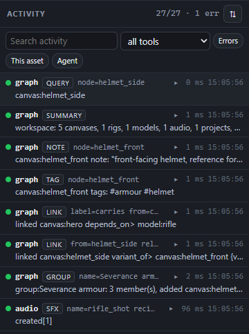 | 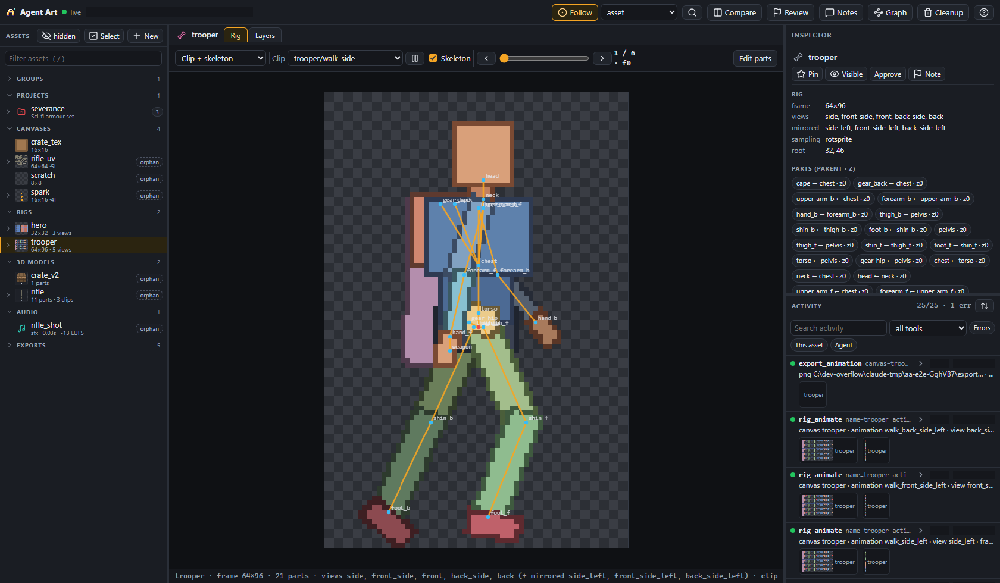 | 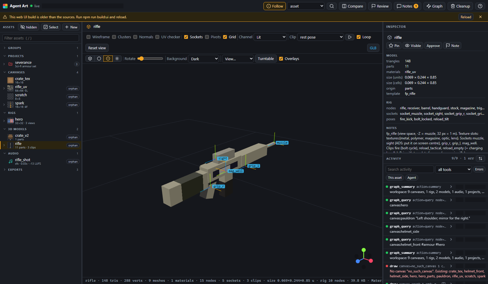 |

Every feature and more screenshots: [docs/ui/README.md](docs/ui/README.md).

Running from a source checkout: run `npm install` and `npm run build:ui` once, and again after pulling changes to `web/`. Without a build the page says so and the server prints it at startup. When the build is older than the sources (`web/src`, `web/index.html`, or another package version), the server prints `Agent Art web UI build is older than web/ sources: run npm run build:ui`, the page shows a banner, `/api/health` reports `ui: {built, stale}` and `art_open_ui` adds a `note` to its reply. The npm package ships the built UI and is never stale.

## Debug and usage logging

Turn on the debug mode to see what Agent Art costs an agent and where agents struggle, then tune tool descriptions, replies and defaults from evidence:

```sh
agent-art mcp --debug            # or AGENT_ART_DEBUG=1; "--debug full" also keeps the call arguments
agent-art usage                  # report: per-session overhead, cost per tool and action, biggest and slowest calls,
                                 # error groups, repeats and retries, art_help reads, suggestions
agent-art usage --transcript ~/.claude/projects/<project>/<session>.jsonl   # plus the real billed tokens from Claude Code
```

Every session, list call and tool call becomes one JSONL record in `<workspace>/debug/usage-<date>.jsonl`:
- the estimated tokens of the arguments and reply (text and images);
- time, errors, and the engine ops the call ran;
- repeated or retried calls.

It is off by default, logs only argument shapes unless you ask for `full`, and never sends anything anywhere. Record format, token estimates and an optimisation loop: [docs/debug/README.md](docs/debug/README.md).

## Configuration

| Setting | Flag | Environment | Default |
| --- | --- | --- | --- |
| Workspace folder | `--home DIR` | `AGENT_ART_HOME` | `~/.agent-art` |
| Web UI / API port | `--port N` | `AGENT_ART_PORT` | `7420` (`mcp` takes the next free port when it has to host and 7420 is taken) |
| Open the browser on start | `--open` | `AGENT_ART_OPEN=1` (`mcp` only) | off |
| ffmpeg for mp3 / ogg / opus export | | `AGENT_ART_FFMPEG` | `ffmpeg` on `PATH` |
| Debug usage log (`mcp` only) | `--debug [full]` | `AGENT_ART_DEBUG=1` or `full` | off |
| Debug log file | | `AGENT_ART_DEBUG_FILE` | `<workspace>/debug/usage-<date>.jsonl` |
| ElevenLabs API key for voice acting | | `ELEVENLABS_API_KEY`, or that line in a `.env` file | none (voice acting is off) |

The workspace holds `canvases/*.json` (layers stored as PNG), `models/*.json` (3D model definitions), `projects/`, `exports/` and `packs/`, plus `graph.json` (asset graph and review notes), `reviews/` (review note crops), `ui-state.json` (hidden and pinned assets in the UI), `debug/` (usage logs, only with `--debug`), `trash/` (cleanup batches and single deletes, until emptied) and `config.json`. Since 0.3.0 there is no implicit fallback to a `./workspace` folder next to a source checkout, because it silently split work between clients started from different folders. If that folder exists, `serve` and `mcp` print a note; pass `--home ./workspace` to keep using it.

`<workspace>/config.json` holds `cleanup.allow_paths` (folders outside `exports/` that cleanup may move files from) and `cleanup.trash_deletes` (`false` makes single deletes hard deletes again). Only the user sets them, in the file or in the web UI under Cleanup › Settings; the agent can read them with `art_cleanup config`.

### ElevenLabs voice acting

`art_audio voice` reads the API key from the `ELEVENLABS_API_KEY` environment variable (system or user), or from a `.env` file in the project folder the MCP server starts in, or in the workspace folder:

```sh
# .env (add it to .gitignore)
ELEVENLABS_API_KEY=sk_...
```

The key is never a tool argument, so it stays out of your MCP config, the chat, replies and the usage log. A `.env` is read on each call; a new environment variable needs a server restart. Saying the same line again with the same voice and settings reuses the saved take, so it costs no credits (`force:true` records a new one). Takes are 24 kHz WAV by default (44.1 / 48 kHz need an ElevenLabs Pro plan) and are stored at 44.1 kHz like every other sound.

The server binds to 127.0.0.1 and refuses cross-origin writes.

## For AI agents

- **[llms.txt](llms.txt)** is the index for language models: what Agent Art is, and links to this README, every docs page and the full reference.
- **[llms-full.txt](llms-full.txt)** is the whole agent-facing reference in one plain-text file: the MCP server instructions, every tool with its description and parameters, every draw command, every help topic and every skill. It is generated from the code by `npm run docs:llms`, and a test fails when it is out of date. Both files ship in the npm package.
- **Over MCP**, the server sends its instructions (`INSTRUCTIONS` in [src/mcp.js](src/mcp.js)) at initialisation, and tool descriptions stay terse to save tokens: call `art_help` for detail, and `art_help {skill}` for a recipe. Errors print the correct usage.
- **Without MCP**, `agent-art tools` prints the same instructions and tool list, and `agent-art tool <name> <json>` calls a tool exactly as an MCP client would.
- Upgrading from 0.6: [docs/upgrading-0.7.md](docs/upgrading-0.7.md). Every release: [CHANGELOG.md](CHANGELOG.md).

## License

MIT. The bundled gun recordings in `src/audio/samples/guns/` are CC0 (public domain), from [The Free Firearm Sound Library](https://opengameart.org/content/the-free-firearm-sound-library); see [src/audio/samples/CREDITS.md](src/audio/samples/CREDITS.md).
