# 3D models from pixel art: `art_model`

[Back to the README](../../README.md)

Low-poly glTF `.glb` models textured with pixel art (HD-2D look, NEAREST filtering): modular map kits, props, ships and vehicles, rigid-part rigs with clips, first-person weapons and arms, hard-surface detail, render-cost tools, skinning, mesh processing and damage. Units are art pixels (32 px = 1 unit). Help topics: `art_help {topic:"3d"}`, `{topic:"materials"}`, `{topic:"damage"}`. Skills: `3d-kit`, `ship-model`, `hard-surface`, `ships-structures`, `fp-weapon`, `prop-rig`.

- [Kit pieces, props and dioramas](#3d-environments-and-props-hd-2d)
- [Rigid-part rigs, animation clips and pre-rendered sprites](#rigid-part-rigs-animation-clips-and-pre-rendered-sprites)
- [Guns held by arms (first person)](#guns-held-by-arms-first-person)
- [Ships and vehicles](#ships-and-vehicles)
- [Hard-surface detail and render cost](#hard-surface-detail-and-render-cost)
- [Materials v2](#materials-v2-render-data-for-modern-renderers) (full page: [docs/materials/README.md](../materials/README.md))
- [Connected textures (CTM)](#connected-textures-ctm), including the reference `ctmTileFor` for engines
- [Ships, interiors, industrial kits and megastructures](#ships-interiors-industrial-kits-and-megastructures)
- [Damage and destruction](../damage/README.md), [skinning](../skinning/README.md), [mesh processing](../meshproc/README.md)
- [World-space UVs at runtime (three.js)](#world-space-uvs-at-runtime-threejs)

## 3D environments and props (HD-2D)

Turn pixel art into low-poly game assets in the HD-2D style (pixel textures on low-poly meshes, nearest filtering), exported as glTF 2.0 `.glb` with no dependencies. The focus is modular map kits; characters stay 2D billboards.

```jsonc
// a kit piece: tileable textures repeat at 1 texel = 1 px, so every piece keeps 32 px per unit
{ "action": "create", "name": "wall_ruin", "parts": [
  { "type": "wall", "w": 32, "h": 64, "d": 8, "texture": { "canvas": "stone", "overlay": "grime" }, "broken": { "seed": 3 }, "holes": "crack" },
  { "type": "rubble", "texture": "stone", "count": 6, "at": [0, 0, 10] } ], "preview": true }
// a diorama section from placed pieces (cell = 32 px grid, turn = 90° steps)
{ "action": "create", "name": "crypt", "parts": [
  { "type": "model", "model": "floor_a", "array": { "count": 4, "cell_step": [1, 0, 0] } },
  { "type": "model", "model": "wall_ruin", "cell": [1, 0, -1] } ] }
{ "action": "export", "name": "crypt" }          // exports/crypt.glb + crypt.meta.json (or instances:true)
```

- **Kit pieces:** `floor`, `wall`, `corner`, `pillar`, `column`, `arch` (gothic or round; frame, solid or ring), `vault`, `stairs`, `ledge`, `balustrade`, `roof`, `rubble`, `box`, `cylinder`/`prism`, `plane`, `shape` (any outline). **Props:** `extrude` (sprite to solid; side walls take the edge pixel's colour; `depth_map` gives voxel relief) and `lathe` (revolve a right-half silhouette). **Layouts:** `model` places other models.
- **Ruins:** `broken` gives jagged tops or edges, `holes` takes a mask canvas whose painted pixels become cracks and breaches, and `rubble` scatters chunks. Outlines are smooth polygons (marching squares, then simplified) and arch curves get a segment count from their size. `style:"voxel"` (arches: `voxel:true`) keeps the old blocky look.
- **Ships and vehicles:** `wedge` (box whose top is resized and moved: `top_w`, `top_d`, `shift:[x,z]`; the default is a ramp), `box` with `taper` (front face scaled for a nose), `bevel` (chamfer px) or `insets` (recessed or raised panels for intakes, hatches and hangar mouths, without CSG; also the `inset` part), `cylinder` with `r_top`/`r_bottom` (frustum; 0 gives a `cone`), `shape` on plane `xy`, `xz` or `zy` (side profile `[z,y]`, extruded along x; unknown planes are an error), and `loft` (a `shape` whose far cross-section is scaled by `scale_end`, so a hull narrows toward the nose). See [Ships and vehicles](#ships-and-vehicles).
- **Smooth geometry:** `lathe` profiles are simplified before revolving (collinear runs merged, then Douglas-Peucker with `simplify` px, default 0.75), so a pixel silhouette gives a few clean rings instead of one ring per pixel row.
- **World-space UVs:** tiled faces get their UVs from the world position after placement, planar per face direction, at 1 texel = 1 px. The texture lattice starts at a grid-cell edge (`uv_origin`, default `[16,0,16]`, settable per model). Offsets, turns, arrays and nested layouts all continue the texture across touching pieces.
- **Overlays:** grime, decay, moss, blood and edge wear become decal shells on a second UV set (glTF `TEXCOORD_1`, strength in `COLOR_0` alpha, alpha MASK). Example: `overlays:[{texture:"grime", where:["bottom","corners"], falloff:20}, {texture:"moss", where:"top"}]`. `map` is `world` (the overlay's own scale) or `face`/`piece`/`surface` (stretched 0..1). Overlays go on a part or on the whole model (model-level `overlays`, kept by `create` and `update`). Decal shells are tessellated adaptively (`detail` defaults from the falloff and face size, 16-64 px), and uniform areas such as `where:"all"` are not split at all.
- **Hard-surface detail and render cost:** greebles, sweeps (pipes, cables), trim sheets, PBR materials, pixel-correct height normals, baked AO, booleans, morph targets, LODs, impostors, collision/occluder proxies and room/portal cull data; see [Hard-surface detail and render cost](#hard-surface-detail-and-render-cost).
- **Connected textures (CTM):** `art_model ctm` builds an OptiFine/Continuity-style tileset; see below.
- **Textures:** set them per face (`faces`, `top`, `side`), use a colour, or add a grime `overlay`. Emissive comes from a layer named `emissive`; that layer is left out of the base colour, so a glow-only pixel is black in the albedo and lit only by the emissive texture. `normal_maps:true` adds normal maps.
- **Preview:** `art_model preview` renders a contact sheet with a software rasterizer. It includes the 38° game camera plus front, side, top and iso views.
- **Export:** NEAREST samplers, REPEAT wrap, embedded PNGs, alpha MASK (cutoff 0.5) only when a triangle actually samples a transparent texel (unused tileset slots no longer force it), and emissive/normal textures. The file is Y-up with 32 px = 1 unit (`scale`). For a Z-up engine set `object.rotation.x = Math.PI / 2` or export with `up:"z"`. Options: one baked mesh, `instances:true` (shared meshes and nodes), or `atlas:true`.

`art_help {topic:"3d"}` has every option plus recipes for a gothic arch kit, a gargoyle relief, chains, lathed candles, CTM marble floors, wall trims, moss and a spaceship. Skills: `3d-kit`, `ship-model`, `hard-surface`.

### Rigid-part rigs, animation clips and pre-rendered sprites

For first-person weapons and arms, or any prop with moving parts (doors, chests, turrets), a model can be a rig of rigid parts, PSX / Half-Life 1 style (no skinning). The same rig exports as glTF nodes and animations or renders to pixel-art sprite layers.

```jsonc
// by hand: name = its own node, parent = nesting, pivot = the joint
{ "action": "create", "name": "door", "parts": [
  { "type": "box", "name": "frame", "w": 20, "h": 34, "d": 2 },
  { "type": "box", "name": "leaf", "parent": "frame", "w": 16, "h": 32, "d": 1, "at": [0, 1, 0], "pivot": [-8, 0, 0] } ],
  "sockets": { "handle": { "part": "leaf", "at": [6, 16, 1], "look": [0, 0, 1] } } }
{ "action": "pose", "name": "door", "pose": "open", "parts": { "leaf": { "rot": [0, -80, 0] } } }
{ "action": "animate", "name": "door", "clip": "swing", "keys": [ { "t": 0, "pose": "rest" }, { "t": 0.8, "pose": "open", "ease": "smooth" } ],
  "events": [ { "t": 0, "name": "creak" } ] }
{ "action": "export", "name": "door" }   // a node per part + socket_handle + one glTF animation per clip
```

- **Nodes:** a part with `name` becomes its own glTF node with its own mesh; `parent` nests it under another named part, and its transform is local to the parent (translation = joint offset, rotation, scale). `pivot:[x,y,z]` is the joint. Unnamed parts merge into the root mesh or into their named parent's mesh; `rig:{merge:false}` makes every part a node. `create` and `info` report the node tree. Models without names export exactly as before.
- **Poses and clips:** `pose` stores per-node offsets from the rest pose (`rot` degrees, `at` px in the parent's frame, `scale`; `base` starts from another pose). `animate` stores a clip of keys in seconds (`ease`: `linear`, `smooth` or `step`, applied to the motion into the key), with `loop`, `duration` and `events:[{t, name}]`; `keys:null` deletes it. Export writes one glTF animation per clip, with translation, rotation (quaternion) and scale channels per moved node. All-linear clips use LINEAR samplers at the key times, all-step clips use STEP, and anything else is baked at 30 fps. Events go in the animation's `extras`. `preview {clip, frames, view}` shows a clip as a contact sheet.
- **Sockets:** `sockets:{muzzle:{part, at, look?}, sight, grip_r, grip_l, mag_well}` export as empty child nodes `socket_<name>`, for aligning ADS, spawning muzzle flashes and placing hands. `meta.json` lists each node's parent-space transform, so a Roblox import maps it to Motor6D joints (C0 = translation and rotation).
- **Templates:** starter rigs in view space (origin = the eye, -Z forward, 32 px = 1 m): `fp_rifle` (receiver, barrel, handguard, stock, magazine, bolt, charging handle, optic, trigger; clips `fire`, `reload_tactical`, `reload_empty`), `fp_pistol` (frame, slide, barrel, magazine, trigger; clips `fire`, `reload`) and `fp_arms` (clavicle > upper arm > forearm > hand > fingers per side; poses `grip_rifle` and `grip_pistol` put the palms on the weapons' grip sockets). The weapons have the five sockets above. Override anything with `textures` (slots such as `metal`, `polymer`, `sleeve`, `glove`), `set` by part name, `add`, `remove`, `poses`, `clips` and `sockets`. The `fp` preview view is the matching camera (eye at the origin, 60°).
- **Sprite renders (`render`):** each clip sample, pose, `angles` entry or `sweep:{yaw:[a,b,step], pitch:[..]}` grid cell becomes one frame of a canvas animation. Frames use nearest texels with no anti-aliasing and a transparent background, plus an optional `light`, `quantize` (median-cut `colors:n`, a colour list or `palette:"project"`, with ordered `dither`) and a 1 px `outline`. The camera is `fp` (the default), `side`, `front`, `iso`, `top`, `game` or `{pos, look, fov}`. `only` and `hide` render layers (for example the gun without its magazine) with the same fitted camera, so the layers stack.
- **Anchors:** every rendered frame stores each socket's screen position and rotation in `meta.anchors`, and spritesheet export writes them to `frames[].anchors`. A 2D arm rig follows them with `art_rig animate {ik_from}` (see [`art_rig`](../rig/README.md#characters-views-and-animations-art_rig)).
- **Known limitation:** the `fp` camera drops triangles that cross its near plane instead of clipping them, so a part that reaches behind the eye (a long stock, a shoulder) can vanish in some frames. Shorten it, move the weapon forward, or render that layer with `camera:"side"`.

End to end, a first-person rifle from the template to 2D sprite layers with arms (texture canvases must exist before `create`):

```jsonc
// art_create_canvas: a texture (paint it with the tileable-texture skill)
{ "name": "gun_metal", "width": 16, "height": 16, "background": "#2c2e33" }
// art_model: the rig, a custom reload clip, the .glb
{ "action": "create", "name": "ar", "template": "fp_rifle", "textures": { "metal": "gun_metal" }, "set": { "magazine": { "h": 5 } } }
{ "action": "animate", "name": "ar", "clip": "reload_fast", "keys": [ { "t": 0, "pose": "rest" },
  { "t": 0.25, "pose": "reload_tilt", "ease": "smooth" },
  { "t": 0.5, "pose": "reload_tilt", "parts": { "magazine": { "at": [0, -9, 1.5] } }, "ease": "smooth" },
  { "t": 0.9, "pose": "reload_tilt", "ease": "smooth" }, { "t": 1.2, "pose": "rest", "ease": "smooth" } ],
  "events": [ { "t": 0.5, "name": "mag_out" }, { "t": 0.9, "name": "mag_in" } ] }
{ "action": "preview", "name": "ar", "clip": "reload_fast", "frames": 6, "view": "side" }
{ "action": "export", "name": "ar" }   // exports/ar.glb: nodes, socket_* nodes, animations fire, reload_*, reload_fast
// art_model: pixel sprite frames (hide/only give stackable layers, sweep gives turn frames)
{ "action": "render", "name": "ar", "canvas": "ar_reload", "clip": "reload_fast", "fps": 12, "size": [160, 120],
  "camera": "fp", "quantize": { "colors": 16, "dither": true }, "outline": "#14141a" }
// art_rig: 2D arms with the same frame size; draw the parts in the listed cells, then follow the grips
{ "action": "create", "name": "arms2d", "frame": [160, 120], "views": ["side"], "root": [80, 119], "parts": {
  "body": { "w": 2, "h": 2, "pivot": [1, 1] },
  "upper_r": { "w": 8, "h": 32, "pivot": [4, 0], "parent": "body", "at": [68, 0] },
  "fore_r": { "w": 7, "h": 30, "pivot": [3, 0], "parent": "upper_r", "at": [0, 30] },
  "hand_r": { "w": 8, "h": 8, "pivot": [4, 0], "parent": "fore_r", "at": [0, 28] },
  "upper_l": { "w": 8, "h": 32, "pivot": [4, 0], "parent": "body", "at": [-30, 0] },
  "fore_l": { "w": 7, "h": 30, "pivot": [3, 0], "parent": "upper_l", "at": [0, 30] },
  "hand_l": { "w": 8, "h": 8, "pivot": [4, 0], "parent": "fore_l", "at": [0, 28] } } }
{ "action": "animate", "name": "arms2d", "animation": "reload_fast", "canvas": "arms_reload",
  "ik_from": { "canvas": "ar_reload", "animation": "reload_fast",
    "map": { "hand_r": { "anchor": "socket_grip_r", "bend": -1 }, "hand_l": "socket_grip_l" } } }
// art_animation: one spritesheet per layer; json frames[].anchors line them up in-engine
{ "canvas": "ar_reload", "action": "export", "format": "spritesheet" }
```

The full pipeline (gun and magazine layers, angle sweep, 3D arms) is in `art_help {topic:"3d"}` under "Rigs & clips" and "Pre-rendered sprites". Skills: `fp-weapon`, `prop-rig` (doors, chests, turrets).

### Guns held by arms (first person)

Create `fp_rifle` or `fp_pistol` with `weapon` and the `fp_arms` hands solve onto the gun instead of following a fixed pose:

```jsonc
{ "action": "create", "name": "arms", "template": "fp_arms" }
{ "action": "create", "name": "gun", "template": "fp_rifle", "weapon": { "attach": ["vertical_grip"] } }
{ "action": "render", "name": "arms", "canvas": "arms_low", "camera": "fp", "hold": { "weapon": "gun", "carry": "ready_low", "both": true } }
{ "action": "check", "name": "arms", "hold": { "weapon": "gun" } }   // every carry state and clip -> pass / fail
{ "action": "animate", "name": "arms", "clip": "reload_empty", "hold": { "weapon": "gun", "carry": "reload", "bake_weapon": "reload_empty_held" } }
```

- **Weapon:** `weapon.grips: {grip_main, grip_support, stock, muzzle, optic, mag}` names a socket or a `{part, at, look, up}` point for each (defaults: the template's `grip_r`, `grip_l`, `muzzle` and `sight` sockets). The attachments `vertical_grip`, `angled_grip`, `bipod` and `suppressor` add parts and sockets and take over the grip or the muzzle. Without `weapon` the templates are unchanged.
- **Hold:** two-bone IK puts each palm on its grip, with the wrist turned to the grip's `look` and `up`. The carry states are `hip`, `aim` (the optic on the screen centre, stock welded), `ready_low`, `ready_high`, `sprint`, `reload` (the support hand on the magazine) and `holster`, plus pistol `compressed` and `low`. `weapon.states` adds your own, with `base`. A grip out of reach moves the gun back or slides the support hand, never stretching the arm. A gun inside the head, chest or shoulder capsules is pushed out. The muzzle must point down outside firing states, and `fix: true` lowers it.
- **Output:** `render {hold}` and `animate {hold}` return a `hold` / `held` report (corrections, issues, pass). `animate {hold}` bakes the solved arms into a clip, and `bake_weapon` also writes the matching gun clip, so the exported glTF plays back without the solver. `check` adds visibility: how much of the gun is on screen and how much the arms hide.

### Ships and vehicles

```jsonc
{ "action": "create", "name": "scout", "origin": "bottom", "preview": true, "parts": [
  { "type": "loft", "points": [[-12,0],[12,0],[10,10],[-10,10]], "d": 64, "scale_end": [0.3,0.4], "color": "#8a94a6" },
  { "type": "wedge", "w": 40, "h": 3, "d": 24, "top_w": 8, "shift": [16,0], "at": [14,2,0], "mirror": "x" },
  { "type": "cone", "r": 3, "h": 8, "rotate": [90,0,0], "at": [0,5,32] },
  { "type": "cylinder", "r_bottom": 5, "r_top": 4, "h": 10, "rotate": [-90,0,0], "at": [10,5,-32], "mirror": "x" },
  { "type": "box", "w": 10, "h": 6, "d": 14, "bevel": 2, "glass": true, "color": "#9fd8ff", "at": [0,10,8] },
  { "type": "box", "w": 6, "h": 6, "d": 6, "at": [0,0,-20], "insets": [{ "face": "back", "rect": [1,1,4,4], "depth": 3, "texture": "#f80" }] },
  { "type": "cylinder", "r": 1.5, "h": 4, "at": [6,10,-10], "array": { "count": 4, "rotate": [0,90,0], "about": [0,10,-10] } } ] }
```

- **Transform order:** every part is scaled, then rotated about the fixed axes X, then Y, then Z (`rotate:[x,y,z]` in degrees), then turned (`turn`, 90° steps about y). All of this happens about the part's own origin (its local `0,0,0`, bottom-centre for most builders), or about `pivot:[x,y,z]` (local px) when given. Then the part is moved by `at` + `cell` × grid. On `extrude` and `lathe` a two-element `pivot:[x,y]` is still the canvas pivot.
- **Mirror:** `mirror:"x"` (or `"y"`, `"z"`, or a list for every combination) also emits a copy mirrored across the model's `x=0` plane. Winding and normals are fixed, so the copy is not inside out.
- **Radial arrays:** `array:{count, rotate:[0,60,0], about:[x,y,z]}` rotates copy k by k steps about that model-space point (engine rings, rotor blades). Without `about`, copies turn in place as before.
- **Translucency:** `opacity:0..1` exports glTF `alphaMode:"BLEND"`, with `baseColorFactor` alpha = opacity multiplied by the texture alpha. `glass:true` is BLEND at opacity 0.35 (unless set), double-sided and glossy. The material extras carry `depthWrite:false`. The image is shared with the opaque material, and the preview blends translucent parts after the opaque ones.
- **Cylinder decals:** `wrap:"once"` puts one copy of the texture round the side, centred on +z. `u_offset` (in turns, + toward +x) rotates it, so a decal can face any side. `wrap:"repeat"` gives a whole number of copies (`repeat:n`, or a default from the circumference), so there is no seam. `tile:false` keeps the old stretched mapping.
- **Insets:** `insets:[{face, rect:[u,v,w,h], depth, texture?, side?}]` on a box. `rect` is in px from the face's top-left as seen from outside. `depth > 0` cuts a recess (the face gets a hole, four inner walls and a floor), and `depth < 0` adds a raised panel. Panels may touch the face border, for a hangar mouth.
- **Origin:** the default `origin:"auto"` keeps part coordinates, so kit pieces stay on the grid; this did not change. For a standalone prop, ship or vehicle use `origin:"bottom"` (centred on X/Z, bottom on y=0). `create` says so in its `next` hint when the model is off-centre.

### Hard-surface detail and render cost

Ships, stations, carrier interiors and cities that read like a big-budget sci-fi universe at a pixel-texture budget, and stay fast in a browser. Everything below is opt-in: models that use none of it export byte-for-byte as before.

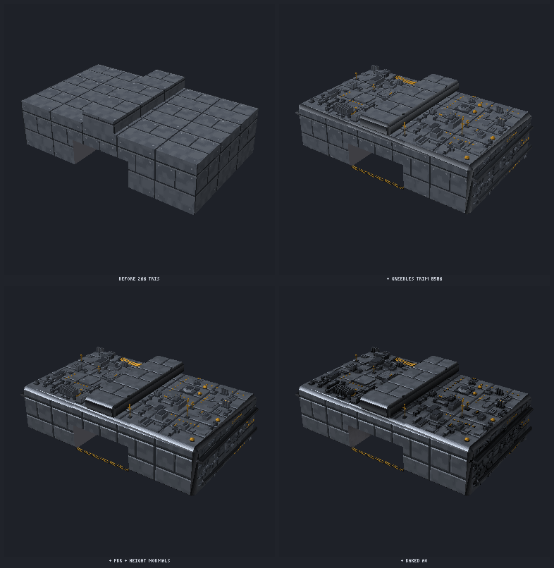

```jsonc
{ "action": "trim", "canvas": "hull_trim" }                     // a 64-wide trim sheet: plate, bevel, bolts, seam, hazard, grate, rib, pipe, rubber, light
{ "action": "create", "name": "hull_a", "origin": "bottom", "parts": [
  { "type": "box", "id": "hull", "w": 160, "h": 40, "d": 96, "bevel": 3, "texture": "hull", "material": "painted_metal", "trim": "hull_trim:bevel",
    "greebles": [ { "face": "top", "seed": 11, "grid": 2, "density": 0.35, "avoid": [[64, 0, 32, 96]] },
                  { "face": "right", "seed": 12, "density": 0.3, "size": [2, 8], "kinds": { "vent": 3, "pipe": 2, "bolts": 2, "panel": 3 } } ] },
  { "type": "box", "w": 52, "h": 22, "d": 30, "at": [0, 0, 36], "boolean": "subtract", "target": "hull" },       // hangar mouth
  { "type": "tube", "path": [[-82, 30, 44], [-82, 30, -40], [-60, 30, -46]], "r": 2, "trim": "hull_trim:pipe", "mirror": "x" },
  { "type": "tube", "from": [-12, 50, 30], "to": [-12, 50, -30], "sag": 3, "r": 0.6, "sides": 4 },             // hanging cable
  { "type": "cylinder", "r_bottom": 9, "r_top": 7, "h": 14, "rotate": [-90, 0, 0], "at": [-50, 20, -48], "mirror": "x", "material": "bare_metal" } ] }
{ "action": "preview", "name": "hull_a", "views": ["game"], "ao": true }        // also lod:1|2, morph:{open:1}, bump
{ "action": "export", "name": "hull_a", "bake_ao": true, "lods": [1, 0.5, 0.2], "impostor": { "grid": 8, "size": 64 }, "collision": "hull", "occluder": "boxes" }
```

- **PBR materials:** `material` on a part is a preset (`painted_metal`, `bare_metal`, `rubber`, `plastic`, `glass`, `emissive_panel`, `fabric`) or `{metal, rough}`, exported as glTF `metallicFactor`/`roughnessFactor` (the old default stays metal 0, rough 1). Canvas layers named `metal` and `rough` (grey = value, unpainted = the factor) become a `metallicRoughnessTexture`; canvas `meta.material` sets a whole canvas. `atlas:true` packs PBR textures into one metallicRoughness atlas.
- **Height and normals:** a `height` layer (or a same-size `<canvas>_h` canvas with `bump`) gives a pixel-correct normal map: no blur, only texels within `bevel` of a drop to a lower neighbour tilt, so a raised panel gets a crisp rim and the low side stays flat. `bump:{strength, bevel, auto:"luminance"|"panels"}` derives height from brightness steps or dark panel lines when you have no height map. glTF convention (green = up).
- **Baked AO:** `bake_ao:true|{mode:"texture"|"vertex"|"both", samples, distance, texel}` ray-casts hemispheres against the model (BVH) into an AO lightmap (`occlusionTexture`, its own unique `TEXCOORD_1`, NEAREST) and/or `COLOR_0`. Contact shadows land in crevices, under greebles and in insets. Bakes are deterministic. `cast_shadow:false` / `receive_shadow:false` on a part split it into a node with those flags in `extras`.
- **Greebles:** a `greeble` part, or `greebles:[{face, ...}]` on a box/wall/floor, scatters non-overlapping pieces (`panel vent pipe conduit antenna bolts hatch heatsink nozzle dome cables tank block`, or your own models via `"model:<name>"` / `greeble_kind`) with a seed, density, size and height ranges, an optional panel `grid`, and an `avoid` mask or rectangles. Pieces merge into the model's materials, or `instanced:true` exports them with `EXT_mesh_gpu_instancing` (three.js `InstancedMesh`). LODs drop them (`drop_lod:"auto"`: flat pieces at LOD 1, tall ones at LOD 2).
- **Sweeps:** `tube`/`sweep` sweeps a circle or a custom `profile` along a polyline, Catmull-Rom or Bezier `path` with rotation-minimising frames, mitred corners, `twist`, taper (`r_end`), caps and texture wrap; `from`/`to`/`sag` hangs a cable. Pipes, hoses, railings, conduits.
- **Trim sheets:** `art_model trim {canvas}` paints a sheet with colour, height, metal, rough and emissive layers, or marks your own (`strips:{name:[y,h]}`). `trim:"sheet:strip"` maps a part's bevels, inset walls and thin faces to that strip: u along the face at world scale, v across the strip. Hulls and interiors share one texture.
- **Mesh ops:** `boolean:"subtract"|"union"|"intersect"` (BSP CSG per closed piece; results are edge-manifold, world UVs continue on the cut walls), model `merge` (weld + drop hidden faces between touching pieces), and model `morphs:{open:{set:{door:{rotate:[0,-90,0]}}}}` (`door` = part index or `id`; a part `name` makes a rig node, and rigs cannot morph yet) or `{model:"variant"}` as glTF morph targets with names in `mesh.extras.targetNames`.
- **LODs:** `lods:[1,0.5,0.2]` (rigged models too: each rig node gets its own `<node>_LODn` children, and skinned models get skinned `<name>_mesh_LODn` levels; `bake_ao` on rigs and skins bakes on the rest pose) runs quadric edge collapse onto existing vertices. Each triangle keeps its own UVs, so flat regions stay pixel-exact. Material and open borders are kept, and hidden faces between pieces are dropped first. The levels go into `<name>_lods > <name>_LOD0..n` nodes (or `lod_mode:"files"`), and `meta.lods.levels[i].distance` is where that level's error falls below one screen pixel (`lod_screen:{height:720, fov:70, px:1}`).
- **Impostors:** `impostor:{grid:8, size:64}` (hemi-octahedral) or `{layout:"ring", angles:8|16}` renders albedo, world-normal and depth atlases plus `<name>.impostor.json` (cells, directions, encode formula, quad size, switch distance) for far-LOD billboards.
- **Proxies and stats:** `collision:"hull"|"boxes"` and `occluder:"boxes"` (conservative, inside the surface) export as hidden named nodes, with the boxes also listed in `meta.json`; they are not counted in triangles. `stats:true` adds per-part triangles and bounds.
- **Cull data:** a layout's `cull:{rooms:[{name, min, max}]}` exports one `room_<name>` node per room, finds doorways automatically where rooms touch, and writes `meta.cull` (rooms, portals, PVS). The engine draws the camera's room plus its PVS, or walks the portals through the frustum.

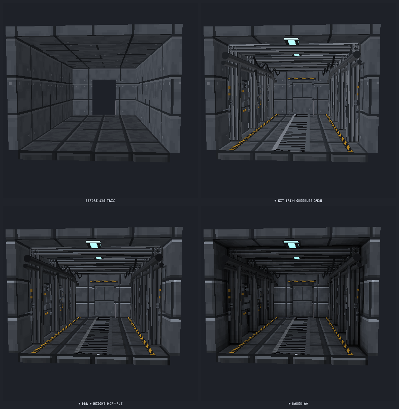
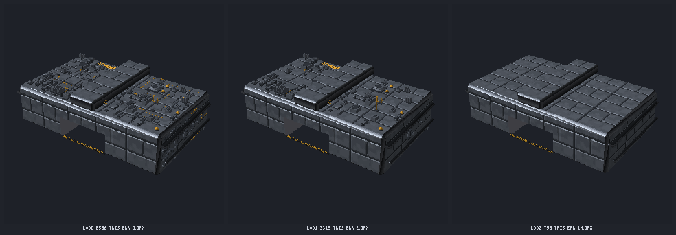
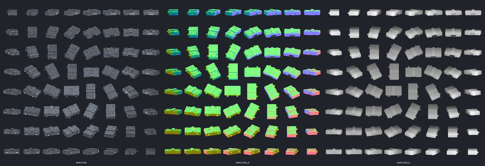
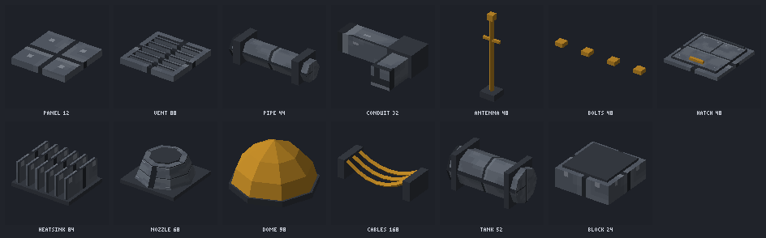

`node docs/surface/build-demos.mjs` rebuilds these renders. `art_help {topic:"3d"}` has every option plus recipes for hull greebling, a corridor with one trim sheet, a pipe run and LOD + impostor for a city block. Skill: `hard-surface`.

### Materials v2: render data for modern renderers

Opt-in per part, canvas or model; models that use none of it export the same bytes as before.

- **Material extensions:** presets `painted_hull` (clearcoat), `brushed_metal` (anisotropy + streaked direction map), `glass_canopy` (transmission + volume + ior), `cloth` (sheen), `neon` (emissive strength), `skin` (diffuse transmission + SSS thickness); or fields `emissive:{color, strength, animate}`, `clearcoat`, `anisotropy`, `transmission`, `ior`, `sheen`, `subsurface`, `height` (parallax height texture), `detail` (tiling detail albedo + normal). `art_model material {name, material, preset|set}` edits model materials after creation.
- **Baked light:** light parts (`{type:"light", kind:"point"|"spot"|"area"}`), `export {lightmap}` = a coloured, quantised, dithered lightmap on TEXCOORD_1 (sun, sky, lights, emissive bounce), `probes` = SH9 light probes on a grid, `bake_ao:{bent:true}` = bent normals, `thickness` = SSS thickness.
- **Geometry and vertex data:** MikkTSpace-compatible TANGENT, part `displace` (adaptive, crack-free true displacement from the height map), `vertex_colors` (paint / masks / AO sets), `uv2` / `uv3`.
- **Packing and profiles:** ORM packing (`gltf_orm`, `roblox`, `unity_mask`), texture dedupe, `export {profile:"three"|"roblox"|"minimal"}` (Roblox: SurfaceAppearance maps <= 1024 px, meshes < 20k triangles, a report of what was dropped). Every v2 export runs an in-repo structural glTF validator.
- **Channels:** `preview {channel:"normal"|"orm"|"lightmap"|"bent"|"emissive"|"height"|...|"all"}`, and a channel dropdown in the web UI 3D viewer.

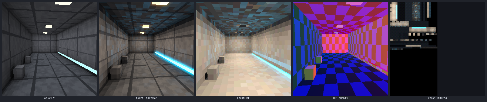

[docs/materials/README.md](../materials/README.md) has every demo (hull clearcoat, brushed metal, glass canopy, fabric seat, neon sign, parallax, detail maps) and the three.js hookups (lightmap, probes, pixel-snapped parallax, detail, bent normals, emissive flicker, SSS). `art_help {topic:"materials"}`.

### Connected textures (CTM)

```jsonc
{ "action": "ctm", "name": "marble_ctm", "ctm": { "base": "marble", "method": "full", "border": { "width": 2, "style": "bevel" } } }
{ "action": "create", "name": "hall", "parts": [ { "type": "floor", "texture": "marble_ctm", "cell": [0, 0, 0], "array": { "count": 4, "cell_step": [1, 0, 0] } } ] }
```

- **Methods:**
  - `full`: the 47-tile blob set.
  - `compact`: 5 tiles, combined by quarters.
  - `horizontal`, `vertical` and `horizontal+vertical`.
  - `top`.
  - `random`: weighted, picked deterministically from the world cell. `variants:[...]` lists the canvases; without `base`, the first variant is the base.
  - `repeat`: one big pattern over cols × rows cells.
  - `overlay`: tiles that creep in from neighbouring cells of another material.
- **Tileset sources:** a base texture plus a border style, or a hand-drawn `template`. A template holds either all the tiles, or the 5 compact tiles, which are expanded to 47.
- **Bake:** every world-tiled face using the tileset is split into world cells. Each cell takes its tile from its 8 neighbours across all placed pieces. A neighbour counts when it is on the same plane and has the same connect key: `material`, `texture`, or `tag` via `ctm_tag`. Walls fold around vertical corners.
- **Export:** writes `<name>.ctm.json` (method, tile order, masks, connect rule) and the tileset PNGs, for re-tiling at runtime.

Neighbour bits: N=1 NE=2 E=4 SE=8 S=16 SW=32 W=64 NW=128 (N = up on walls, −Z on floors). Reference selection for engines:

```js
/**
 * ctmTileFor(neighbors, method, opts) -> tile index into the tileset (compact: [tl, tr, br, bl]
 * indices of the 5 compact tiles). neighbors: 8-bit mask (N1 NE2 E4 SE8 S16 SW32 W64 NW128),
 * an array of 8 booleans in that order, or {n, ne, e, se, s, sw, w, nw}.
 * opts: cell [x, y, z?] (random, repeat), weights (random), seed (random), repeat [cols, rows].
 */
function ctmTileFor(neighbors, method = 'full', opts = {}) {
  const K = ['n', 'ne', 'e', 'se', 's', 'sw', 'w', 'nw'];
  let m = 0;
  if (typeof neighbors === 'number') m = neighbors & 255;
  else if (Array.isArray(neighbors)) neighbors.forEach((v, i) => { if (v) m |= 1 << i; });
  else K.forEach((k, i) => { if (neighbors && neighbors[k]) m |= 1 << i; });
  const blob = (x) => {
    let r = x & 85; // edges N E S W
    if (x & 1 && x & 4 && x & 2) r |= 2;
    if (x & 4 && x & 16 && x & 8) r |= 8;
    if (x & 16 && x & 64 && x & 32) r |= 32;
    if (x & 64 && x & 1 && x & 128) r |= 128;
    return r;
  };
  const N = !!(m & 1), E = !!(m & 4), S = !!(m & 16), W = !!(m & 64);
  const cell = opts.cell || [0, 0, 0];
  const hash = () => {
    let h = (opts.seed ?? 1) ^ 0x9e3779b9;
    for (const v of [cell[0] | 0, cell[1] | 0, (cell[2] ?? 0) | 0]) { h = Math.imul(h ^ v, 0x85ebca6b); h ^= h >>> 13; h = Math.imul(h, 0xc2b2ae35); h ^= h >>> 16; }
    return (h >>> 0) / 4294967296;
  };
  switch (method) {
    case 'full':
    case 'overlay': {
      if (!ctmTileFor.blobIndex) {
        const masks = [...new Set([...Array(256).keys()].map(blob))].sort((a, b) => a - b);
        ctmTileFor.blobIndex = new Map(masks.map((x, i) => [x, i]));
      }
      // overlay: bits mean "the other material is there"; its tiles are the blob set of the complement
      return ctmTileFor.blobIndex.get(blob(method === 'overlay' ? ~m & 255 : m));
    }
    case 'compact': {
      const q = (v, h, d) => (v && h ? (d ? 1 : 4) : v ? 3 : h ? 2 : 0);
      return [q(N, W, m & 128), q(N, E, m & 2), q(S, E, m & 8), q(S, W, m & 32)];
    }
    case 'horizontal': return (W ? 1 : 0) | (E ? 2 : 0);
    case 'vertical': return (N ? 1 : 0) | (S ? 2 : 0);
    case 'horizontal+vertical': return (N ? 1 : 0) | (E ? 2 : 0) | (S ? 4 : 0) | (W ? 8 : 0);
    case 'top': return N ? 0 : 1;
    case 'random': {
      const w = opts.weights && opts.weights.length ? opts.weights : [1];
      let r = hash() * w.reduce((a, b) => a + b, 0);
      for (let i = 0; i < w.length; i++) { r -= w[i]; if (r < 0) return i; }
      return w.length - 1;
    }
    case 'repeat': {
      const [cw, ch] = opts.repeat || [1, 1];
      const mod = (a, n) => ((a % n) + n) % n;
      return mod(cell[0], cw) + mod(cell[1], ch) * cw;
    }
    default: throw new Error(`unknown CTM method "${method}"`);
  }
}
```

### Ships, interiors, industrial kits and megastructures

Big-budget sci-fi set pieces at a pixel-texture budget (renders below and in `docs/ships/`, rebuilt by `node docs/ships/build-demos.mjs`). Designs from the templates and generators are original and seeded.

- **Walkable hero ship.** `create {template:"gunship"}` builds an original 25 m VTOL gunship (maker ORVANE, class TERN) at true scale (32 px = 1 m) with a walkable interior in the same model. The exterior is a faceted, chined fuselage wedge with a dorsal spine, side sponsons, a heavy chin, separate bevelled armour slabs, armoured wing pylons and faceted VTOL nacelles. Inside: a corridor with chamfered portal arches, grating and blue edge strips, a weapon rack, personal storage and a component bay, a round airlock with a boarding ladder, a hold and a cockpit behind multi-pane glazing. Renders: `docs/ships/hero_*.png`, rebuilt by `node docs/ships/build-hero.mjs`.
- **Player metrics and `walk_check`.** One shared set of metrics (1.8 m capsule, doors at least 1.2 x 2.1 m, corridors at least 1.4 x 2.3 m, stairs at most 0.2 m per step and 38 deg, slopes 35 deg, ramps 20 deg, hull at least 0.15 m thick) drives the kit and `art_model walk_check {name}`, which reports blocked doors, headroom (including seated head clearance), unreachable areas, floor gaps, interior parts poking through the hull and metric violations. `export {walk:true}` adds a navmesh node, box colliders per room, door / ladder / lift trigger volumes, seats and spawn points.
- **Walkable hull capabilities.** `hull {shell, openings}` gives the hull a real wall with cut openings and visible rims; `glazing` sets mullioned glass into an opening; `ring_door` is a round airlock door; `portal_arch`, `locker_wall`, `screen_arm`, `pilot_seat`, `terminal`, `stair_run` and clutter pieces furnish interiors; `decal` adds stencils, serials, labels, arrows and chevrons; `figure` is a 1.8 m scale silhouette.
- **Kit textures by default.** `kit_<name>` and tinted `kit_<name>_<rrggbb>` references resolve to built-in painted pixel textures (with normal maps and metal/rough) when there is no canvas of that name, so kit pieces, templates and generators are textured out of the box. `preview {mood:true, ao:true}` lights them per pixel with the model's own lights plus key, fill and rim light.

- **Hull from design curves.** `{type:"hull", length, plan:[[t, half_width]], profile:[[t, top, bottom]], sections:[[t, "hex"|"wedge"|"box"|2.6|{points, chamfer}]]}` lofts a closed hull (t 0 = tail, 1 = nose). Polygon corners stay hard creases (`crease` sets the smoothing angle). `panel_lines` cuts grooves, `plates` raises armour, `carve:{mask}` recesses quads from a canvas, and `uv:"fit"` maps one livery canvas over the hull. The surface stays closed.
- **Components.** `on_hull:{hull, t, u, lift?, mirror?}` puts any part or assembly on the hull surface. Assemblies are one part that expands into several: `canopy`, `engine`, `thruster`, `wing`, `fin`, `landing_gear`, `ramp`, `cargo_door`, `turret`, `rotary_cannon`, `hardpoint`, `antenna`, `sensor_dome`, `rcs_quad`, `intake`, `vent`, `armor_plate` and `container_rack`. A named assembly becomes rig nodes with clips (`gear_retract` / `gear_deploy` merged over every leg, `canopy_open`, `ramp_open`, `wings_fold`, `vtol_down`, `<turret>_scan`) and sockets (`<gear>_contact`, `<turret>_muzzle`, plumes, hardpoints). An unnamed assembly is static in the given state (`open`, `deployed`).
- **Templates.** `create {template:"fighter"|"dropship"|"hauler"|"capital_ring", seed, textures:"kit"}` builds a complete ship that you refine by part name. `art_model kit` paints the kit textures (hull, deck, wall, screen, glow, hazard, rock and more, with height, metal, rough and emissive layers). `art_model livery` paints paint masks, stripes, hazard zones, decals, a seeded original emblem and wear onto a canvas mapped over the hull.
- **Interiors.** The interior kit snaps to a 64 px deck grid: `corridor` (straight, L, T, X, end), `room`, `door` (bulkhead, blast, hatch), `airlock`, `ladder`, `lift`, `seat`, `console` (MFD screen markers for UI textures), `bridge`, `engine_room`, `quarters`, `cargo_bay`, `hangar`, `med_bay` and `armoury`. `generate {kind:"interior", hull:<ship>}` fits a deck plan inside the hull: it places doors where the exterior ramp and hatches are, writes window parts back onto the ship, and adds cull rooms for portal culling.
- **Exteriors and city.** The kit includes `tower`, `dish`, `tank`, `silo`, `crane`, `gantry`, `pipeline`, `scaffold`, `truss` (warren, pratt, x or k bracing), `catwalk`, `landing_pad`, `hangar_shell`, `hab_module`, `rock_platform`, `shaft`, `atrium`, `bridge_walk`, `lift_shaft`, `cable_web`, `pipe_wall`, `market_stall` and `sign_frame`. `generate {kind:"mining_colony"|"market", seed}` lays out instanced kit models, with walkable floors in the report.
- **Neon and light.** `neon {text}` builds emissive tube text from the pixel font, or from a canvas of 1 px strokes. `sign` is a lit sign box and `holo` an additive card. `light` exports node extras so the game can place real lights. `fog_card` and `god_ray` are additive banded falloff planes. `preview {mood:true}` lights a dark scene with the model's own light markers.
- **Budgets.** `budget {name}` reports the scale class, triangles, a LOD estimate, draw calls and the costliest parts. Export options:
  - `budget:"fighter"` refuses an over-budget export.
  - `split:true` keeps every mesh under 20 000 triangles (the Roblox MeshPart limit).
  - `static:true|"<pose>"` bakes a rigged ship so lods, impostor and cull apply.

| Hero gunship | Interior | Scale |
| --- | --- | --- |
| 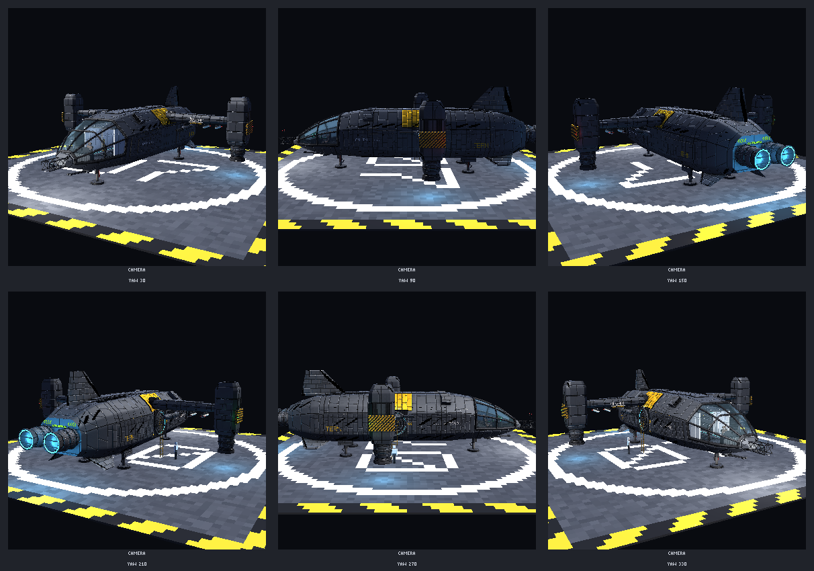 | 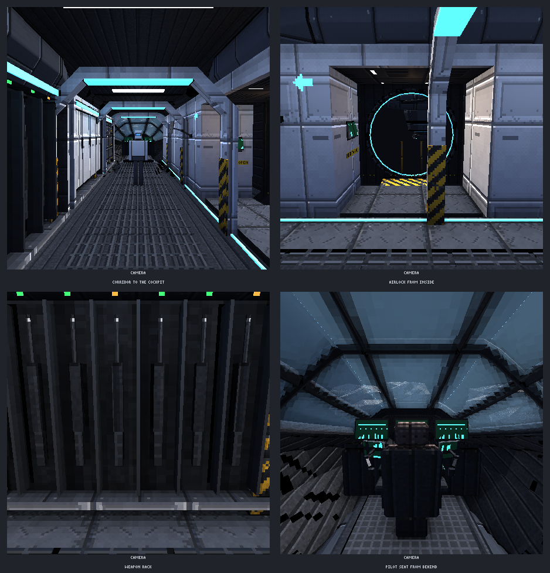 | 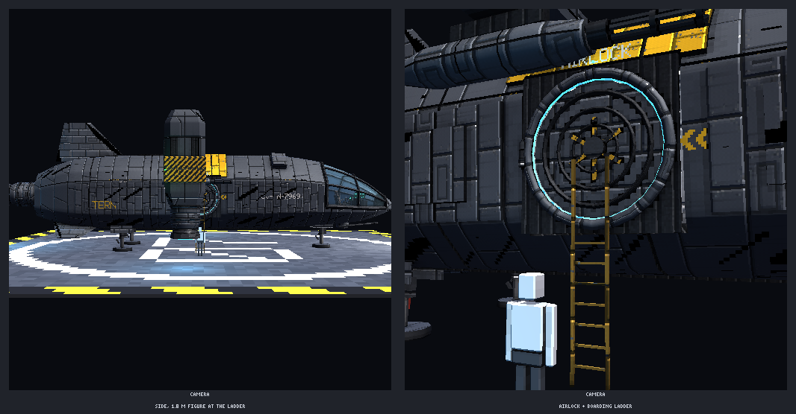 |
| **Fighter** | **Dropship** | **Hauler** |
| 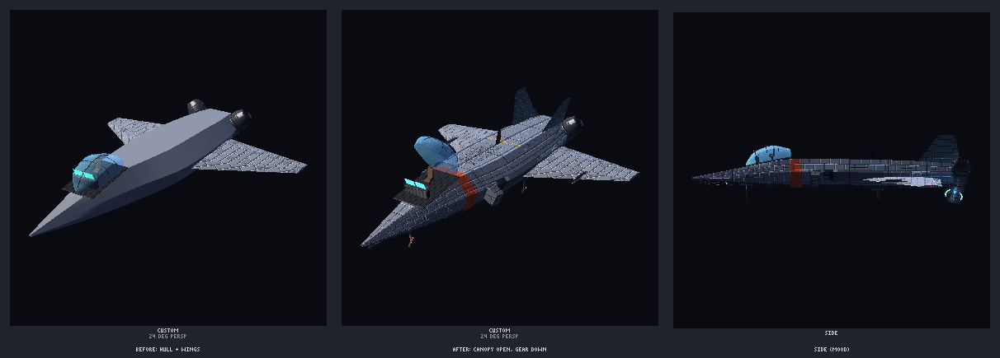 | 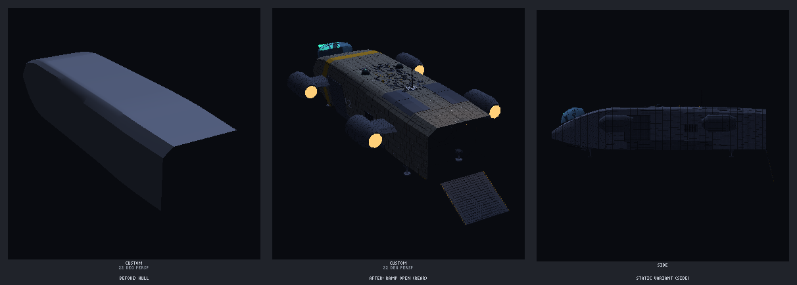 | 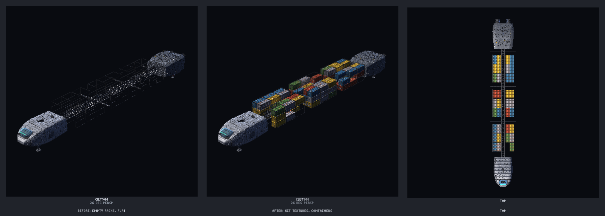 |
| **Kit pieces** | **Mining colony** | **Underground market** |
| 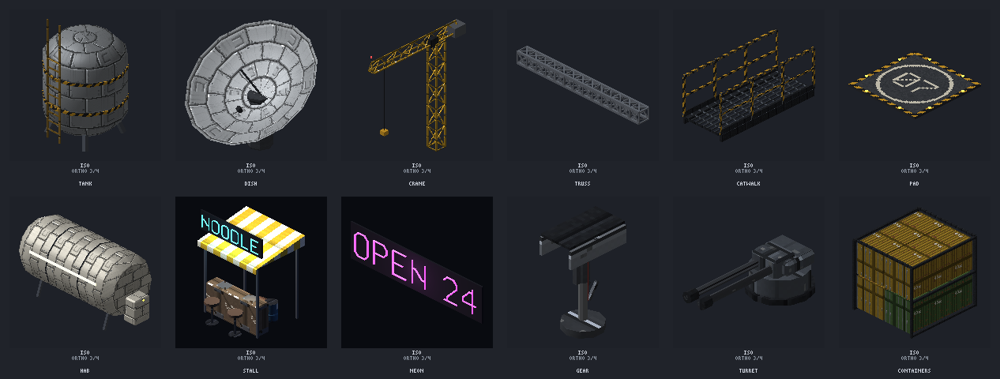 | 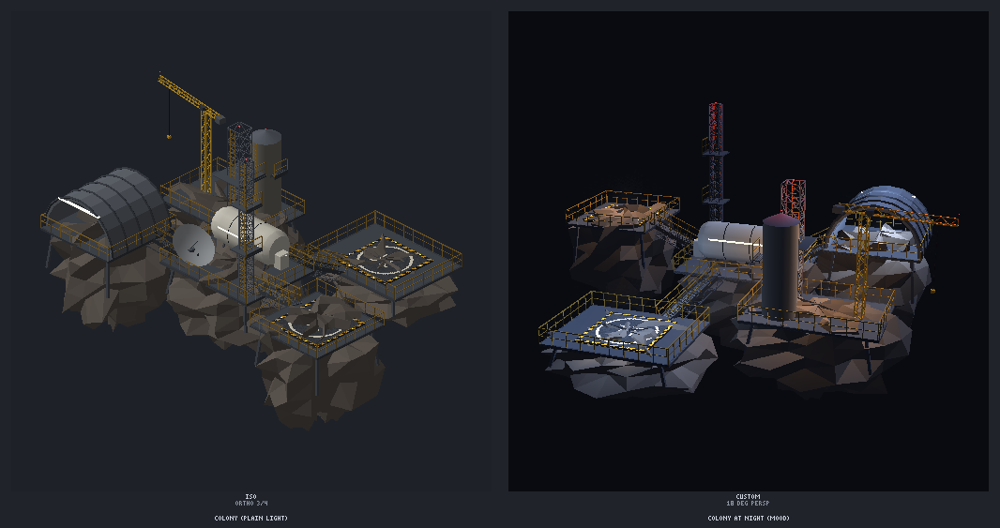 | 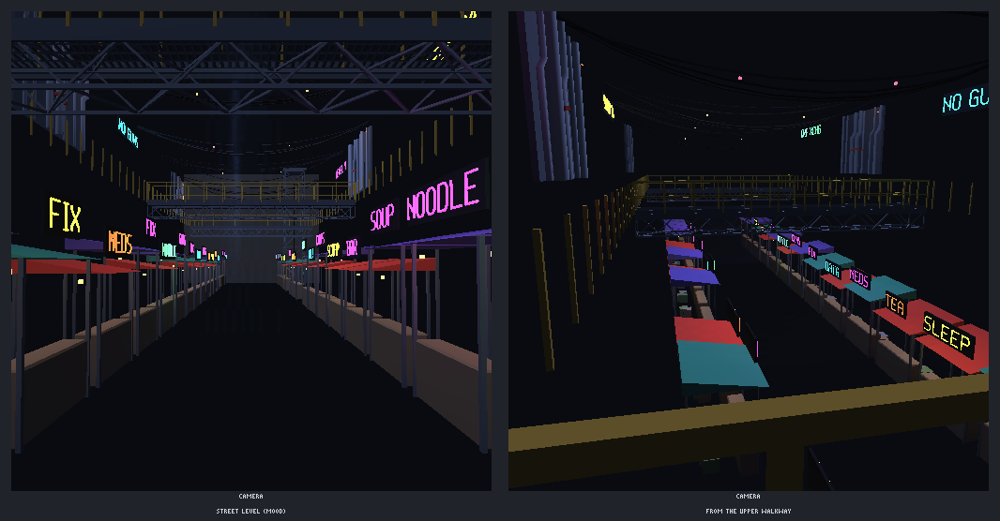 |

### Damage and destruction

Seeded, nested damage states, fracture into watertight chunks and blend-ready damage exports: see [docs/damage/README.md](../damage/README.md).

### Skeletal skinning, mesh processing

- **Skinning** (`skeleton`, `skin`, `weights`): bone hierarchies from templates (`humanoid`, `exosuit`, `quadruped`, `chain`, `landing_gear`), from rigid parts or from an `art_anim` skeleton; heat / distance / rigid weights (at most 4 influences), blend shapes and correctives; `animate {retarget}` plays art_anim clips on 3D bones; glTF skins and a Roblox profile. Demos and the recipe: [docs/skinning/README.md](../skinning/README.md).
- **Mesh processing** (`boolean`, `remesh`, `decimate`, `cluster_lod`, `visibility`): exact booleans, voxel / quad / cleanup remeshing, error-bounded decimation, a Nanite-style cluster LOD DAG with a pure-JS runtime selector, and cells / portals / PVS. Details and the `.clod` format: [docs/meshproc/README.md](../meshproc/README.md).

### World-space UVs at runtime (three.js)

The same mapping the exporter bakes, for runtime-placed tiles. Shown for a Z-up scene; for Y-up swap `up` to `(0,1,0)` and the cap branch accordingly.

```js
const pxPerUnit = 32, texSize = 32; // texels per tile
material.onBeforeCompile = (shader) => {
  shader.uniforms.uvScale = { value: pxPerUnit / texSize };
  shader.uniforms.uvOrigin = { value: new THREE.Vector3(0.5, -0.5, 0) }; // uv_origin [16,0,16] px, glTF Y-up -> Z-up
  shader.vertexShader = shader.vertexShader
    .replace('#include <common>', `#include <common>
      uniform float uvScale;
      uniform vec3 uvOrigin;`)
    .replace('#include <uv_vertex>', `#include <uv_vertex>
      vec3 wp = (modelMatrix * vec4(position, 1.0)).xyz - uvOrigin;
      vec3 wn = normalize(mat3(modelMatrix) * normal);
      vec3 up = vec3(0.0, 0.0, 1.0);
      vec3 t = abs(dot(wn, up)) > 0.999 ? vec3(1.0, 0.0, 0.0) : normalize(cross(up, wn));
      vec3 b = abs(dot(wn, up)) > 0.999 ? (dot(wn, up) > 0.0 ? vec3(0.0, 1.0, 0.0) : vec3(0.0, -1.0, 0.0)) : cross(wn, t);
      vMapUv = vec2(dot(wp, t), -dot(wp, b)) * uvScale;`);
};
```
