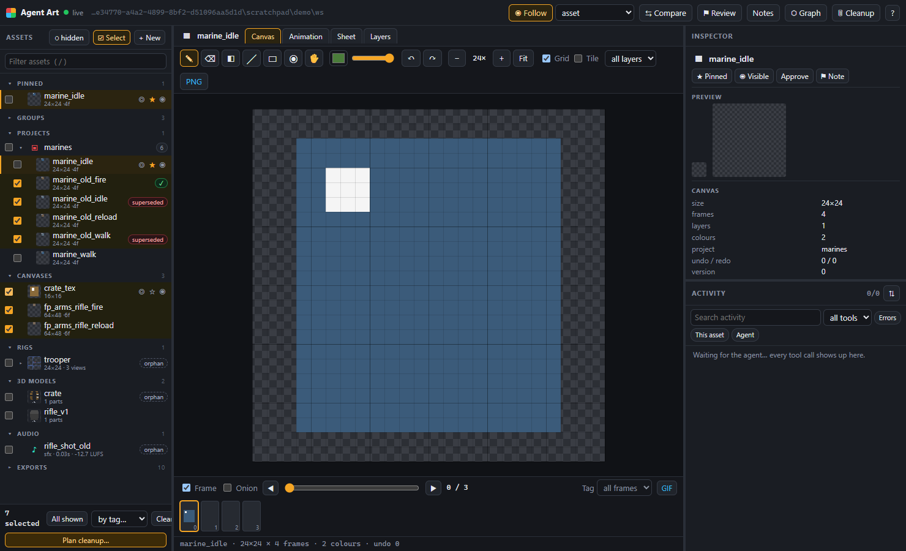
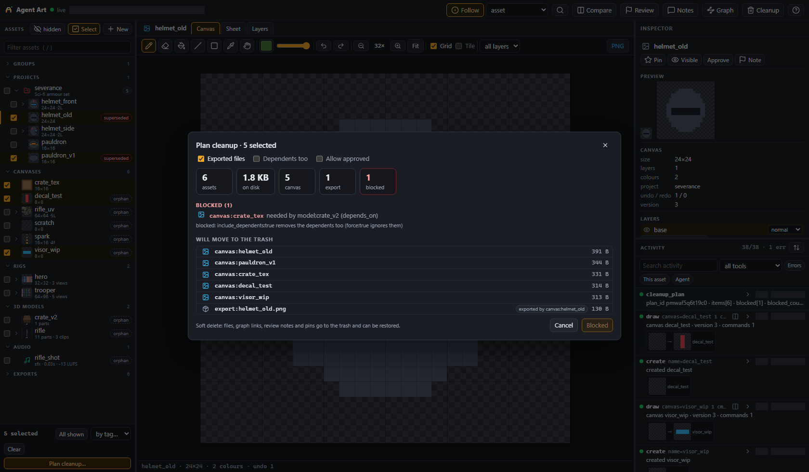
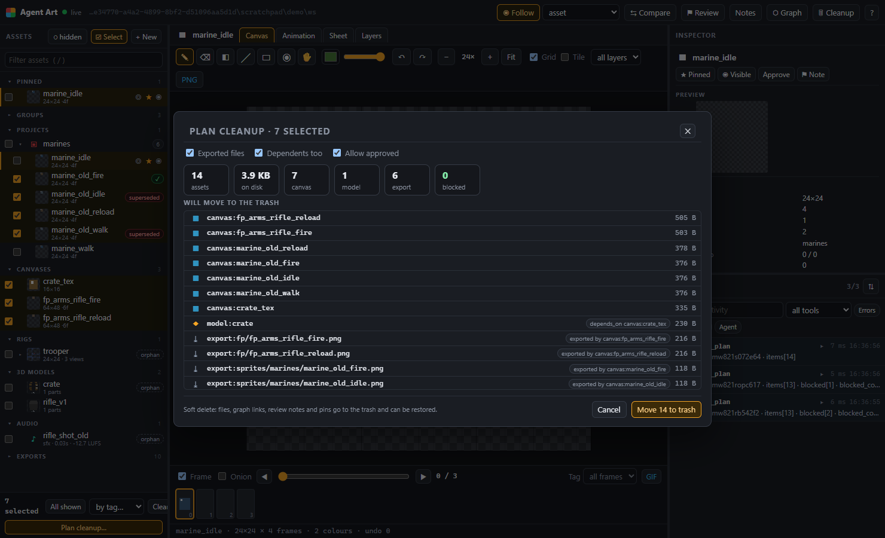
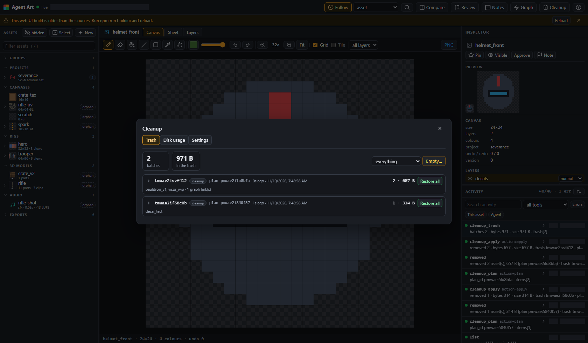
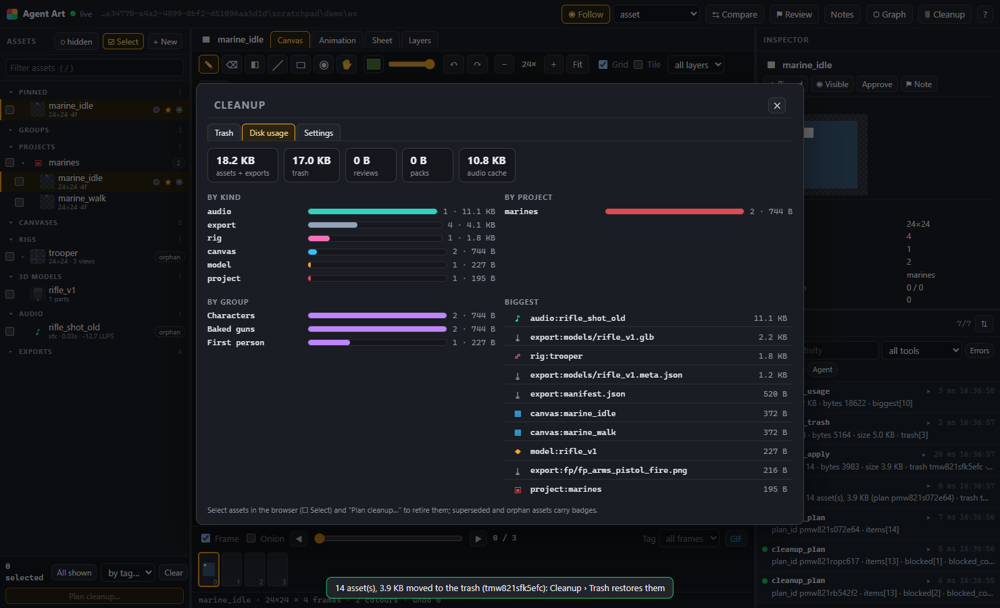
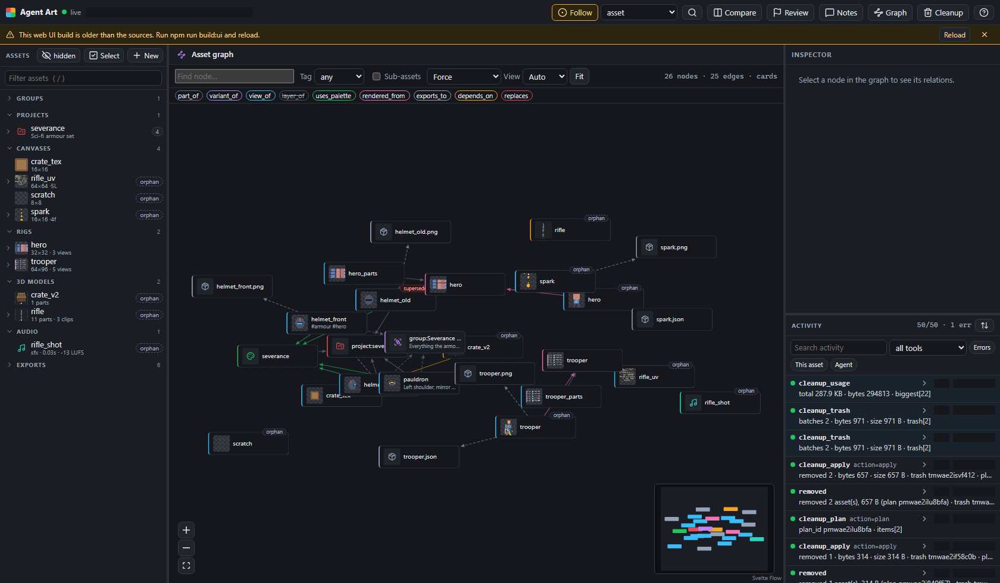

# Cleanup: retiring superseded art

[Back to the README](../../README.md)

When a set of assets is replaced (baked-gun sprites by rigged characters, old FP strips by separate arm and gun sweeps), `art_cleanup` removes the old set without leaving junk and without breaking what still uses it.

```jsonc
{ "action": "replace", "pairs": [{ "old": "marine_old_idle", "new": "marine_idle" }] }  // old is now superseded
{ "action": "plan", "select": { "superseded": true }, "include_exports": true }           // dry run: counts, sizes, first 10, blockers
{ "action": "apply", "plan_id": "p…", "confirm": true }                                    // soft delete into workspace/trash/<batch>
{ "action": "restore", "ids": ["t…"] }                                                     // or {"ids":["canvas:marine_old_idle"]}, {"all":true}
{ "action": "empty", "older_than": "30d", "confirm": true }                                // the only hard delete
```

- **Dependency-aware.** An asset that a kept asset needs blocks the plan: the parts of a kept rig (a rig is one asset with its parts canvas), the texture of a kept model, the project palette of kept canvases (`depends_on`, `uses_palette`, `part_of` a project). `include_dependents: true` removes those dependents too (`"all"` also takes soft users such as `rendered_from` sprites), and `force: true` ignores them. Soft users are listed as warnings.
- **Protected.** Assets approved in review need `allow_approved: true`. Pinned assets produce a warning.
- **Export files** are only moved when they are inside `workspace/exports` or a folder the user allowlists in `cleanup.allow_paths` (in `<workspace>/config.json`, or the web UI under Cleanup › Settings; the agent cannot change it). Symlinks, paths that resolve outside the allowed folder, path traversal and workspace internals are refused. Moved files keep their original paths in the trash, so restore returns them. `prune_manifest: {file, keys?}` also removes entries from a JSON manifest (with no keys, the entries that name a removed file are removed); the original is kept in the trash.
- **Logged.** Every apply or restore is a `removed` / `restored` entry in the activity timeline and in the graph's event log, with the plan id and the trash batch id.
- **Compact.** Plans and results return counts and the first 10 items (`limit`, or `full: true` for everything).
- **Single deletes** (`art_canvas`, `art_model`, `art_audio`, `art_project` `delete`) keep their old graph behaviour but now move the files to the trash too, so they can be restored. `cleanup.trash_deletes: false` in `config.json` restores hard deletes.

In the web UI, **☐ Select** in the asset browser adds checkboxes (Shift+click selects a range; *All shown* takes the filtered rows; *by tag* adds a tag), and **Plan cleanup…** shows the dry run with blockers and sizes before you apply it. The **🗑 Cleanup** button opens the Trash (restore or empty, with sizes), Disk usage (by kind, project and group, biggest first) and Settings. Superseded and orphan assets carry badges in the browser and in the graph.

| Select | Plan (blocked) | Plan |
| --- | --- | --- |
|  |  |  |
| **Trash** | **Disk usage** | **Graph badges** |
|  |  |  |

## Adding an asset kind (registration hook)

A new kind of asset (planets, ships, animation sets, ...) takes part in the asset graph and in cleanup through one call in its own module, `registerAssetType` from `src/assettypes.js`. No other file needs a per-kind case:

```js
import { registerAssetType } from './assettypes.js';
registerAssetType('planet', {
  list: (engine) => [...planets(engine).keys()],                       // required: every name of this kind
  files: (engine, name) => [path.join(dir(engine), `${name}.json`)],   // required for cleanup: every file it is made of
  unload: (engine, name, source) => planets(engine).delete(name),      // its files are already in the trash
  reload: (engine, name, source) => loadPlanet(engine, name),          // its files are back: load it again
  info: (engine, name) => ({ project, updated }),                      // optional: project / older_than / unused_since selectors, usage
  edges: (engine, add) => add('planet:mars', 'depends_on', 'canvas:mars_tex'), // optional: derived graph edges (depends_on = hard dependency)
  sub: ['planetlayer'],                                                 // optional: sub-node kinds (planetlayer:mars/clouds) owned by it
  container: false,                                                    // true: part_of edges into it are hard dependencies (like a project)
  flush: (engine, name) => {},                                         // optional: write pending in-memory changes before measuring / moving
});
```

Once registered, `planet:mars` (or the bare name `mars`) resolves in `art_graph`, `art_cleanup` selects it by kind, name, tag, group or project, dependencies through its edges block or cascade, and apply / restore move its files, graph links, notes and pins.
