# Damage and destruction

[Back to the README](../../README.md)

```jsonc
// art_model: nested damage states, pre-cut chunks, then a blend-ready export
{ "action": "damage", "name": "crate_a", "kind": "crate", "states": ["scuffed", "damaged", "wrecked"], "seed": 4 }
{ "action": "fracture", "name": "crate_a", "groups": [{ "part": 0, "pieces": 8, "debris": 2 }] }
{ "action": "preview", "name": "crate_a", "damage": "wrecked" }
{ "action": "export", "name": "crate_a", "damage": true, "bake_ao": true, "lods": [1, 0.5] }
```

`art_model damage` gives a model seeded, nested damage states (scuffed, damaged, wrecked or custom amounts): dents that respect part rigidity, lost or hinged panels with an inner frame and sparking wires, bent parts, shattered glass, scorch, wear, bullet holes, hull breaches, and fx sockets for sparks, smoke, fire, steam and leaks. `art_model fracture` pre-cuts parts into watertight chunks with mass, centre and collision hulls. `art_model export {damage:true}` writes the states as nodes (with LODs), blend masks and a manifest; `damage:{profile:"roblox"}` writes MeshParts with baked decals. Details: `art_help {topic:"damage"}`.

- The damage mask UVs take the first free UV set, so baked AO, lightmaps and thickness (TEXCOORD_1) and `uv2` / `uv3` work on damage exports (`blend.uv_set` in the manifest). Without them the mask stays on TEXCOORD_1.
- The blend-ready intact mesh keeps its chart UVs, damage RGBA and dent morph on every LOD level; the intact overlay shells carry the same morph.
- Rigs survive: named parts, sockets and clips are kept in every state (a damaged door still opens, a wrecked turret still turns), and skinned models get every state skinned on the shared armature. Skinned damage takes LODs (weights carried through the decimation), the Roblox profile (4 influences, 50 bones per MeshPart, split when over), baked AO / light on the bind pose and fracture (rigid chunks ride their nearest bone). Rigged and skinned damage files pass both glTF validators.
- Open parts (capless tubes, plates) are closed before fracture and breaches (`close:false` refuses / keeps them open).
- `art_draw damage` on sprites scales its features with the damaged box, so 0.25 / 0.6 / 1.0 read clearly at 128×192.

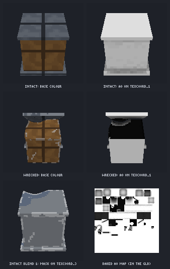
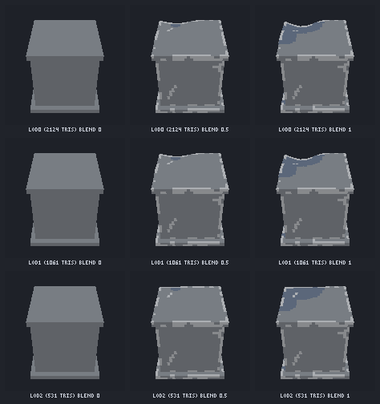
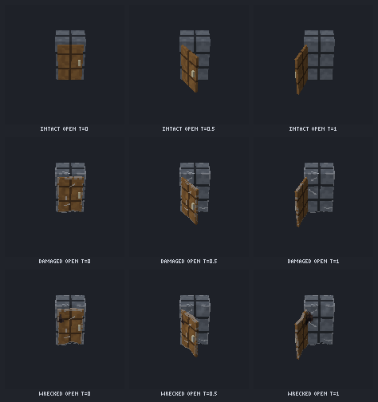
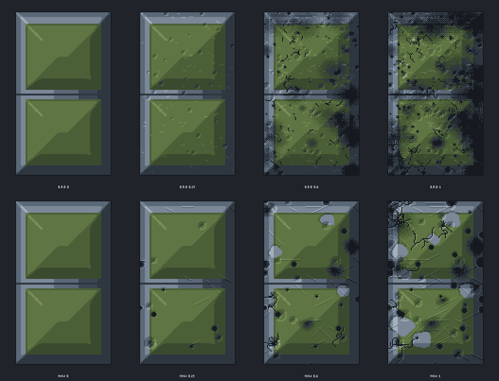

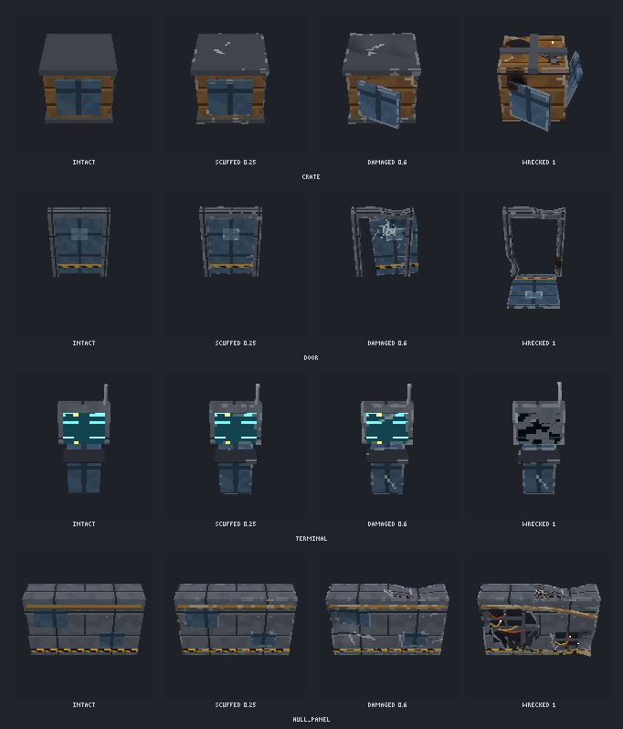
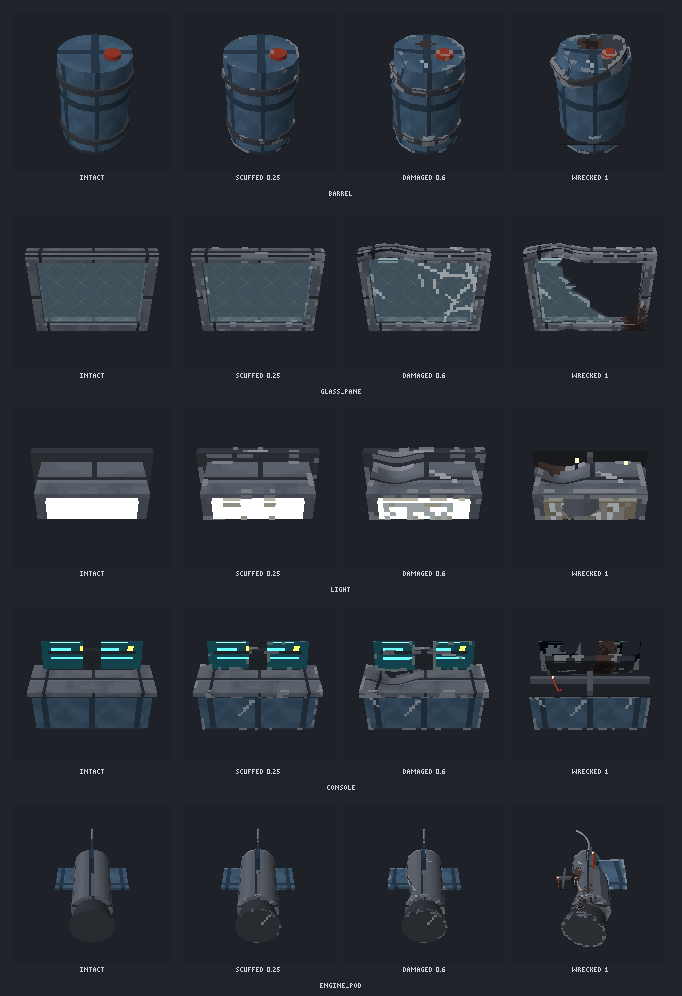
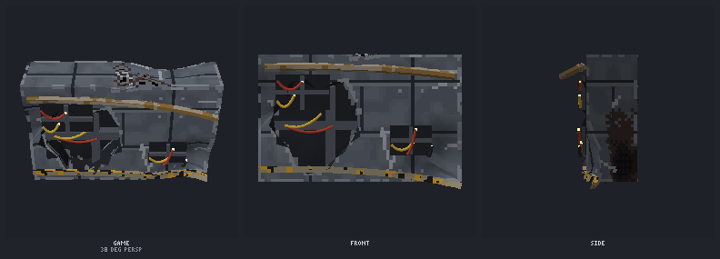
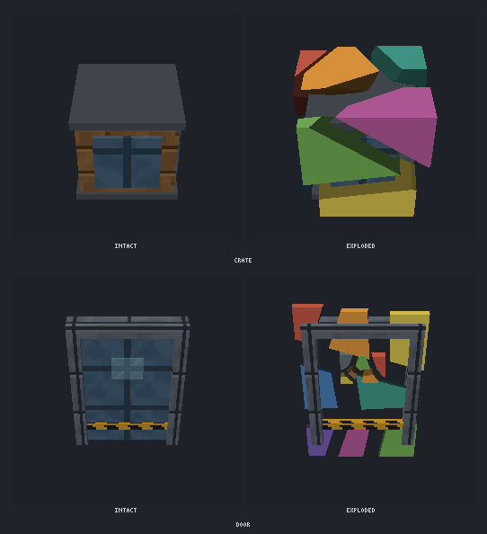
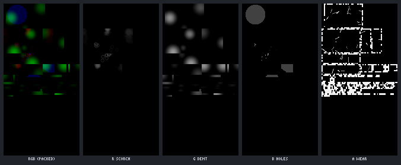
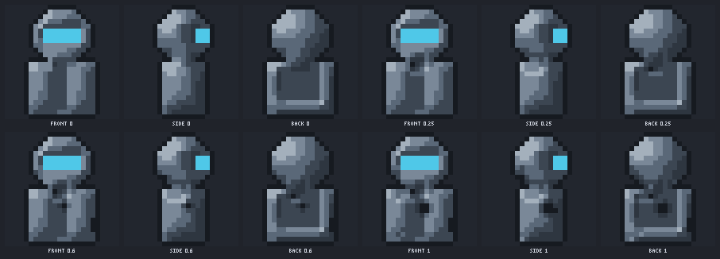

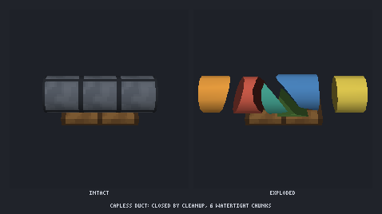
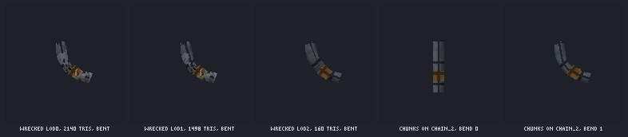
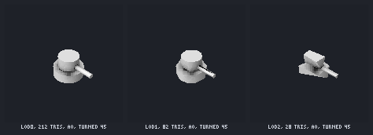

`node docs/damage/build-demos.mjs` rebuilds the renders in `docs/damage/` with Agent Art's own ops.
