# First-person viewmodels: `art_fp`

[Back to the README](../../README.md)

First person built from separate pixel sprites, so the gun reads as 3D with no 3D models in the game (the fp v2 runtime contract). The arms are animated once per **handling class** (pistol, smg, rifle, dmr, shotgun, lmg, sniper, launcher, unarmed, knife, baton, grenade, med, tablet). Guns, magazines, attachments and items are yaw × pitch sprite sweeps that the game turns with look sway and snaps onto per-frame sockets. Adding a gun or a scope never touches the arms.

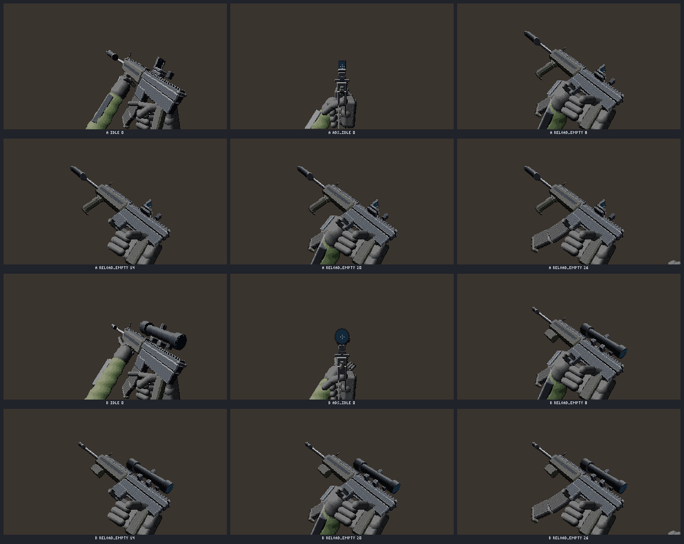

- **Arms:** a 3D skeleton in eye space (clavicle, upper arm, forearm, palm, thumb, index and grouped fingers, both sides) solved with two-bone IK onto the anchors the game draws, so both palms stay on the grip and support at every frame. Finger presets cover trigger, support under the handguard, vertical grip, angled grip, magazine, charging-handle pinch, pistol cup, knife hammer grip, grenade hold, pin pull, open palm and fist. Every bone is a part sprite rendered once per view bucket (forearm foreshortening, back of the hand or palm) and placed with RotSprite rotation, so frames stay palette-stable. Skins (`mec`, `severance`) swap sleeves, bracers and gloves without re-animating.
- **Sweeps:** an `art_model` gun, magazine, attachment or item rendered over a yaw × pitch grid into sheets of at most 1024 px, with every anchor per cell (`grip`, `support`, `mag_well`, `muzzle`, `optic`, `muzzle_mount`, `underbarrel`, `sight`, `mount`). One camera for all of them, so pixels per metre match. Moving parts export as state variants (`rifle@bolt_back`, `pistol@slide_locked`, `shotgun@pump_back`), and optics add a lens layer (`att:scope_4x@lens`).
- **Clips per class:** idle, walk, sprint, fire and fire_ads (recoil kick and recovery), ads_in and ads_idle (iron sight on the frame centre), reload and reload_empty (mag out, pouch, new mag, seat, charging handle) with events, charge, draw, holster, inspect, jam_clear, firemode, check_mag, melee, a one-handed grenade throw over the held gun, use_med and interact. There is a shotgun shell loop, a sniper bolt cycle, an LMG cover, knife slash, stab and a three-hit combo, baton strike with riot shield up and bash (the shield is a second held item, `item2`), grenade cook and throw, med bandage, stim and kit, and tablet raise and use. `@vgrip` / `@agrip` variants move the support hand onto a foregrip.
- **Check:** hands on every gun of a class, the ADS sight centred to 1 px, magazine hand-offs, anchor continuity across the sweep, grip geometry against the class (`handling.js` `conform`) and attachment fits.
- **Kit and hand edits:** `kit {guns?, mags?, attachments?, items?}` builds the editable `art_model` kit (the standard gun of every class at its grip geometry, magazines, attachments, items). `paint {out, sweep}` moves sweep sheets out to canvases (the default `mode:"export"`), and `paint {out, sweep, mode:"import"}` writes them back with the anchors kept, so any cell can be retouched by hand. (In 0.10.0 `art_fp paint` could only import; use `agent-art op fp_paint` with `action:"export"|"import"` on that version.)


```js
art_fp { action:"sweep", out:"public/assets" }                       // fp_guns / fp_mags / fp_attach
art_fp { action:"batch", out:"public/assets", skins:["mec","severance"] } // fp: arms strips + sockets
art_fp { action:"composite", out:"public/assets", class:"rifle", clip:"reload_empty", frame:14, attachments:{ optic:"scope_4x", muzzle:"compensator", underbarrel:"angled_grip" } }
art_fp { action:"check", out:"public/assets" }
```

| Look sway (the gun turning through its sweep) | Inspect | Pistol reload |
| --- | --- | --- |
| 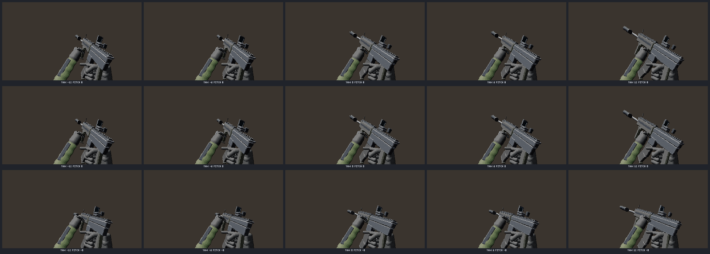 | 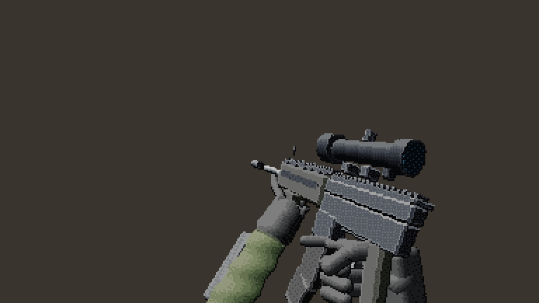 | 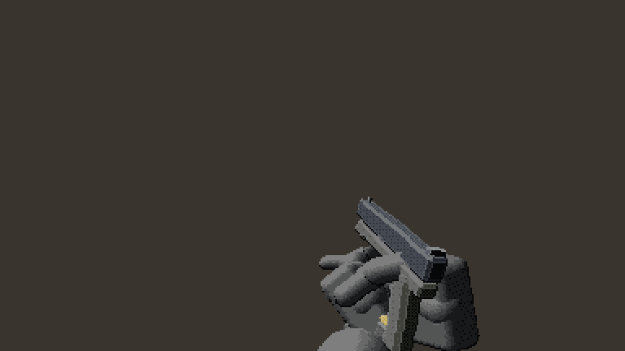 |

`art_help {topic:"fp"}` has the details. `node scripts/fp-demos.js` rebuilds `docs/fp/`.

| Rifle reload (empty) | Knife slash | Grenade throw |
| --- | --- | --- |
| 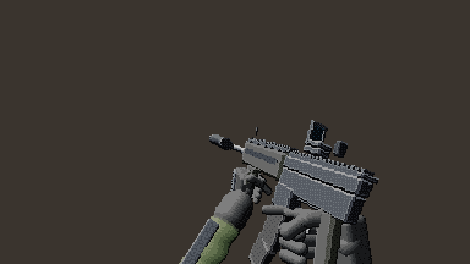 | 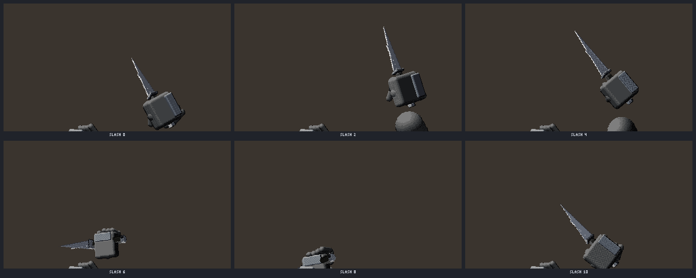 | 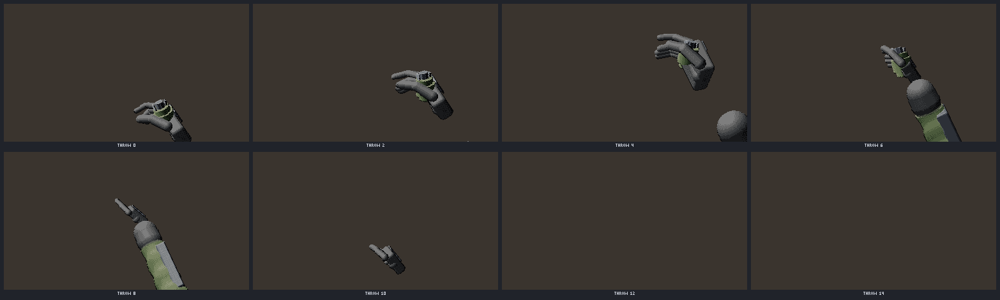 |

## Hand-drawn first person (2D sources, no 3D)

The same fp v2 contract from pure 2D art: draw a few key views, and `art_fp` builds the sweeps and arm strips from them. 2D and 3D sources mix (2D gun with 3D arms, 3D gun with 2D arms, all 2D).

- **`template {kind: gun|mag|attachment|item|arm, name, class?, view?}`:** a blank key canvas with a guides layer showing the class anchors in that view (named views hip, ads, reload, side, rear, top, or yaw / pitch / roll). Arm part canvases (upper arm and forearm per view bucket, hand per pose with back / front / trigger layers) come with joint, wrist and grip guides.
- **`anchors {canvas, set?, remove?, suggest?, accept?}`:** place, move and remove anchors in the canvas meta. `suggest` proposes anchors from the silhouette with a confidence, and warnings flag anchors off the opaque pixels or inconsistent between keys.
- **`sweep2d {out, sources?}`:** a few key drawings become the full yaw × pitch sweep, in the same files and manifests as `sweep`: card-plane perspective warp with a correction field through the anchors, nearest sampling from a Scale2x upscale and re-outlining, so the source palette and hard alpha are kept. Painted cells (`paint {mode:"import"}`) are kept as overrides.
- **`trace {skin, name}`:** a 3D arms skin exported as an editable 2D skin. `batch` takes 2D gun and skin names.
- **Hands against the gun:** keys carry paintable contact zones (`mask_grip`, `mask_guard`, `mask_fore`, `mask_pinch`) and an optional `height` layer. Finger pixels over a prop outside the zones go behind it, the trigger finger shows only in the guard opening, and `check` fails on fingers outside the zones or a magazine under 50 % visible.

| Rifle keys | Sweep grid | Contact zones | 2D rifle reload |
| --- | --- | --- | --- |
| 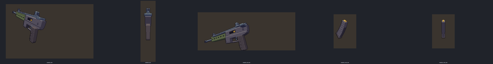 | 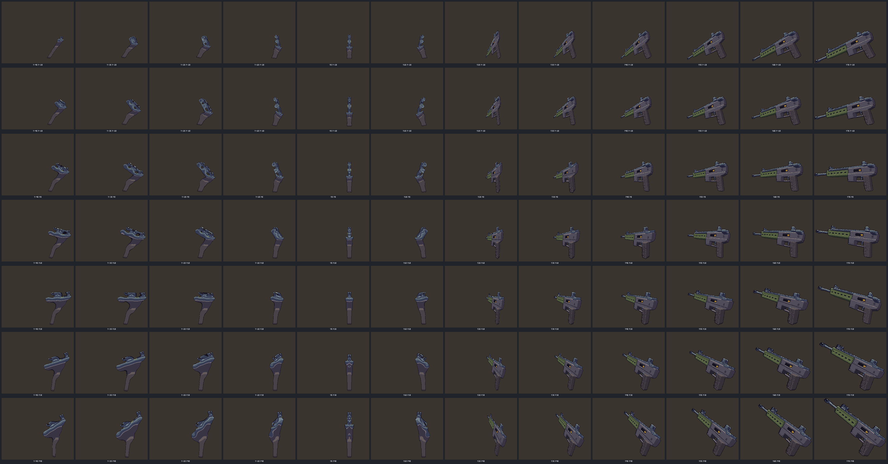 | 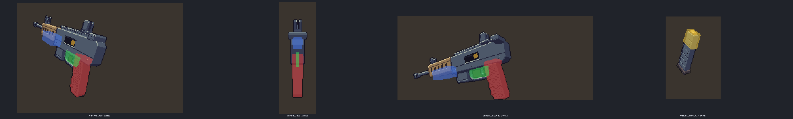 | 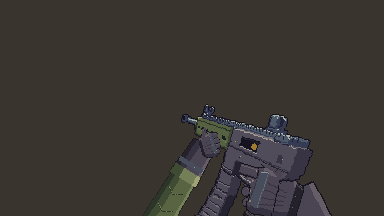 |

| Arm parts | Contact before / after | Mixed 2D and 3D sources |
| --- | --- | --- |
| 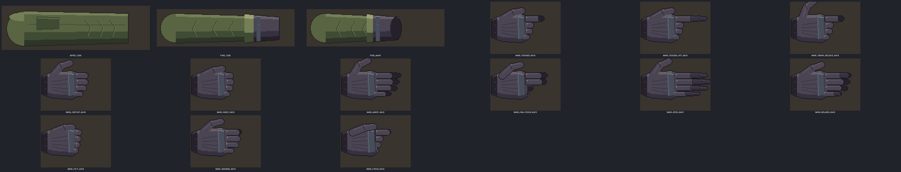 | 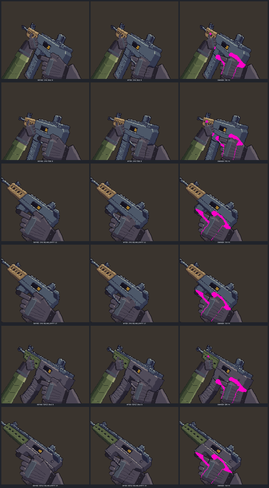 | 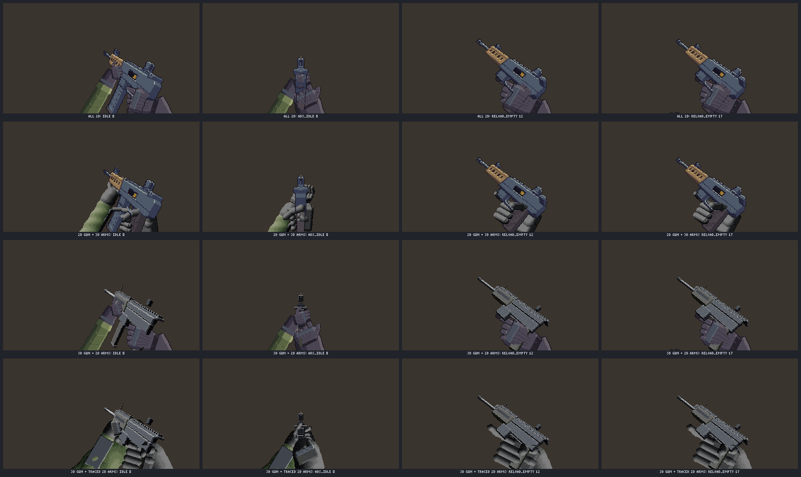 |

`node scripts/fp2d-demos.js` rebuilds `docs/fp2d/` (drawn with Agent Art's own ops in `scripts/fp2d-art.js`).

The older single-model route (an `art_model` `fp_rifle` / `fp_pistol` / `fp_arms` rig exported as glTF or rendered to sprite layers) is in [docs/3d/README.md](../3d/README.md#rigid-part-rigs-animation-clips-and-pre-rendered-sprites) and the `fp-weapon` skill.
