# Combat effects: `art_fx`

[Back to the README](../../README.md)

Seeded pixel-art flipbooks (muzzle flashes, tracers, impacts, decals, explosions, smoke, fire, sparks, steam, strobes) with engine metadata. Muzzle flashes are drawn per view: `side`, `front_side` and `back_side` (3/4 toward and away from the camera), `front` and `fp`; third-person metadata carries a per-facing sprite table. First-person flashes come as aim variants (`aims`, default 5, 25° apart), each drawn at its aim, listed in `fp.aims` so the runtime picks the nearest. Steam lists its art_audio sounds (`steam_vent` / `steam_leak` loops, `steam_hiss` one-shot). Details: `art_help {topic:"fx"}`.

```js
art_fx { action:"make", type:"muzzle", variant:"rifle", view:"side", seed:3 }
art_fx { action:"make", type:"muzzle", variant:"rifle", view:"fp" }          // aim variants (aims:5 by default)
art_fx { action:"make", type:"impact", variant:"metal" }
art_fx { action:"batch", preset:"all", seed:3, group:"combat" }             // + combat_contact.png
art_fx { action:"preview", type:"muzzle", variant:"rifle", over:{ canvas:"ar_fire", anchor:"socket_muzzle" } }
art_fx { action:"export", group:"combat" }                                   // validated combat.fx.json
```

- **Types:** `muzzle`, `tracer`, `casing`, `dust`, `impact` (per surface: metal, concrete, stone, glass, dirt, sand, water, flesh, armor, shield, electronics), `decal` (bullet holes per surface, scorch, blood, energy burns, with normal / height / emissive maps), `explosion` (frag, plasma, emp, incendiary), `smoke`, `fire`, `sparks`, `steam`, `strobe`, `haze` (distortion masks) and `particles` (8x8 cells). `list` returns the full table.
- **Deterministic:** every frame is a function of the options, the seed and the time, so the same input gives a byte-identical sheet. Colours come from hue-shifted ramps with ordered dither; `hue` shifts them and `palette` (a list or `"project:<name>"`) snaps them onto a palette.
- **Engine-ready:** sheets are at most 1024 px, and square cells use Roblox flipbook grids (2x2, 4x4, 8x8). Metadata per effect: blend mode, frames / fps / loop, pivot, facing, world size, emitter hints, a point-light intensity curve, first-person shake and flash, `art_audio` recipe names and Roblox settings.
- **Runtime:** `art_help {topic:"fx"}` has the three.js flipbook + light-curve snippet and the Roblox ParticleEmitter notes. Skill: `combat-fx`.

| Muzzles | Impacts per surface | Contact sheet |
| --- | --- | --- |
| 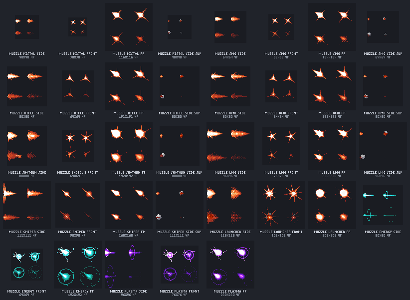 | 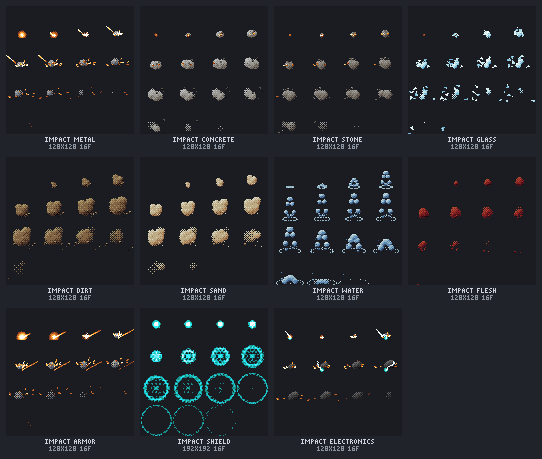 | 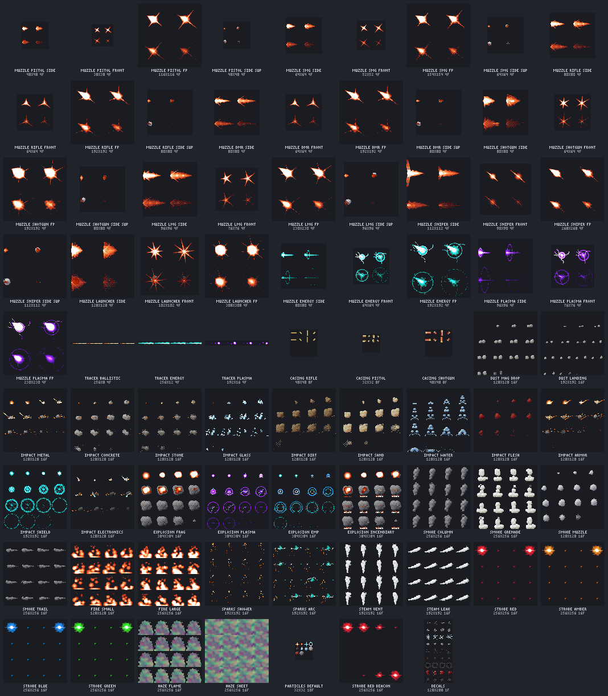 |

| Frag explosion | EMP | Large fire | Grenade smoke | Arc sparks | Metal impact |
| --- | --- | --- | --- | --- | --- |
| 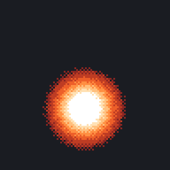 |  | 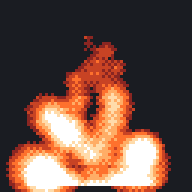 | 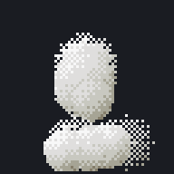 | 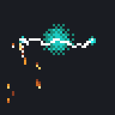 | 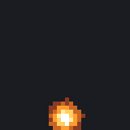 |

| fp rifle muzzle over the gun | Decals: albedo | Decals: normal |
| --- | --- | --- |
| 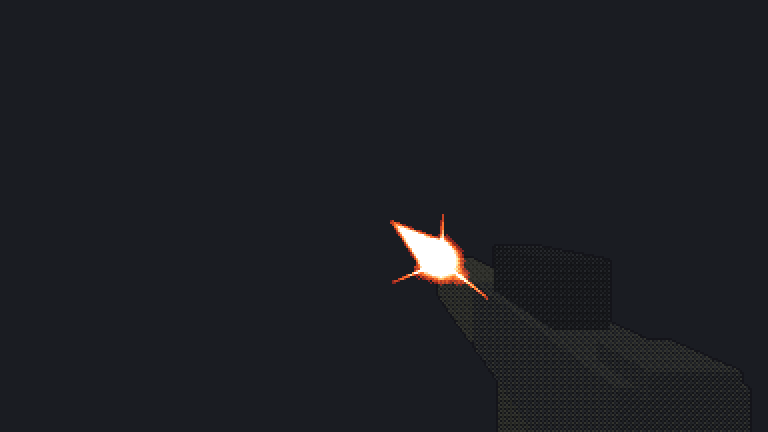 | 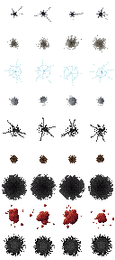 | 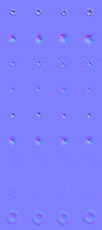 |

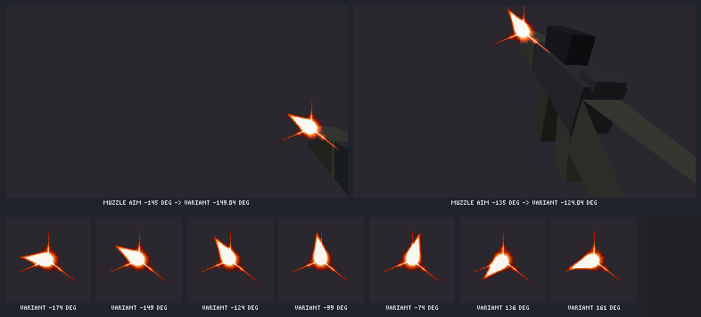
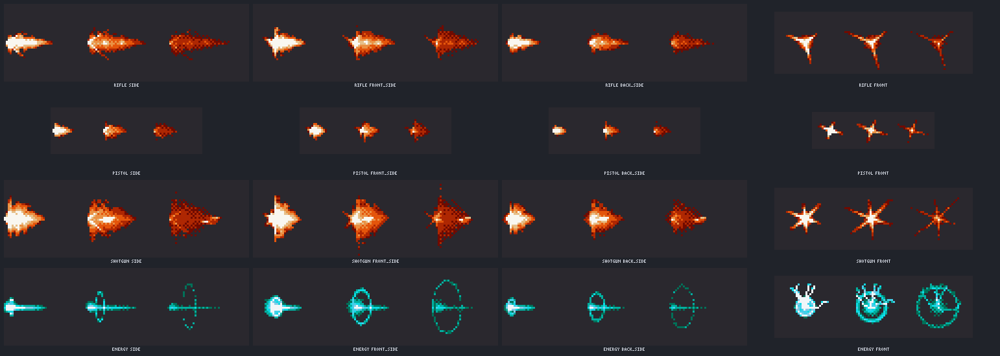
