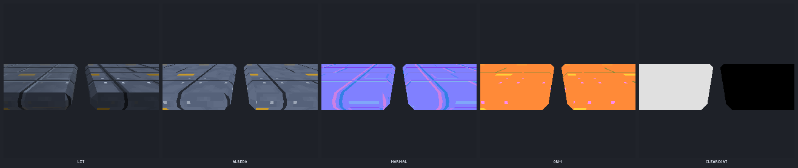
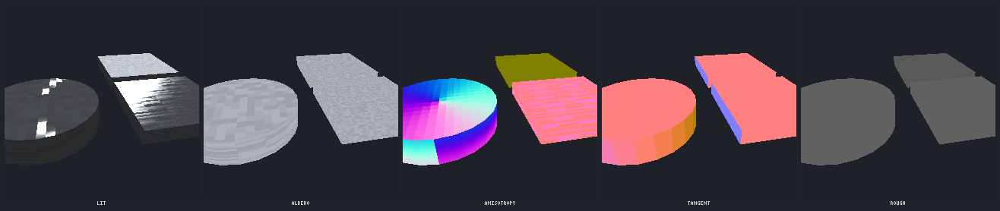
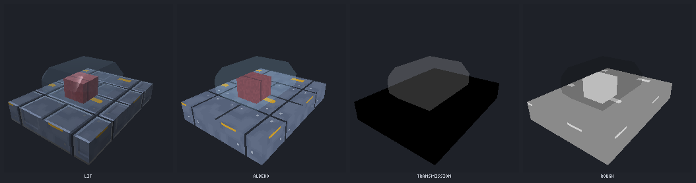
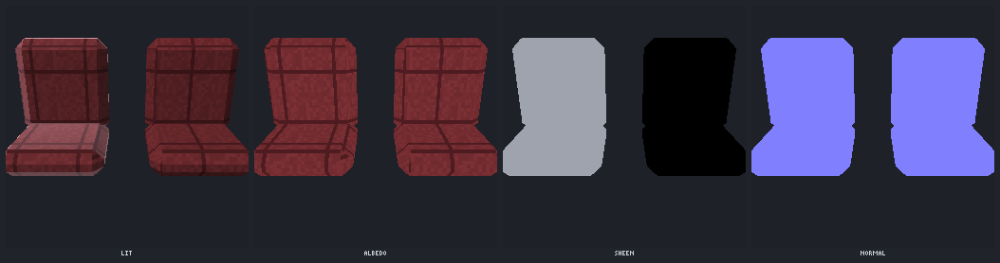
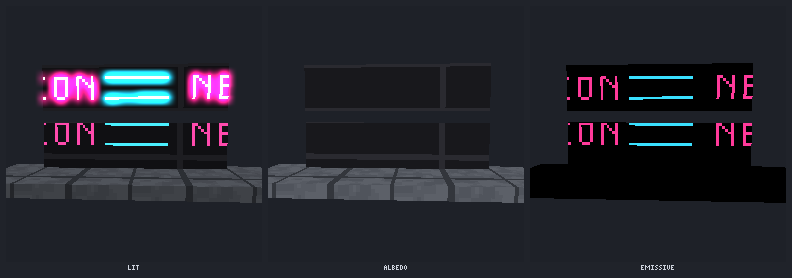
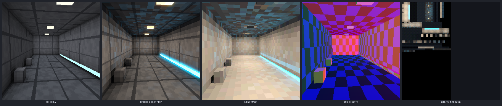
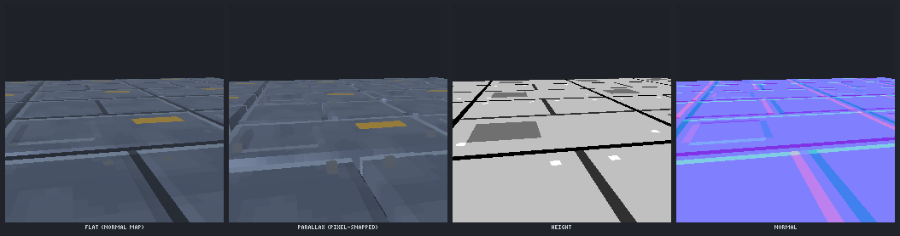
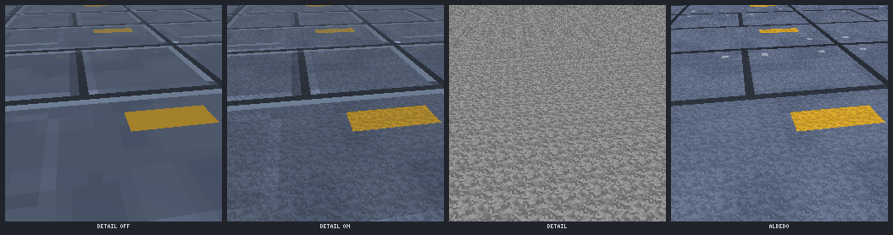

# Materials v2: render data for `art_model` exports

`art_model` exports (glTF `.glb`) can carry everything a modern renderer uses (tangents, baked light,
light probes, parallax heights, bent normals, emissive strength, the KHR material extensions, packed
channels, detail maps and extra vertex data) while the textures stay pixel art: NEAREST sampling,
quantised and dithered bakes, and pixel-snapped parallax.

Everything is opt-in, set per part, canvas or model, or per export. A model that uses none of it
exports the same bytes as 0.7. `test/fixtures/golden-0.7.json` holds the 0.7 digests and the test suite
checks them on every run.

Renders below come from the software preview (`node docs/materials/build-demos.mjs`), the same
renderer as `art_model preview {channel}`. Each row shows the lit result first, then its channels.

| Demo | |
|---|---|
| Painted hull panel: `painted_hull` (clearcoat, left) vs `painted_metal` |  |
| Brushed metal: radial (spun disc) and brushed plate (`brushed_metal`) vs `bare_metal` |  |
| Glass canopy: transmission + volume + ior, seat visible through it |  |
| Fabric seat: `cloth` (sheen) vs `fabric` (0.7) |  |
| Neon sign: emissive strength 6 + flicker vs strength 1, bloom from the over-bright buffer |  |
| Corridor: AO only (0.7) vs baked coloured lightmap (3 area lights, emissive strip bounce, 2 bounces) |  |
| Parallax occlusion mapping vs flat (normal map only) |  |
| Detail map off vs on, up close |  |

## Authoring

```js
// a model material (art_model material {name, material, preset?, set?})
art_model material {name:"ship", material:"hull", preset:"painted_hull", set:{clearcoat:{factor:0.9, rough:0.1}}}
// parts use it by name; a model material named like a canvas applies to that canvas's faces
{type:"box", texture:"hull_plate", material:"hull"}
// or inline
{type:"box", color:"#9fd8ff", material:"glass_canopy"}
{type:"box", texture:"sign", material:{preset:"neon", emissive:{color:"#ff40a0", strength:8, animate:"flicker"}}}
{type:"box", texture:"plate", material:{preset:"painted_hull", detail:{texture:"grit", scale:8, strength:0.6}, height:{scale:3}}}
{type:"box", texture:"terrain", displace:{scale:6, max_triangles:4000}}
{type:"light", kind:"area", at:[0,46,0], size:[8,8], color:"#ffc890", intensity:1.4, range:90, array:{count:3, step:[0,0,64]}}
```

| Field | glTF | Notes |
|---|---|---|
| `emissive:{color, strength, animate}` | `KHR_materials_emissive_strength`, `emissiveFactor`, `emissiveTexture` (mask), `extras.emissiveAnimation` | With `color`, the `emissive` layer becomes a grey mask that the colour tints. Without an emissive layer, the whole surface glows. |
| `clearcoat:{factor, rough}` | `KHR_materials_clearcoat` | Painted hulls. |
| `anisotropy:{strength, rotation, pattern}` | `KHR_materials_anisotropy` (+ `anisotropyTexture`) | `brushed` streaks along +u (4 strength levels per row), `radial` circles the texture centre (use `tile:false` on a cylinder cap), `flat` writes factors only. TANGENT is always written. |
| `transmission:{factor, ior, thickness, attenuation}` | `KHR_materials_transmission` + `_volume` + `_ior` | Opaque alpha mode, not BLEND. |
| `sheen:{color, rough}` | `KHR_materials_sheen` | Fabric. |
| `subsurface:{factor, color}` | `KHR_materials_diffuse_transmission` + `extras.thicknessTexture` (export `thickness:true`) | three.js r170 does not implement diffuse transmission: see the SSS snippet below. |
| `height:{scale, bias}` | `extras.heightTexture {index, texCoord 0, scale, bias, uv_per_unit}` | Profile `three` writes it for every texture with a height source. |
| `detail:{texture, normal?, scale, strength}` | `extras.detail {texture, normal, scale, strength, uv_scale}` | `scale` = detail texels per base texel. |
| canvas layer `ao` | ORM red channel | Without the layer, a cavity term from the height map. |

## Export

```
art_model export {name, profile:"three"}                     // TANGENT, ORM, dedupe, height maps, every extension
art_model export {name, profile:"three", lightmap:{sun:false}, bake_ao:{bent:true}, probes:true, thickness:true}
art_model export {name, profile:"roblox"}                    // + <name>.roblox/ SurfaceAppearance maps
art_model export {name, profile:"minimal"}                   // geometry + base colour
art_model export {name, packing:"unity_mask", tangents:true, vertex_colors:true, uv2:"world"}
```

Every v2 export runs `src/gltfcheck.js`, an in-repo structural validator. It checks the container,
accessors, attribute semantics, unit normals and tangents, consecutive `TEXCOORD_n` / `COLOR_n`, texCoord
sets used by materials, each extension's schema, `extensionsUsed`, and the texture indices inside
extras. `result.materials_v2.valid` reports the outcome and `meta.materials_v2.validation` lists the
errors.

## three.js integration (r155+, tested against the vendored r170)

GLTFLoader already handles: TANGENT (it keeps `normalScale (1, 1)` when tangents exist), `aoMap` on
TEXCOORD_1 (`channel 1`), the ORM texture (`aoMap` + `roughnessMap` + `metalnessMap`), clearcoat,
anisotropy (+ map), transmission / volume / ior, sheen and `emissiveIntensity` from
`KHR_materials_emissive_strength`. Material `extras` arrive in `material.userData`. The game has to wire
up the rest: textures referenced only from extras, and the custom shading.

```js
const gltf = await loader.loadAsync(url);
const tex = (i) => gltf.parser.getDependency('texture', i); // NEAREST sampler already set
```

### Lightmap (`extras.lightMap`)

```js
for (const m of materialsOf(gltf.scene)) {
  const ex = m.userData.lightMap;
  if (!ex) continue;
  const t = await tex(ex.index);
  t.channel = ex.texCoord;                 // 1 = TEXCOORD_1 = geometry.attributes.uv1
  t.colorSpace = THREE.SRGBColorSpace;     // encoded sRGB, quantised + dithered
  m.lightMap = t;
  m.lightMapIntensity = ex.intensity;      // = range * PI (texel 1.0 = albedo x range)
  m.aoMapIntensity = 0.5;                  // the lightmap already contains sky occlusion
  m.needsUpdate = true;
}
```

The bake includes sky, bounce and emissive light. With `direct:true` (the default) it also includes the
sun and the light parts. In that case don't add matching dynamic lights to these meshes, or bake with
`direct:false` and keep a dynamic sun with shadows.

### Light probes (`meta.probes` or `<name>.probes.json`)

SH9 radiance, three.js `SphericalHarmonics3` order, 27 numbers per probe. Probe `(x, y, z)` is
`coefficients[(z * dims[1] + y) * dims[0] + x]` at `origin + [x, y, z] * spacing` (units).

```js
function probeAt(P, p) {                    // trilinear blend of the 8 surrounding probes
  const f = [0, 1, 2].map((k) => Math.min(P.dims[k] - 1, Math.max(0, (p[k] - P.origin[k]) / P.spacing)));
  const i0 = f.map(Math.floor), w = f.map((v, k) => v - i0[k]), out = new Float32Array(27);
  for (let c = 0; c < 8; c++) {
    const ix = [0, 1, 2].map((k) => Math.min(P.dims[k] - 1, i0[k] + ((c >> k) & 1)));
    const wt = [0, 1, 2].reduce((s, k) => s * ((c >> k) & 1 ? w[k] : 1 - w[k]), 1);
    const src = P.coefficients[(ix[2] * P.dims[1] + ix[1]) * P.dims[0] + ix[0]];
    for (let j = 0; j < 27; j++) out[j] += src[j] * wt;
  }
  return out;
}
const probe = new THREE.LightProbe(); probe.intensity = Math.PI; scene.add(probe);  // PI matches the lightmap scale
// per frame, for the character / camera:
probe.sh.fromArray(probeAt(P, character.position.toArray()));
// a billboard sprite: tint by the irradiance toward the camera (n = direction to the camera)
// E(n) = 0.886227 L00 + 1.023328 (L1-1 y + L10 z + L11 x) + 0.858086 (L2-2 xy + L2-1 yz + L21 xz)
//        + 0.743125 L20 z^2 - 0.247708 L20 + 0.429043 L22 (x^2 - y^2)   (three.js shGetIrradianceAt)
```

### Parallax occlusion mapping, pixel-snapped (`extras.heightTexture`)

The shader needs TANGENT and a normal map (both present in `profile:"three"`). It marches the height
field in tangent space, then snaps the UV to the texel centre so pixels stay square.

```js
async function addParallax(m) {
  const ex = m.userData.heightTexture; if (!ex) return;
  const h = await tex(ex.index); // linear data
  m.onBeforeCompile = (s) => {
    Object.assign(s.uniforms, { heightMap: { value: h }, heightScale: { value: ex.scale },
      uvPerUnit: { value: new THREE.Vector2(...ex.uv_per_unit) }, texSize: { value: new THREE.Vector2(h.image.width, h.image.height) } });
    s.fragmentShader = s.fragmentShader
      .replace('#include <common>', `#include <common>
uniform sampler2D heightMap; uniform float heightScale; uniform vec2 uvPerUnit; uniform vec2 texSize;
vec2 pomUv(vec2 uv, vec3 vt) {          // vt: view dir in tangent space (x +u, y image up, z out)
  float vz = max(vt.z, 0.15);
  vec2 delta = vec2(-vt.x, vt.y) / vz * heightScale * uvPerUnit;   // uv shift at full depth (v runs down)
  float steps = clamp(heightScale * uvPerUnit.x * texSize.x * 2.0 / vz, 4.0, 24.0);
  vec2 cur = uv;
  for (int i = 0; i <= 24; i++) {
    float d = float(i) / steps; if (d > 1.0) break;
    cur = uv + delta * d;
    if (1.0 - texture2D(heightMap, cur).r <= d) break;
  }
  return (floor(cur * texSize) + 0.5) / texSize;                 // pixel snap
}`)
      .replace('void main() {', `void main() {
  vec3 pV = normalize(vViewPosition);
  vec2 pomUV = pomUv(vMapUv, vec3(dot(pV, normalize(vTangent)), dot(pV, normalize(vBitangent)), dot(pV, normalize(vNormal))));
  #define vMapUv pomUV
  #define vNormalMapUv pomUV
  #define vRoughnessMapUv pomUV
  #define vMetalnessMapUv pomUV
  #define vEmissiveMapUv pomUV`);
  };
  m.needsUpdate = true;
}
```

### Detail maps (`extras.detail`)

```js
async function addDetail(m) {
  const d = m.userData.detail; if (!d) return;
  const [dc, dn] = await Promise.all([tex(d.texture), d.normal !== undefined ? tex(d.normal) : null]);
  for (const t of [dc, dn]) if (t) t.colorSpace = THREE.NoColorSpace;   // linear data: mid grey = no change
  m.onBeforeCompile = (s) => {
    Object.assign(s.uniforms, { detailMap: { value: dc }, detailNormal: { value: dn || dc }, detailUv: { value: new THREE.Vector2(...d.uv_scale) }, detailStrength: { value: d.strength } });
    s.fragmentShader = s.fragmentShader
      .replace('#include <common>', '#include <common>\nuniform sampler2D detailMap; uniform sampler2D detailNormal; uniform vec2 detailUv; uniform float detailStrength;')
      .replace('#include <map_fragment>', `#include <map_fragment>
  diffuseColor.rgb *= mix(vec3(1.0), texture2D(detailMap, vMapUv * detailUv).rgb * 2.0, detailStrength);`)
      .replace('#include <normal_fragment_maps>', `#include <normal_fragment_maps>
  vec3 dN = texture2D(detailNormal, vMapUv * detailUv).xyz * 2.0 - 1.0;
  normal = normalize(normal + tbn * vec3(dN.xy * detailStrength, 0.0));`);
  };
  m.needsUpdate = true;
}
```

When both parallax and detail apply, chain them in one `onBeforeCompile` (each assignment replaces the
previous hook).

### Bent normals (`extras.bentNormalTexture`, object space, TEXCOORD_1)

Use the bent normal for ambient and environment lookups, and for specular occlusion:

```js
m.onBeforeCompile = (s) => {
  s.uniforms.bentMap = { value: bentTex }; s.uniforms.bentToView = { value: new THREE.Matrix3() };
  s.fragmentShader = s.fragmentShader
    .replace('#include <common>', '#include <common>\nuniform sampler2D bentMap; uniform mat3 bentToView;')
    .replace('#include <lights_fragment_maps>', `vec3 bentN = normalize(bentToView * (texture2D(bentMap, vAoMapUv).xyz * 2.0 - 1.0));
` + THREE.ShaderChunk.lights_fragment_maps.replaceAll('geometryNormal', 'bentN'))
    .replace('#include <aomap_fragment>', `#include <aomap_fragment>
  reflectedLight.indirectSpecular *= saturate(dot(bentN, reflect(-normalize(vViewPosition), normal)) * 0.5 + 0.5);`);
};
mesh.onBeforeRender = (r, sc, cam) => bentToView.getNormalMatrix(new THREE.Matrix4().multiplyMatrices(cam.matrixWorldInverse, mesh.matrixWorld));
```

`vAoMapUv` exists because the bent map ships with the baked AO (`aoMap` on channel 1).

### Emissive flicker / pulse (`extras.emissiveAnimation`)

```js
function emissiveLevel(a, t) {
  if (a.mode === 'pulse') return a.min + (a.max - a.min) * (0.5 - 0.5 * Math.cos(2 * Math.PI * a.hz * t));
  if (a.mode === 'strobe') return (a.hz * t) % 1 < a.duty ? a.max : a.min;
  const step = Math.floor(t * a.hz), h = (((Math.sin(step * 12.9898 + a.seed * 78.233) * 43758.5453) % 1) + 1) % 1;
  if (a.mode === 'sputter' && h < 0.12) return 0;
  return a.min + (a.max - a.min) * h;                           // flicker
}
// per frame: m.emissiveIntensity = m.userData.emissiveAnimation.base_strength * emissiveLevel(m.userData.emissiveAnimation, clock.elapsedTime)
```

### Subsurface (`KHR_materials_diffuse_transmission` + `extras.thicknessTexture`)

three.js r170 keeps the extension in `material.userData.gltfExtensions` without shading it. A cheap
translucency term for directional lights:

```js
const ext = m.userData.gltfExtensions?.KHR_materials_diffuse_transmission, th = m.userData.thicknessTexture;
m.onBeforeCompile = (s) => {
  Object.assign(s.uniforms, { sssColor: { value: new THREE.Color(...ext.diffuseTransmissionColorFactor) }, sssFactor: { value: ext.diffuseTransmissionFactor }, thick: { value: thickTex } });
  s.fragmentShader = s.fragmentShader
    .replace('#include <common>', '#include <common>\nuniform vec3 sssColor; uniform float sssFactor; uniform sampler2D thick;')
    .replace('#include <lights_fragment_end>', `#include <lights_fragment_end>
#if NUM_DIR_LIGHTS > 0
  float tk = texture2D(thick, vAoMapUv).r;     // white = thick
  for (int i = 0; i < NUM_DIR_LIGHTS; i++) reflectedLight.directDiffuse += directionalLights[i].color * saturate(dot(-normal, directionalLights[i].direction)) * sssColor * sssFactor * (1.0 - tk) * diffuseColor.rgb;
#endif`);
};
```

### Vertex data

GLTFLoader turns on `vertexColors` for `COLOR_0`, which multiplies the base colour. If `COLOR_0` is a
paint mask, set `material.vertexColors = false` and read `geometry.attributes.color` in your shader.
`COLOR_1` arrives as `color_1` and `TEXCOORD_2` / `_3` as `uv2` / `uv3`. `meta.vertex_data.attributes`
says which set landed where. The `masks` set holds R = wetness, G = AO, B = height over the model.

## Roblox (`profile:"roblox"`)

- `<name>.glb`: base colour + normal + metallicRoughness, every mesh under 20k triangles (simplified
  when over), no extensions, no extra UV sets, no vertex colours, no morph targets.
- `<name>.roblox/<material>_color|normal|metalness|roughness.png`: one SurfaceAppearance per
  MeshPart, each map at most 1024 px. Roblox filters textures bilinearly, so the exporter upscales
  each map with nearest neighbour by an integer factor to keep texels crisp. The normal maps use the
  OpenGL convention (green up), same as glTF.
- `surface_appearance.json`: maps per material, `AlphaMode`, `mesh_parts` triangles, `limits.ok`, and
  `dropped` (what was removed and why: emissive, extensions, baked light, overlays, ...).
- Import the `.glb` with the 3D Importer, which makes one MeshPart per material (`atlas:true` gives one
  MeshPart), then add a SurfaceAppearance per MeshPart with the four maps.

## Limitations

- Lightmaps, probes and thickness are not available on rigged models or `instances:true` exports yet
  (like `bake_ao`). LOD files (`lod_mode:"files"`) are written without v2 data.
- Charts are one planar chart per face, the AO charting with a gutter. Curved parts (cylinders,
  lathes) make many small charts.
- Point, spot and area lights use a windowed falloff `(1 - (d / range)^2)^2`, not the inverse square,
  so that light pools can be art-directed.
- Displacement adds triangles only inside a part's faces. With `seams:"lock"` the region borders stay
  put, so cliffs at the borders are kept rather than cracking. Overlay decal shells do not follow the
  displaced surface.
- The software preview approximates the extensions to read like the engine at pixel scale. It is not
  a reference renderer.
