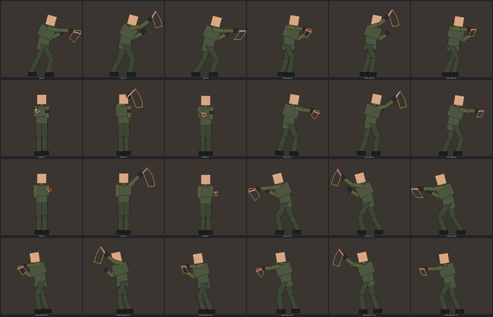
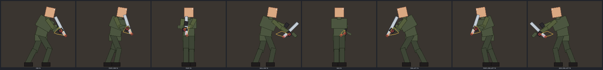
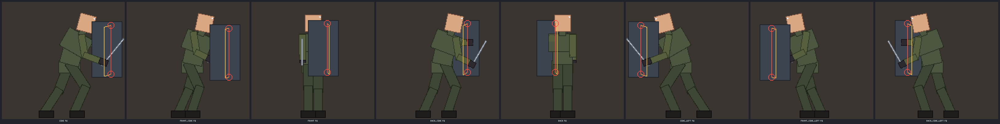
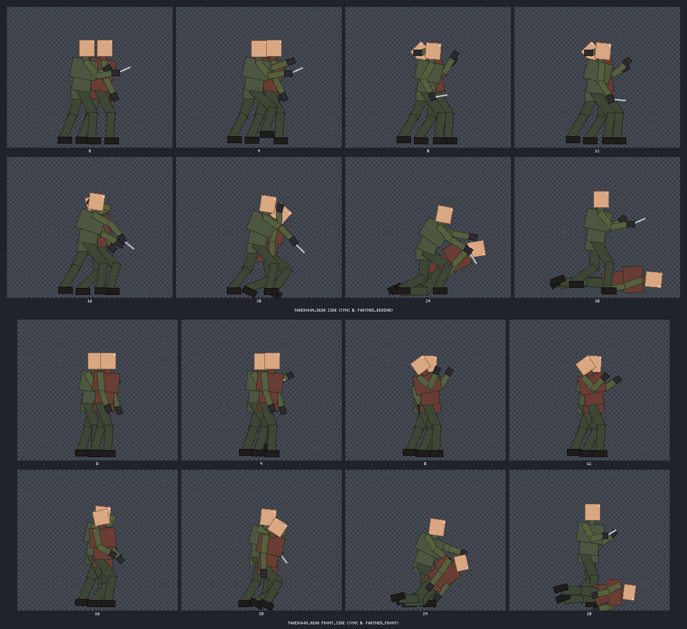
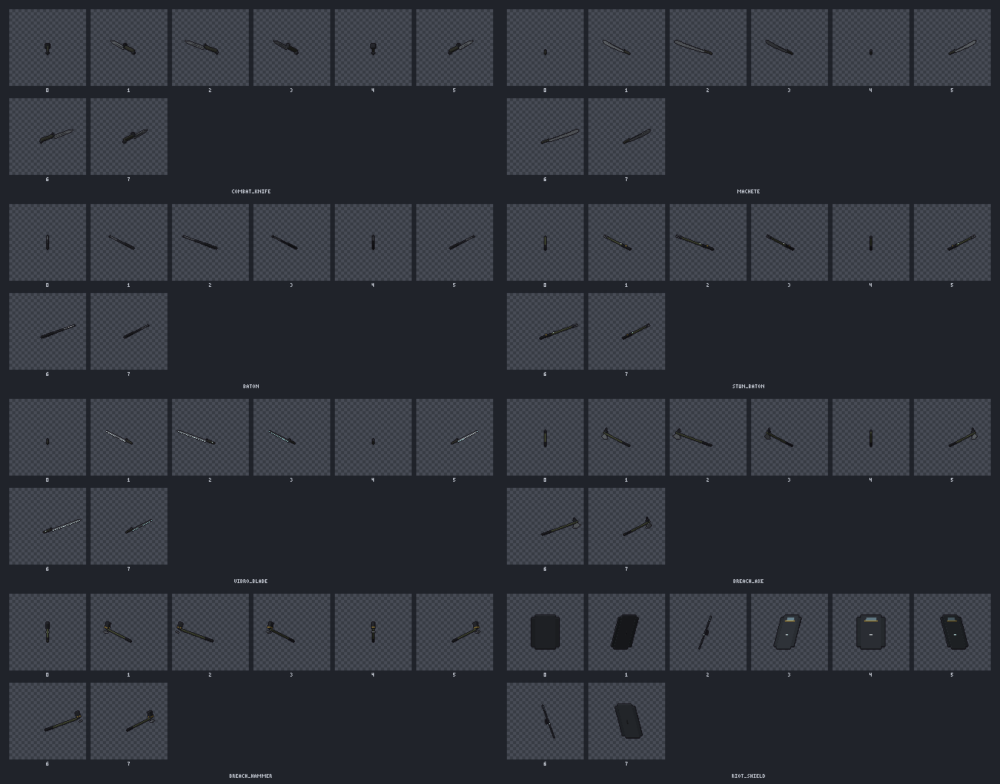
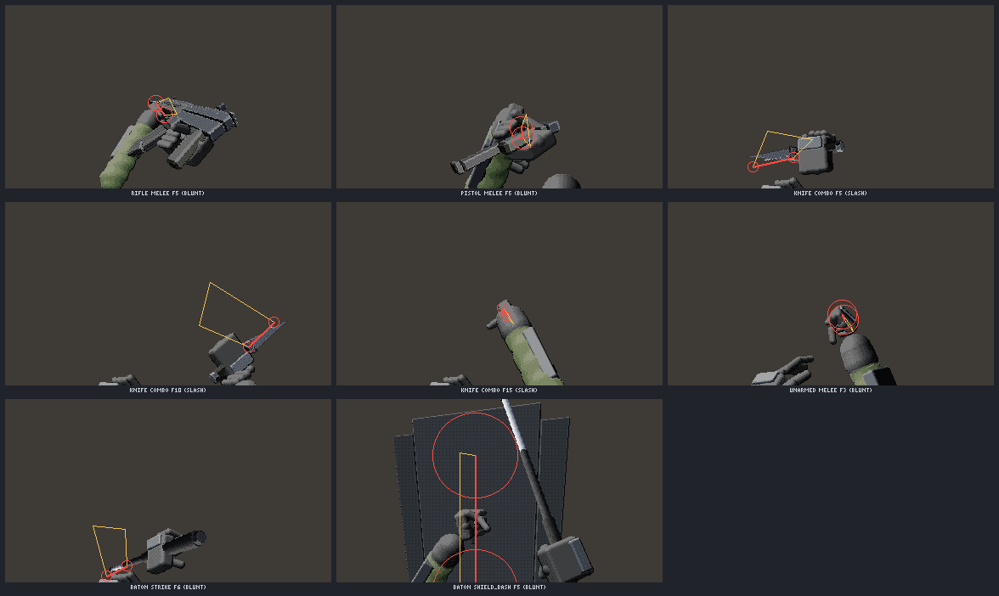
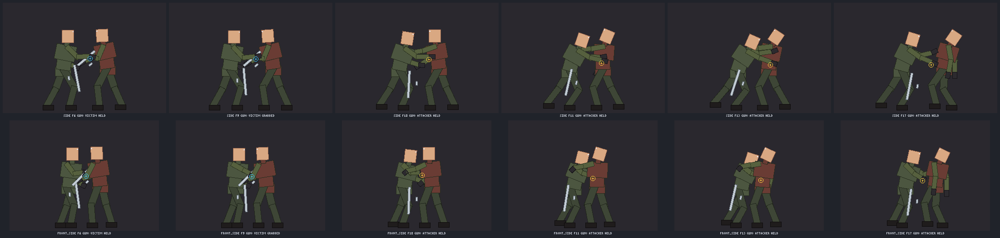
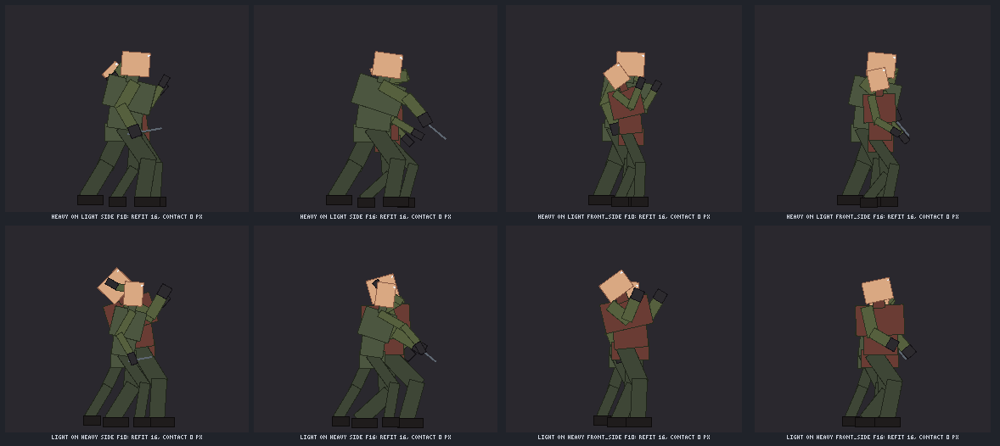
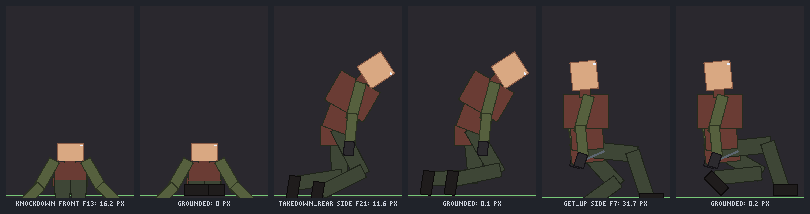
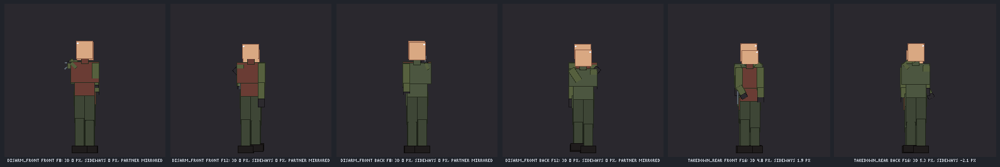

# Melee

[Back to the README](../../README.md)

Melee clip sets for `humanoid_hd` skeletons in the animation library (`art_anim`), with hit events and hit volumes for the game, plus eight melee weapon models (`art_model`) and first-person melee clips (`art_fp`).

```jsonc
// art_anim: a knife set on the skeleton "hd" (made with art_anim skeleton; see docs/rig/README.md)
{ "action": "melee", "skeleton": "hd", "weapon": "combat_knife" }
{ "action": "melee_check", "skeleton": "hd" }
{ "action": "paired", "skin": "mec", "pair": "takedown_rear", "view": "side" }
{ "action": "melee_sheet", "out": "C:/game/public/assets" }
// gun skeletons: disarm_front takes the gun or knocks it to the floor
{ "action": "melee", "skeleton": "hd_rifle", "disarm": "take" }
```

`melee {skeleton, weapon?, shield?, disarm?}` writes a melee clip set onto a humanoid_hd skeleton.

- Strikes per weapon: knife slash / stab / combo, blade and heavy swings, baton strike with a shock tip, rifle butt-stroke, pistol whip, punches, kick and shove. Also block and parry, hit reactions in four directions, stagger, knockdown and get-up.
- Paired takedowns (`takedown_rear`, `disarm_front`, `shield_knockdown`) are attacker / victim clips that share one alignment. On gun skeletons `disarm_front` takes the gun (`disarm:"take"`) or knocks it to the floor (`disarm:"drop"`) for every handling class, with a per-frame gun track for both actors' weapon layers.
- Ground contact: a melee clip foot or hand drawn below the ground row is lifted onto it by limb IK in every view (fallen bodies keep their legs and hands on the ground in front / back); `melee_check` reports `foot_sink_px` / `hand_sink_px` per clip, and checks the weapon path 16x between frames against the exported hit volumes.
- Front and back views are checked in 3D (screen gap plus the side-view depth). A face-to-face partner is staged in depth and drawn mirrored there (`partner_flip`, matching the side views), so contacts meet without a big sideways shift; what remains is staged per frame (`partner_dx_track`, at most 3 px at 128x192). Skins with proportions get each pair refit on their own rigs (heavy on light, light on heavy, all passing). The offset fit is deterministic: two runs give byte-identical clips.
- `batch` adds `anims.<clip>_<view>.melee` to the characters manifest: phases, events (windup, active start / end, impact, recovery, sound, effect), a hit capsule per active frame and view with the swept polygon since the previous frame, damage type, stamina, root motion, combo windows and paired metadata.
- `melee_check` validates event order, sweep coverage, foot slide and contact alignment.
- `melee_sheet` renders the eight weapon models (`art_model template:"melee_<id>"`: combat knife, machete, baton, stun baton, vibro-blade, breaching axe and hammer, riot shield) into world sheets of views × pitch with the grip on one pixel.
- First-person melee clips (gun bash, knife combo, punch, baton strike, shield up and bash) carry the same events and per-frame capsules in `manifest/fp.json`.
- `art_help {topic:"melee"}` has the manifest fields and the Three.js and Roblox runtime notes. Demos: `docs/melee/` (`node scripts/melee-demos.js`).

| Knife combo with hit volumes | Rifle butt-stroke | Shield bash |
| --- | --- | --- |
|  |  |  |

| Paired rear takedown | Melee weapon turntables | First-person melee |
| --- | --- | --- |
|  |  |  |








