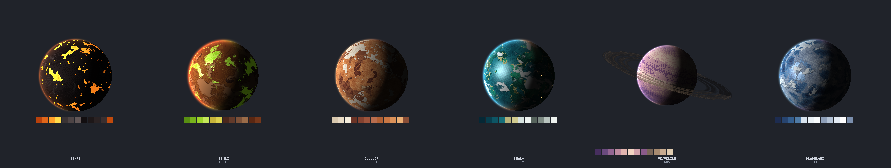
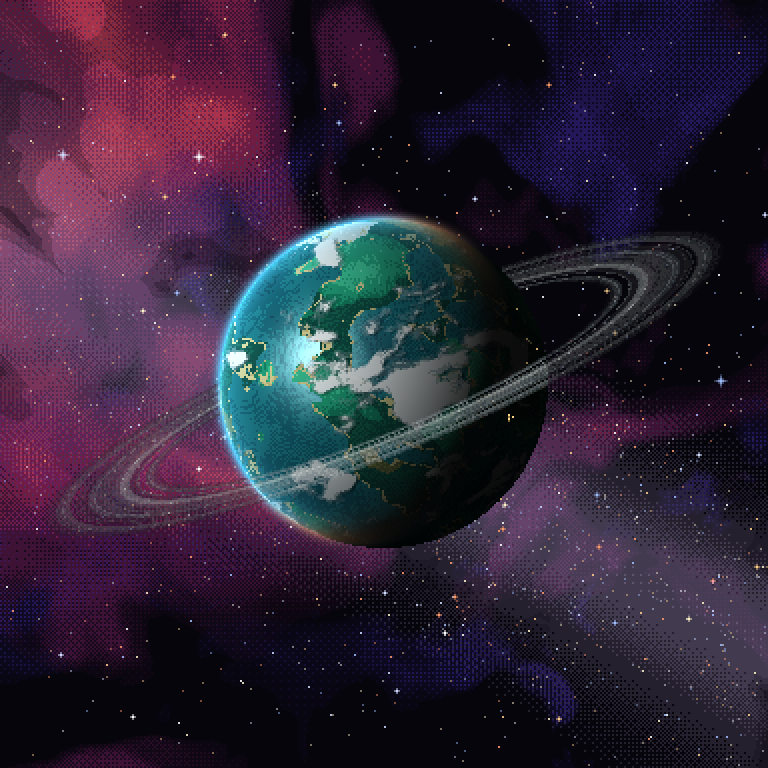
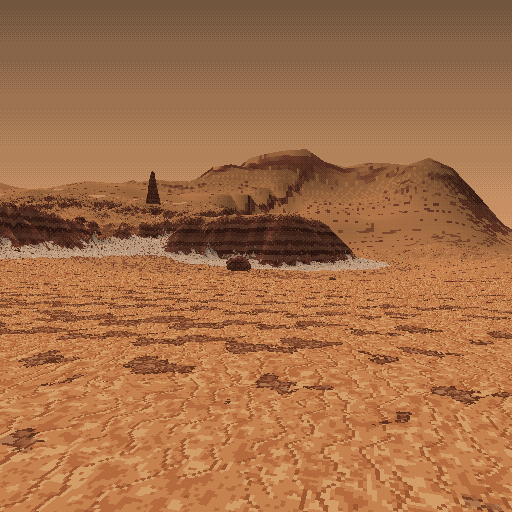
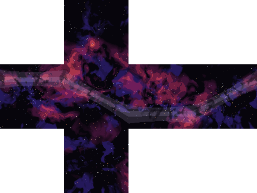
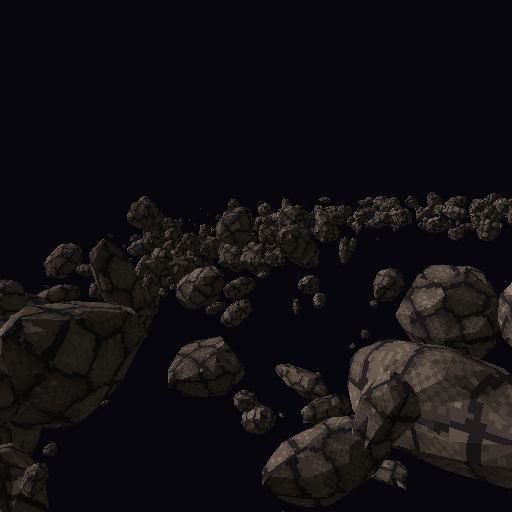
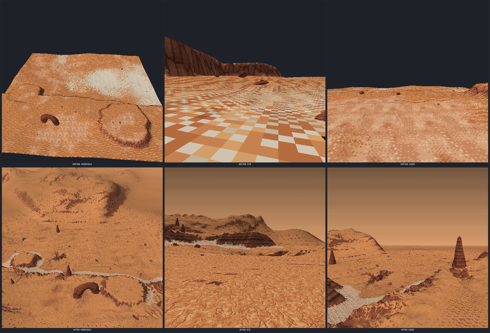
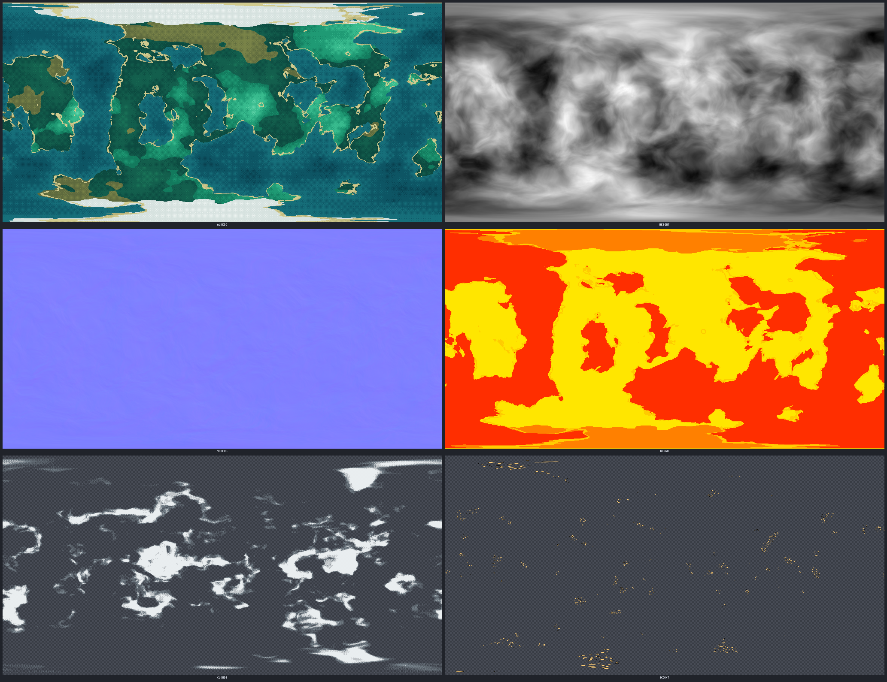
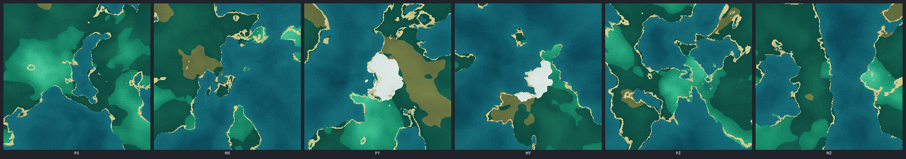
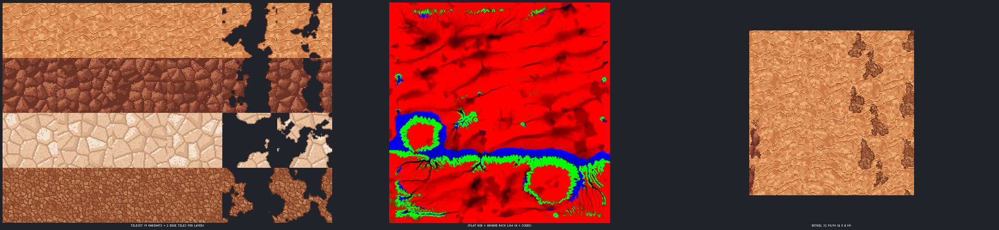
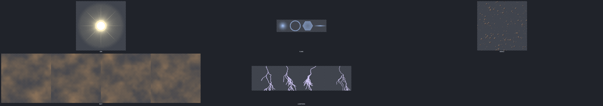

# Planets, ground terrain and space backdrops: `art_planet`

[Back to the README](../../README.md)

Planets you can see from orbit and land on, with pixel-art textures (palette ramps, ordered dither, NEAREST, every texture at most 1024 px) for a browser three.js game, and kept portable to Roblox. Each planet comes from one seeded field (3D noise on the unit sphere). The orbit maps, cube faces, mesh LODs, quadtree tiles and ground patches all sample that same field, so they agree.



- **Planets** (`planet`): presets `ice`, `toxic`, `bloom`, `lava`, `desert`, `gas` (latitude bands, storms, rings) and `barren`. Any preset field can be overridden. Biome rules (`where: {water, height, lat, moisture}` select a palette `ramp`, mapped `by` height, moisture, latitude, noise or depth), noise (`fbm`, `ridged`, `billow`, domain warp), continents, craters, canyons, emissive seams (lava rivers, ice crevasses), night-side city lights, `hue`, and `palette` (quantise to a list or `"project:<name>"`).
- **Maps:** equirect (three.js `equirectUv`) and cube faces (`px nx py ny pz nz`, OpenGL / `CubeTextureLoader` order). Each set has albedo, height (8-bit and 16-bit packed), tangent-space normal, roughness (glTF metallicRoughness), emissive glow, night lights, and a cloud layer with alpha. Rings come as a banded alpha strip.
- **Meshes:** a cube-sphere on an integer lattice, so shared face edges are bit-identical and every LOD is watertight. The `.glb` holds a root node carrying the axial tilt, with `<name>_lods` (LOD0..n with switch distances), a cloud shell, an atmosphere shell (shader parameters in `extras`) and a ring annulus. A quadtree tile set (`tiles/<face>/<level>/<x>_<y>.glb` plus `<name>.tiles.json` with bounds, geometric error, children and skirt depth) lets an engine stream detail near the camera. For far LODs there is an octahedral impostor atlas (#7 `bakeImpostor`) and a pre-lit disc sprite.
- **Systems** (`system`): an original star with 4 to 8 bodies (distinct biomes, orbits, moons and names), written as `.system.json` with a palette strip render.
- **Ground** (`terrain {planet, lat, lon}`): a landing-zone patch in a local frame (+X east, +Z south, metres). Its base elevation and biome come from the planet field. On top of that come ground detail, ridged-multifractal mountain ranges on parts of the horizon, dunes on desert worlds, mesas and escarpments, then a thermal pass (scree at cliff bases) and a droplet hydraulic pass (gullies). The landing pad stays flat. The ground uses per-biome pixel tilesets painted with Agent Art's own `cells`, `noise`, `scatter` and `line` ops (cracked plates, sand ripples, gravel, dried mud, ice crust, toxic crust, moss, snow, glowing basalt, regolith), with 4 variants and 2 transition tiles per layer at 32 px/m. Materials blend per texel through a noise-perturbed splat lookup with noise-masked, dithered organic borders and a 1 px rim, and steep faces get strata bands. Output: chunk `.glb`s (8 px/m, LODs, skirts, collision), 32 px/m detail decals around the pad, a horizon ring out to the far ranges with fog and sky colours, an RGBA splat (bytes sum to 255), the tileset, masks and noise for a runtime ground shader, `heightfield.json`, clustered GPU-instanced props (boulder clusters with size falloff at cliff bases and in gullies, debris, rock spires, shrub and grass clumps, crystal outcrops), rock arches, colony `anchors`, and overview / eye-height (1.7 m) / wide renders.
- **Kits:** `rocks` (chunky low-poly boulders, rocks, slabs, shards and pebbles, plus crystals, grass cards and the `mesa`, `butte`, `spire` and `arch` formations, each with LODs from #7's simplifier) and `asteroids` (potato, contact-binary, shard and cratered shapes; a belt, ring or cluster field exported as instance transforms with spin, plus an instanced `.glb`).
- **Backdrops:** `skybox` (layered, domain-warped nebula gas, dust lanes, an optional galaxy band, star classes and bright-star sprites; 6 faces plus an equirect, 512 to 1024 px) and `fx` (a sun with corona, a lens-flare sheet, a debris card, dust-storm frames and lightning frames).

```js
art_planet { action:"system", seed:2251, count:6 }
art_planet { action:"planet", name:"phalo", preset:"bloom", seed:<from the system json>, rings:{ inner:1.45, outer:2.25 } }
art_planet { action:"terrain", planet:"phalo", lat:14, lon:32, size:512 }
art_planet { action:"skybox", name:"ember_sky", preset:"ember", size:512 }
art_planet { action:"asteroids", name:"belt", field:{ shape:"belt", count:1200 } }
```

| Orbit (atmosphere, clouds, rings) | Landing zone | Nebula skybox | Asteroid belt |
| --- | --- | --- | --- |
|  |  |  |  |



`art_help {topic:"planets"}` lists every option. The `planets-space` skill has the reference three.js snippets: the atmosphere shader (fresnel rim and day/night terminator), night lights, quadtree tile streaming, the far-planet sphere-on-quad impostor, terrain loading and a pixel ground shader. `node docs/planets/build-demos.mjs` rebuilds the renders and `docs/planets/demo-stats.json`.

| Orbit maps | Cube faces | Landing zone maps | Space FX sprites |
| --- | --- | --- | --- |
|  |  |  |  |
