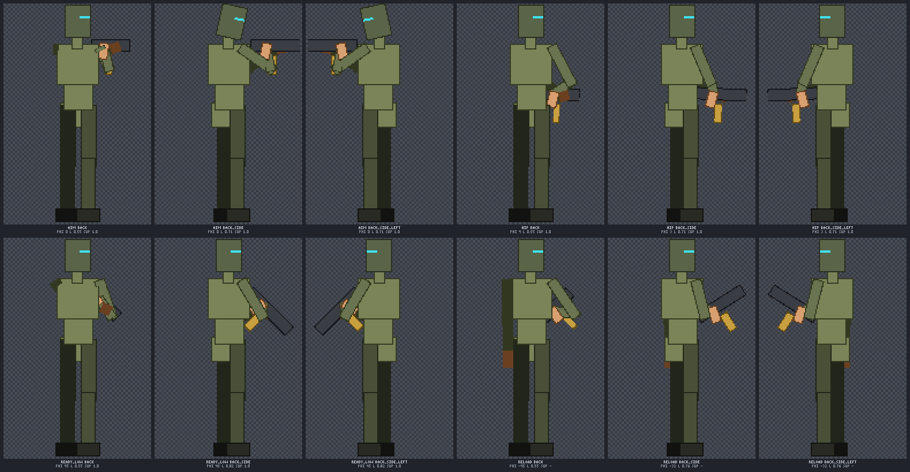
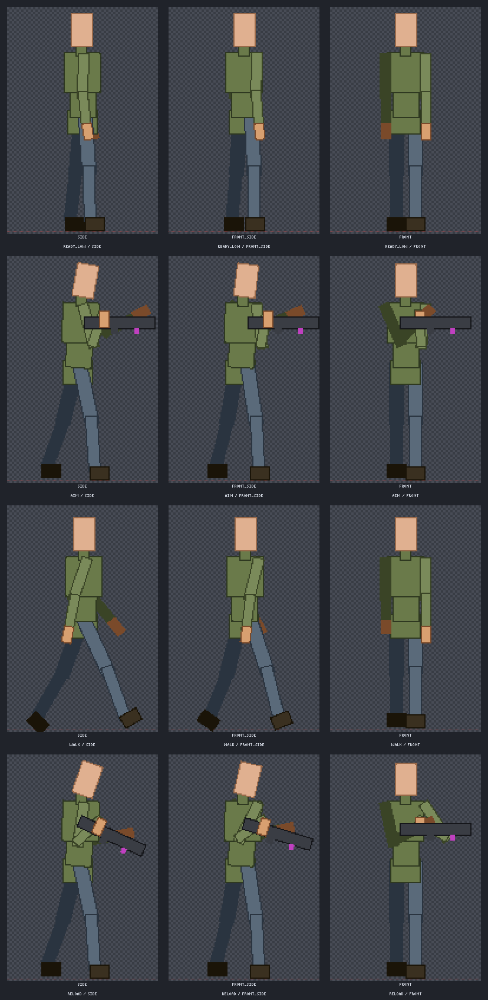
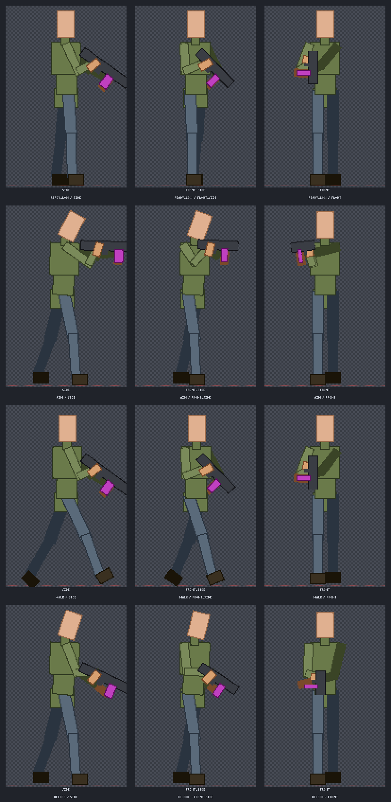
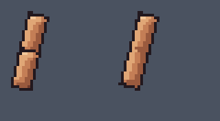
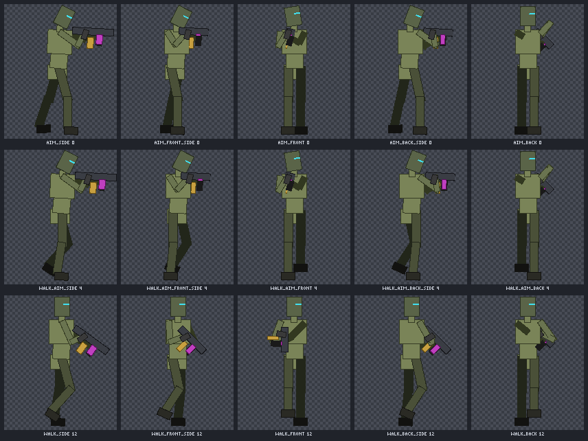
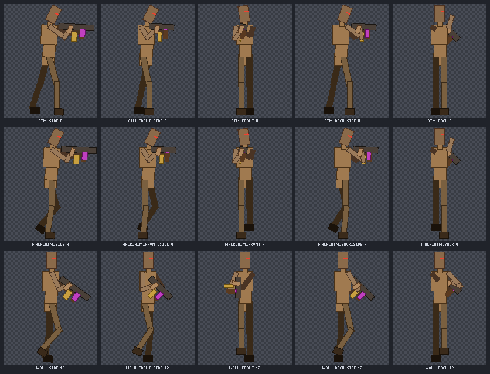
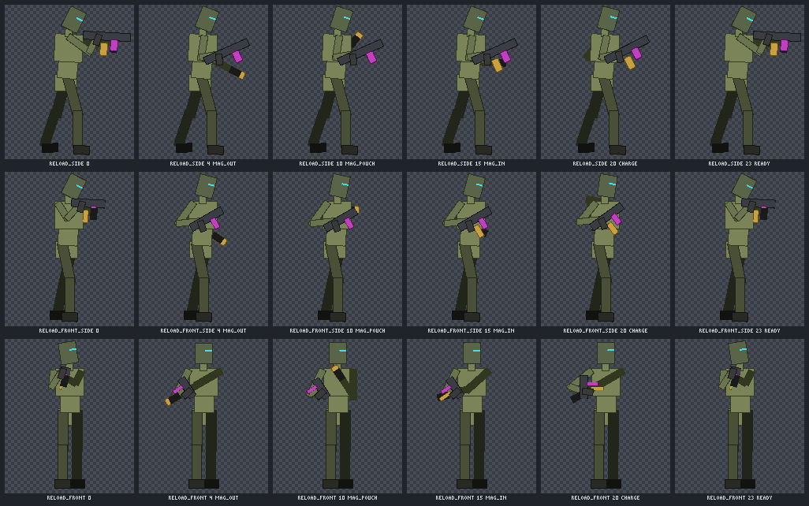
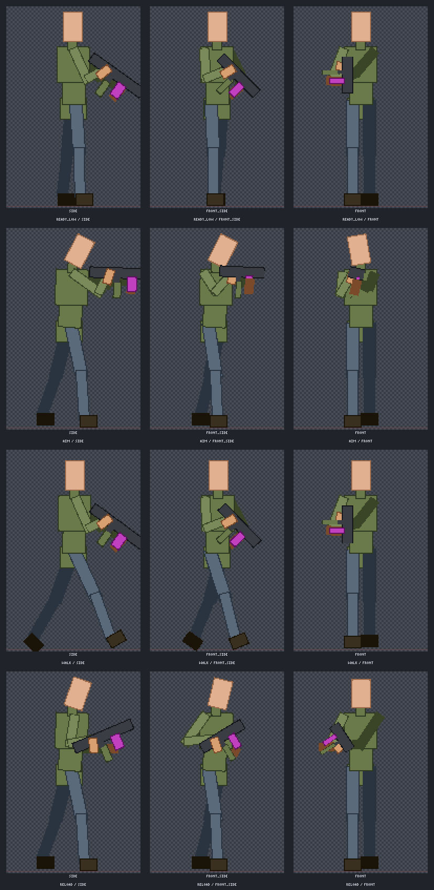
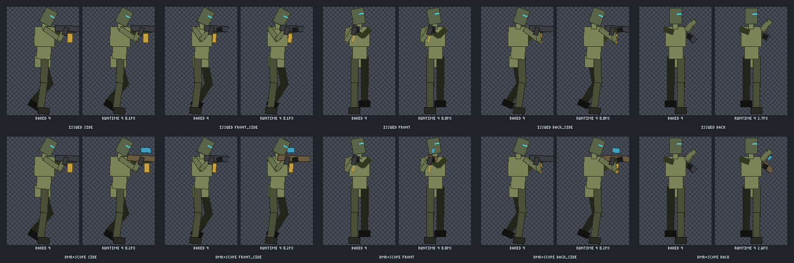

# Characters, rigs and the animation library

[Back to the README](../../README.md)

Tools: `art_rig` (one character: parts, views, poses, animations, held weapons, 2D skinning) and `art_anim` (a skeleton and clip library shared by many characters, batch export to game strips). Help topics: `art_help {topic:"rig"}`, `{topic:"library"}`, `{topic:"skin2d"}`, `{topic:"melee"}`. Skills: `rig`, `rig-hd`, `weapon-handling`, `anim-library`, `walk-cycle`.

- [Characters, views and animations: `art_rig`](#characters-views-and-animations-art_rig)
  - [High-detail characters: `humanoid_hd`](#high-detail-characters-humanoid_hd)
  - [Held weapons: `weapon`](#held-weapons-weapon)
  - [Depth, draw order and linked cells](#depth-draw-order-and-linked-cells)
  - [2D skinning](#2d-skinning)
- [Animation library: `art_anim`](#animation-library-art_anim)
- Related: [humanoid_hd guide](../rig-hd-guide.md), [melee](../melee/README.md), [2D skinning demos](../skin2d/README.md), [first-person viewmodels](../fp/README.md)

## Characters, views and animations: `art_rig`

A rig is a set of parts drawn once per view on a `<name>_parts` canvas. Poses move, rotate and squash those parts, and `animate` tweens poses into frames, so every frame and every view uses the same pixels.

```jsonc
// 1. start from a template (humanoid | humanoid_hd | blob | flyer): only a starting point
{ "action": "create", "name": "knight", "frame": [32, 32], "template": "humanoid",
  "parts": { "head": { "w": 14, "h": 11 }, "cape": { "w": 8, "h": 12, "pivot": [4, 0], "parent": "body", "at": [-2, -6], "z": -4 } } }
// 2. draw each part in the cells the reply lists (one row per view) on canvas "knight_parts"
// 3. generate animations: frames are assembled from the same part pixels, so the knight never drifts
{ "action": "animate", "name": "knight", "preset": "walk", "view": "side", "frames": 16, "fps": 20 }
```

Templates set up parts, joints, views, poses and presets: humanoid has idle, blink, walk, run, attack, hurt, jump and death; blob has idle, hop, blink, hurt and death; flyer has fly, hurt and death. Every size, joint, view, pose and preset can be changed. You can add parts (tails, capes, weapons) or remove them. For anything else (quadrupeds, vehicles, props with moving parts), define your own rig. Poses set per-part offsets, rotation, squash and stretch (`sx`/`sy`), variants (a blinking head) and visibility. `mirror_pairs` swaps left and right limbs for the second half of a walk, and `plant_feet` keeps feet on the ground line.

### High-detail characters: `humanoid_hd`

For detailed sprites in the style of late-90s pre-rendered games or *Replaced* (64x96 up to 160x240 frames, rich shading, 12-24 frame cycles), `template: "humanoid_hd"` gives 21 parts: `pelvis` (root), `torso`, `chest`, `neck`, `head`, `upper_arm`/`forearm`/`hand` and `thigh`/`shin`/`foot` on both sides, plus optional `weapon` (child of `hand_f`), `gear_back`, `gear_hip` and `cape` slots. Limbs are parent chains, so elbows and knees bend. It draws five views (`side`, `front_side`, `front`, `back_side`, `back`) and mirrors three more, for 8 directions. Presets: idle (12 frames), walk (16), run (12), crouch_walk (16), aim (1), shoot (6), reload (24), hurt (8), death (20), throw (12) and blink.

```jsonc
// the template already gives the cape and gear_hip secondary motion; this loosens the cape
{ "action": "create", "name": "soldier", "frame": [128, 192], "template": "humanoid_hd",
  "secondary": { "cape": { "stiffness": 0.15, "damping": 0.2, "gravity": 0.5 } } }
// draw the cells, then one canvas per preset and view (frame strips are at most 8192 px tall)
{ "action": "animate", "name": "soldier", "preset": "reload", "view": "front_side", "canvas": "soldier_reload_front_side" }
// a custom cycle from the template's poses, with planted feet and cape follow-through
{ "action": "animate", "name": "soldier", "animation": "patrol", "view": "front_side", "frames": 16, "fps": 12,
  "keys": [{ "pose": "walk_contact" }, { "pose": "walk_pass" }, { "pose": "walk_contact", "mirror_pairs": true }, { "pose": "walk_pass", "mirror_pairs": true }],
  "plant": true, "secondary": true, "canvas": "soldier_patrol_front_side" }
// a pose with a view-specific override and two-bone IK (hand on the weapon's foregrip)
{ "action": "pose", "name": "soldier", "pose": "brace", "parts": { "chest": { "rot": -4 } },
  "views": { "front": { "head": { "rot": 0 } } },
  "ik": { "hand_b": { "target": { "part": "weapon", "at": [20, -3] }, "bend": -1 } } }
```

- **Per-view poses:** `views: {front: {part: {...}}}` is merged over the base pose in that view; mirror views use their source view, and tweening blends the overrides. The template's poses come with front, back and 3/4 overrides already, so forward swings foreshorten (thigh and shin `sy` with `scale_children`) instead of splaying sideways.
- **Two-bone IK:** `ik: {end: {target: [x, y] | {part, at: [dx, dy]}, bend: 1 | -1, rot?, weight?}}` in a pose or key rotates the end's parent and grandparent so the end pivot reaches the target. It is solved per frame after FK, in each view. `rot` sets the end part's world rotation afterwards, for example to keep a gun level. Targets tween between keys, and a key without the entry fades back to FK.
- **Foot planting:** `animate {plant: true}` (alias `ik_feet`) keeps stance feet on the ground through every contact frame with leg IK. A standing foot stays put and a walking stance foot moves at constant speed. `plant: ["foot_f"]` picks the feet; rig `feet` sets the default.
- **Secondary motion:** rig `secondary: {cape: {stiffness, damping, gravity?}}` plus `animate {secondary: true}` adds lag and follow-through to capes, straps and pouches. Loops are simulated until they repeat, so they stay seamless.
- **`scale_children`:** a part's `sx`/`sy` also moves its children's joints (foreshortening, breathing); humanoid_hd has it on.
- **Rotation sampling:** rig `sampling: "rotsprite"` (the humanoid_hd default) supersamples the Scale2x image, keeps only the part's own colours and cleans up holes and stray pixels, so thin limbs keep their thickness from frame to frame. `"smooth"` does the same on the 1x cell, and `"nearest8"` is the old behaviour, still the default for existing rigs.
- **Follow another animation (`ik_from`):** `animate {ik_from:{canvas, animation, map:{hand_r:"socket_grip_r", hand_l:{anchor:"socket_grip_l", bend:-1}}, offset?}}` takes per-frame IK targets from another canvas's anchors, for example an `art_model render` of a gun clip, and copies its frame count, timing and loop. A map value is an anchor name or `{anchor, bend?, rot?, at?, weight?}`. Give the rig the render's frame size (or an `offset`). See [the end-to-end example](../3d/README.md#rigid-part-rigs-animation-clips-and-pre-rendered-sprites).
- `art_animation export {format: "spritesheet", json: false}` skips the sidecar JSON.

- **Equipment sets:** give parts variants (`chest: ["plate"]`, `head: ["helmet", "helmet_blink"]`) and optionally a rig `variant_sets: {heavy: {chest: "plate", head: "helmet"}}`. Then `animate {..., variant: "heavy"}` renders every part with that set, so armour sets need no sheet swapping. A pose variant such as `blink` combines as `<set>_<variant>` (`helmet_blink`) when the part has one.
- **Tags:** preset animations are always tagged `<preset>_<view>` (`walk_side`, `walk_front`). Pass `animation` to choose your own.
- **Compact replies:** `create`, `update` and `info` reply with a summary. Cells come as `rows` (the y of each view's band) plus `parts` (`[x, w, h]`), so a cell is `[x, rows[view], w, h]`. `full: true` returns everything, and `fields: ["poses"]` returns only those fields. `art_info` works the same way.

See the [humanoid_hd step-by-step guide](../rig-hd-guide.md). Skill: `rig-hd`.

### Held weapons: `weapon`

Without constraints, generated sprites hold guns wrong: the support hand misses the foregrip, arms don't reach, the rifle clips through the torso, the gun swaps hands halfway through a walk cycle, and it vanishes outside aim poses. Declare the weapon and the rig handles it in every frame of every pose, clip and view:

```jsonc
{ "action": "create", "name": "soldier", "frame": [128, 192], "template": "humanoid_hd",
  "weapon": { "class": "rifle", "attachments": { "vgrip": "vertical_grip" } } }
// draw "weapon" and "att_vgrip" in the side row only, pointing right; then
{ "action": "check", "name": "soldier" }   // every preset x 8 directions -> pass / fail + failing frames
{ "action": "animate", "name": "soldier", "preset": "walk", "view": "front_side", "carry": "ready_high", "canvas": "soldier_walk_fs" }
```

- **Weapon definition:** named points in the weapon cell: `grip_main` (trigger hand), `grip_support` (handguard; it may slide back along the rail), `stock` (shoulder pocket contact), `muzzle`, `optic` (eye line) and `mag`. Classes (`rifle`, `carbine`, `smg`, `shotgun`, `dmr`, `sniper`, `lmg`, `pistol`) give defaults as fractions of the cell. Attachments are sub-parts that mount on sockets (`underbarrel`, `top`, `muzzle`). A vertical or angled grip or a bipod takes over `grip_support`, a suppressor the `muzzle`, an optic the `optic`. `attach` picks the active ones, and `animate {attach: []}` overrides them per call.
- **Hands:** both hands solve onto their grips with two-bone IK every frame, and the wrists turn to each grip's angle. The support hand of a pistol cups the trigger hand. Mirrored views, 3/4 views and front and back views all hold, because the weapon and arms are solved once in a 3D body proxy and projected into each view.
- **Reach:** arm lengths come from the rig. The shoulders protract a little. If that isn't enough, the support hand slides back along the rail and then the weapon moves back along its axis, or the frame is flagged. Limbs never stretch, and elbows always bend down and out.
- **Dead zone:** the torso, head and legs (and any free arm) are capsules the weapon may not enter. The weapon is pushed out forward first, then outward, turning about the stock when it is shouldered. `standoff` sets the minimum gap between chest and receiver. When aiming, the stock sits in the shoulder pocket and the head tilts for a cheek weld to the optic line.
- **Carry states:** long guns have `aim`, `ready_low`, `ready_high`, `hip`, `sprint`, `reload`, `slung`, `one_hand_low`, `drop` and `holster`. Pistols have `aim`, `compressed`, `low`, `reload`, `one_hand_low` and `holster`. Outside firing states the muzzle points down or forward-low, never at the character's own body. Set the state with `carry` on a pose or key, `weapon.poses` (by pose name), `weapon.carry` (the default) or `animate {carry}`, and add your own with `weapon.states`. The humanoid_hd presets come mapped: walk and idle use `ready_low`, run `sprint`, aim and shoot `aim`, reload `reload`, and throw `slung` (a pistol is holstered). The weapon stays visible unless it is holstered.
- **Mirroring:** `mirror_pairs` swaps legs and free arms but keeps held hands and the weapon on their side. The key option `mirror_hands: true` deliberately swaps handedness.
- **Front-view readability:** a barrel pointing at the camera is canted outward with a length floor (`foreshorten: {floor, cant, back_cant} | false`). In back-facing views the muzzle angles out past the silhouette on the weapon side.
- **Back view:**
  - **Gun:** yawed outward in 3D and projected, so its pitch is kept, and it has one length (`back_floor`), so runtime sheet cells match the frames.
  - **Arms:** they follow the projected 3D arm, so the elbow sits out and below the shoulder.
  - **Draw order:** arms holding the gun in front of the body are drawn under the whole trunk, and the support shoulder protracts.
  - **Weapon check:** it flags a raised elbow and an arm drawn over the torso from behind.

  
- **Layering:** the weapon is drawn over the torso when it is held in front of it and under it when behind, using projected depth. `weapon.layer: {above, below, pin}` overrides that. `layers {name, pose | preset + frame, view}` lists the draw order with the reason for each z, and `explain {part_a, part_b}` says why one part is drawn over another. `debug_render` returns a frame as one layer per part; the web UI's Layers view uses both.
- **Validation:** `check` measures every frame: hand-to-grip distance, limb over-extension, inverted elbows, weapon-body penetration, muzzle flags, layering and weapon visibility. `animate` runs the same checks and by default refuses to write a clip with a violating frame. `constraints: "fix"` auto-corrects instead (muzzle down, stronger cant, flipped elbows, draw order), and `"warn"` writes the frames and reports.
- **Front aim and reload:** aimed at the camera, a long gun's barrel stays short and is canted inward, so the muzzle sits near the centre line. It is drawn over the forearms and the trigger hand and under the support hand, which is further forward on the handguard; a pistol's slide goes over both hands. The head tilts onto the stock. `humanoid_hd` with a weapon adds a `mag` part (draw it in the side row) and `mag_hand`, which draws the same cell in the support hand. The reload goes grab, strip (mag in the hand), chest pouch, seat, charging handle, with the events `mag_out`, `mag_pouch`, `mag_in`, `charge` and `ready`.

The same system works for first-person `art_model` arms: see [Guns held by arms](../3d/README.md#guns-held-by-arms-first-person). Skill: `weapon-handling`.

### Depth, draw order and linked cells

- **Depth model:** `depth: true` on a rig decides the order of each arm chain against the chest frame by frame, using the weapon solver's 3D proxy. An arm in front of the chest's front surface goes over it, one behind its back surface goes under it, and in between the authored order stays. Clips decide with hysteresis, so a limb that hovers at the surface does not flicker. A bone that crosses the surface is split into two pieces with their own z (a forearm reaching across the chest). Rules: `depth: {rules: [{part, ref, chain?, split?, views?}], margin?}`.
- **z keyframes:** a key `{pose, z: {forearm_b: 9}}` sets the order for that key. It steps at the tween midpoint, and a pose z wins over the depth model.
- **zcheck:** `zcheck {name, clips?, views?, window?}` finds z-flicker (two overlapping parts that swap order and swap back within `window` frames) and depth violations. `animate` stores each frame's order from bottom to top, and spritesheet JSON writes it as `frames[].order` (with `frames[].events`).
- **Linked and shared cells:** `parts.p.link: {back_side: "side"}` (or `{view, flip}`) draws another view's cell, so it is not drawn twice. `parts.p.art: "mag"` draws another part's cell. `hide: true` keeps a part hidden until a pose sets `hide: false`.
- **Cross-view checks:** `consistency {name}` compares every part across views: empty cells, palette drift, bone length drift, pivots and joints off the drawing, and rest silhouette height. `derive {name, from: "side", to: ["front_side"], parts?, flip?}` copies cells as a start to paint over.
- **Stable rotation:** `animate {stable: true}` quantizes each part's drawing angle in 3° steps with hysteresis, so slow limbs do not shimmer. Joint positions stay exact.

| Weapon handling, before | After |
| --- | --- |
|  |  |

### 2D skinning

`art_rig skin` bends your own drawn sprites on the rig's bones instead of rotating rigid cells: a lattice mesh clipped to the opaque pixels, `heat` / `distance` / `rigid` weights (at most 4 influences), deform `shapes` and correctives driven by a joint angle, `chain` for cables and straps (damped CCD), plus `limits` and `constrain` (aim, look_at, copy_rotation). Sampling stays pixel-art safe: only the drawing's colours, deterministic. `weights` checks the binding and returns a heat-map image, and `export` writes `<name>.skin2d.json` with textures and baked clips for a runtime. Clips from `art_anim` play on skinned rigs unchanged.



Demos, the minimal recipe and the runtime format: [docs/skin2d/README.md](../skin2d/README.md). `art_help {topic:"skin2d"}` has every option.

## Animation library: `art_anim`

Author motion once per skeleton and render it on every character. A skeleton is a rig definition without art, with named proportions and masks. Clips belong to a skeleton. A skin is a drawn rig bound to a skeleton. `batch` renders skins × loadouts × clips × views straight into game strips and a manifest.

```jsonc
{ "action": "skeleton", "name": "hd", "template": "humanoid_hd", "frame": [128, 192], "weapon": { "class": "rifle" },
  "proportions": { "heavy": { "width": 1.15, "spine": 1.04 }, "lean": { "width": 0.9, "legs": 1.04 } } }
{ "action": "skin", "name": "mec", "skeleton": "hd", "proportions": "heavy",
  "equipment": { "pack": { "part": "gear_back" } }, "loadouts": { "light": { "equip": [] }, "heavy": { "equip": ["pack"] } } }
// draw the cells of rig "mec" (art_rig consistency checks the views agree), then
{ "action": "clip", "skeleton": "hd", "name": "limp", "layers": [{ "clip": "walk" }, { "clip": "flinch", "additive": true }] }
{ "action": "batch", "skins": ["mec", "sev"], "loadouts": "all", "out": "C:/game/public/assets", "front": "auto" }
```

- **Skeletons:** a skeleton is made from a template, from an existing rig (`from_rig`) or from parts. The template presets become the clip library, plus `walk_aim` (walk legs with the aim upper body as a masked layer), `flinch` (an additive upper-body hit) and `walk_hit`. The masks `lower`, `upper`, `arms`, `head` and `all` are built in; add your own with `masks`. The depth model is on by default.
- **Clips:** keys (named poses or inline parts, `carry`, `z`), `frames`, `fps`, `loop`, `events: [{t, name}]`, `plant` and `secondary`, plus `layers: [{clip, mask?, weight?, additive?}]`. An override layer blends the masked parts toward the layer (IK ends included). An additive layer adds its offset from its first frame or its `ref` pose.
- **Skins:** `skin` creates a rig with cells sized for the proportions, or binds an existing rig (`rig`, `map`). Clips retarget to the skin's proportions automatically. `equipment` maps items to parts or variants, and `loadouts` pick items and sets.
- **Retargeting:** `retarget {clip, from, to, map?}` copies a clip to another skeleton. Named poses are inlined (keeping their carry state), translations scale with hip height, frame-pixel IK targets move with the root, and rotations carry over.
- **Batch:** writes `characters/<set>/<clip>_<view>.png` as horizontal strips. `front: "auto" | [parts]` adds `__front` strips with the parts drawn over the weapon. It also merges `sprites.<set>` into `manifest/characters.json`: `frame`, `anchor` (the ground point), `pad`, `skeleton`, `skin`, `loadout`, `class`, and per anim `file`, `front`, `frames`, `fps`, `loop`, `events` and the draw `order` (only where it changes). `pad: "auto"` (the default) grows the set's frame symmetrically until every frame fits, for example a rifle barrel past the 128 px side frame, and records the padding. The engine anchors on `anchor`. Stable rotation is on by default.
- **Runtime weapon layers:** the game draws the gun, so one character export works with every gun of its handling class (pistol, smg, rifle, lmg, sniper, launcher).
  - `batch {weapon: "runtime"}` writes the body strip without the gun and the `__front` strip, which holds what is drawn over the gun. Each anim gets `class` and a per-frame `weapon` socket: `{x, y, rot, pitch, order, hidden?}` in the set's frame pixels. `pad`, `frame` and `anchor` are unchanged.
  - `weapon {name, class, skin}` makes a standalone gun asset with its grips at the class geometry. Use `from_skin` to copy a character's gun instead. `conform` checks the grips against the class geometry.
  - `weapon_sheet` writes `weapons_world/<name>.png` with rows for the five views and columns for pitch, without the magazine. The magazine gets its own overlay, `<name>_mag.png`, which the engine leaves out on `mag:false` frames such as a reload. There is also one overlay sheet per attachment. Each sheet is at most 1024 px. It merges `manifest/weapons_world.json`.
  - `composite` shows the baked frame next to the runtime frame.
  - `weapon_check` verifies that the hands stay on the grips of every gun in the class.
  - The class table, grip geometry (in body units), carry positions and `conform` live in `src/handling.js`. They are shared with other pipelines, such as first-person viewmodels.
- **glTF:** `gltf {skin, clips?, path?}` exports a skinned cutout mesh: one quad per part from the base-view cells, one joint per part, and the rest pose as the bind pose. Each clip becomes an animation, a hidden part is scaled to 0, and events go in the animation extras.

Skill: `anim-library`. `art_help {topic:"library"}` has every option.

**Export paths:** an absolute path is used as is, and `./x` or `../x` resolves against the MCP server's working directory. A bare relative path goes to the workspace `exports` folder, and the reply now says so. `art_animation export {layout: "files"}` writes one horizontal strip (and JSON) per tag; the default `rows` stacks one row per tag and says so in the reply.

| Two skins on one skeleton | Reload clip | Runtime weapon sheet |
| --- | --- | --- |
|   |  |  |



Melee clip sets, paired takedowns and gun disarms are part of `art_anim`: see [docs/melee/README.md](../melee/README.md).
