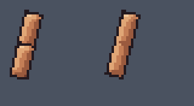
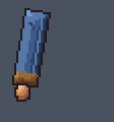
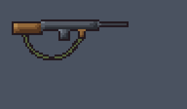
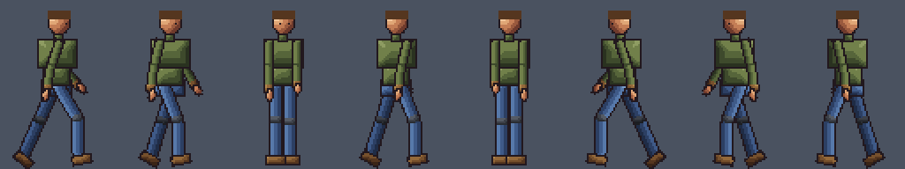

# 2D skinning in `art_rig`

Every image here comes from `node docs/skin2d/make-demos.mjs`, which runs the real `art_rig` ops: `skin`, `weights`, `shapes`, `chain`, `animate` and `export`.

| Demo | What it shows |
| --- | --- |
|  | **Rigid hinge vs skinned bend.** Left: the cutout rig, two rigid pieces meeting at the elbow. Right: the same arm drawn as one sprite and skinned on `upper` + a bone-only `fore` (heat weights). Still sheet: `elbow-hinge-vs-skin.png` (top: hinge, bottom: skin; 0 to -120 degrees). |
|  | **A drawn sleeve bending.** The cloth folds ride along, the cuff stays on the forearm bone, and a `crease` variant drawing swaps in through a corrective driven by the elbow angle (`driver:{bone:"fore", from:-20, to:-70}`). |
|  | **A rifle sling.** `chain {part:"strap", bones:7}` adds bone-only segments along the drawn strap and heat-skins it; `ik:{strap_7:{target:{part:"gun", at:[24,4]}, chain:7}}` pins the far end with damped CCD, and `limits` keep it from kinking. |
|  | **8-direction humanoid_hd walk with skinned limbs.** Each arm and leg is one drawing per view (in the upper_arm / thigh cells); forearms and shins are absorbed bones. The stock `walk` preset plays unchanged in the 5 drawn views and 3 mirrors. Sheet: `walk-8dir.png` (one row per view). |

`weights-elbow.png` and `weights-leg.png` are `weights {mesh, bone}` images: the drawing with its lattice on the left, the bone's weight (blue 0 .. red 1) on the right.

## Minimal recipe

```js
art_rig update  {name:"hero", parts:{upper_arm_f:{h:30}}}                    // room for the whole arm in one cell
art_rig skin    {name:"hero", skin:{arm_f:{part:"upper_arm_f", absorb:["forearm_f"]}}}
art_rig weights {name:"hero", mesh:"arm_f", bone:"forearm_f"}                // check + heat map
art_rig shapes  {name:"hero", mesh:"arm_f", shapes:{crease:{variant:"crease", fit:false, driver:{bone:"forearm_f", from:0, to:-90}}}}
art_rig animate {name:"hero", preset:"walk", view:"front_side"}              // or art_anim render / batch
art_rig export  {name:"hero", presets:["walk"], layers:true}                 // runtime JSON + strips
```

A whole character drawn on one canvas: `skin:{body:{canvas:"hero_side", bones:"all", views:{front:{canvas:"hero_front"}}}}`. Each canvas is frame-sized and drawn at the rest pose; a top-level `canvas` applies to every view unless a view overrides it (or sets `off:true`).

## How it stays pixel art

- **Mesh**: a pixel-aligned lattice (step = `density`) clipped to the opaque pixels. Each lattice cell holds one quad per 8-connected pixel component, and corners are shared only where pixels connect, so a 1px gap (two legs, an arm against the body) cuts the mesh. Weights are measured at each corner clamped into its own pixels.
- **Weights**: `heat` (Laplacian diffusion with line-of-sight bone attachment, Baran and Popovic style), `distance` or `rigid` (+ `blend`); `paint` regions, `weight_canvas`, `smooth`. Influences under 1% are dropped, at most 4 are kept, and they are normalised to sum 1.
- **Rendering**: inverse mapping. Each output pixel finds its deformed triangle, maps back to the rest drawing and takes the nearest pixel of a Scale2x 8x copy, with a 3x3 supersampled majority vote (`rotsprite`; `nearest8` and `smooth` are the other modes). Only colours of the drawing come out. Triangles that only translate copy their pixels exactly, so the rest pose is the drawing pixel for pixel. A cleanup pass fills pinholes and drops stray pixels (resampled pixels only), and an outline repair paints newly exposed edges with the drawing's outline colour (`outline:false` turns it off). Everything is deterministic.

## Runtime format (`<name>.skin2d.json`, `format: "agent-art-skin2d"`, `version: 1`)

| Field | Meaning |
| --- | --- |
| `frame`, `root`, `views`, `mirror` | Frame size, root position, exported drawn views, mirror views (`{side_left:"side"}`: render the source view and flip x: `x' = 2*root.x - 1 - x`). |
| `bones[]` | `{name, parent, bind:{view:[x,y]}, z:{view:z}, bone_only?}`. `bind` is the joint position at rest in frame px (rotation 0, scale 1). Joint indices below refer to this list. |
| `parts[]` | Rigid sprites: `{name, view, cell:[x,y,w,h] in parts.png, pivot, z}`. A part listed in a mesh's `replaces` is not drawn in that view. |
| `meshes[]` | `{name, view, host, z (null = the host part's z), replaces, texture, size, pages, vertices:[x,y,...] (bind, frame px), uvs:[u,v,...] (texture px), triangles:[a,b,c,...] (draw order), joints:[4 per vertex], weights:[4 per vertex, sum 1], shapes?}`. The texture stacks `pages` copies of the drawing vertically; each page holds one pixel component per lattice cell, so cut quads never show the other side's pixels. |
| `meshes[].shapes[]` | `{name, offsets:[dx,dy,...] per vertex, driver?:{bone, from, to}, texture?, uvs?}`. With `texture` + `uvs`: draw with that drawing while the shape weight is >= 0.5. |
| `clips` | `<preset>_<view>`: `{fps, loop, events?, strip, layers?, frames:[{bones:{name:[x,y,rot,sx,sy]}, shapes?:{name:w}, order:[...]}]}`. Bone transforms are baked (IK, plants, constraints, secondary), so a runtime needs no solver. `order` is the bottom-to-top draw order of parts and meshes. |

Per frame, for each vertex:

```
v_bind = vertex + sum(shape weight * shape offset)
v      = sum_k weight_k * M_k * (v_bind - bind_k)      M_k = translate(x,y) * rotate(rot) * scale(sx,sy)
```

`rot` is in degrees, clockwise on screen (y points down). Use nearest filtering.

- **three.js**: one `BufferGeometry` per mesh with the `uvs` (divided by the texture size, v flipped) and a `NearestFilter` texture; rewrite the `position` attribute each frame with the formula above (or build a `SkinnedMesh` whose bones are the 2D joints at z = 0). An orthographic camera at 1 unit = 1 px keeps the pixels square.
- **Roblox**: an `EditableMesh` with one vertex per exported vertex, `SetPosition` each frame from the same formula, and a nearest-sampled texture; or skip deformation and use the per-part layer strips (`export {layers:true}`, `layers/<clip>/<part>.png`) as `ImageLabel`s stacked in `order` (ZIndex = index), stepping `ImageRectOffset` per frame.

## Limits

- The lattice follows pixel components on a grid, not a traced contour; a coarse `density` makes quads span a whole lattice cell.
- A mesh draws at its host part's z among the other parts; bone z only orders its own triangles (folds draw children over parents).
- Equipment variant sets do not swap skinned drawings; `link` views with `flip` fall back to the view's own cell.
- Damped CCD has no gravity term: `limits` shape a hanging sling; `secondary` adds sway to free (unpinned) chains.
