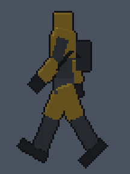
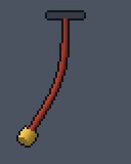
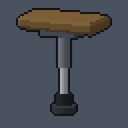
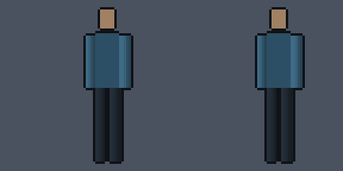
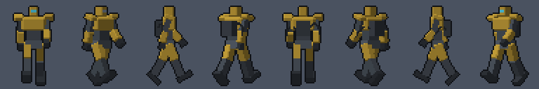

# Skeletal skinning in `art_model`

Every image here comes from `node docs/skinning/make-demos.mjs`, which runs the real `art_model` ops: `skeleton`, `skin`, `weights`, `animate`, `render` and `export`.

| Demo | What it shows |
| --- | --- |
|  | **Exosuit walk.** The `exosuit` skeleton uses the humanoid_hd bone names. The art_anim `humanoid_hd` walk is retargeted onto it with `animate {retarget:{skeleton:"hd", clip:"walk"}}`, and IK foot planting is baked in. The armour plates are rigid; the hoses are heat-weighted. |
|  | **Hanging cable.** A `chain` skeleton with the `cable` helper: a tube swept through the joints, with heat-diffusion weights. The clip is a phase-lagged sway. |
|  | **Landing gear compressing.** The `landing_gear` skeleton. The strut telescopes (`at`), the boot squashes (`scale`), and the pad stays on the ground. The boot is painted between `strut_lower`, `boot` and `pad`. |
|  | **Corrective shoulder shape.** Left: plain linear blend skinning collapses the shoulder as the arm lifts. Right: a sculpted shape, driven by `upper_arm_f` Z from 0 to -90 degrees, restores it. |
|  | **One 3D body, eight sprite directions.** `render {clip:"walk", sweep:{yaw:[0,315,45]}, quantize:{colors:16}, outline}`. |

The still sheets are `exosuit-walk.png`, `cable-sway.png`, `landing-gear.png`, `corrective-shoulder.png` (top row: plain LBS; bottom row: with the corrective) and `exosuit-8dir.png` (one row per direction, eight walk frames per row). `weights-upper-arm.png` is the `weights {bone:"upper_arm_f"}` heat map.

## Minimal recipe

```js
art_model create   {name:"mech", parts:[...boxes with bone:"thigh_f" etc..., {type:"tube", id:"hose", path:[...]}]}
art_model skeleton {name:"mech", skeleton:{template:"exosuit"}}            // or {template:"humanoid", fit:true} | {from_parts:true} | {library:"hd"}
art_model skin     {name:"mech", skin:{method:"heat", parts:["hose"]}}      // other parts: rigid to their bone
art_model weights  {name:"mech", bone:"forearm_f"}                         // weights_check + heat map
art_model animate  {name:"mech", clip:"walk", retarget:{skeleton:"hd", clip:"walk"}}
art_model render   {name:"mech", clip:"walk", sweep:{yaw:[0,315,45]}, size:[48,64], quantize:{colors:16}, outline:"#101216"}
art_model export   {name:"mech"}                                           // glTF skin + animations, validated
art_model export   {name:"mech", profile:"roblox", r15:true}                // bone limit per mesh, R15 names, no morphs
```
